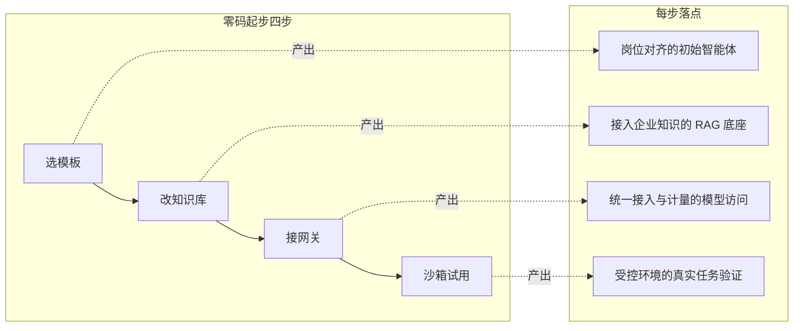

# OpenTrek 零码范式与角色模板

> 中文简称：零码与角色模板

> **一句话理解**: 不会写代码的业务人员，套一个岗位模板、换成自家知识库，就能搭出一个能干活的智能体。

---

## 一、零码范式定位

零码是三范式中门槛最低的一档，官网口径是**业务人员可视化搭建**：

- **使用者**：业务人员，不需要编程背景，在可视化界面完成搭建。
- **扩展方式**：角色模板开箱即用——不从空白画布开始，而是从一个预置的岗位型智能体开始改。
- **适用场景**：标准化岗位型智能体——职责清晰、流程相对固定、以知识问答与流程执行为主的岗位。
- **产物去向**：智能体应用 + 资产，与低码/高码产物进入同一个 OpenTrek Hub 资产库。

零码的价值不在「功能最强」，而在「把多数标准场景从 IT 队列里拿走」：业务侧自助完成长尾需求，工程师聚焦少数复杂集成与治理——这也是三范式统一纳管的人力结构逻辑。

---

## 二、角色模板机制：三个开箱即用模板

OpenTrek 官方提供三类角色模板：**产品研发、财税管理、城市运营中心**。官网公开信息只有模板名，以下职责与用法展开均为基于岗位常识的**分析视角**，具体以产品实际模板内容为准：

| **模板** | **岗位形态** | **典型职责与用法（分析视角）** |
| --- | --- | --- |
| **产品研发** | 研发线岗位 | 需求整理、技术调研、文档撰写、研发流程问答 |
| **财税管理** | 职能线岗位 | 财税政策问答、单据处理辅助、报表口径整理 |
| **城市运营中心** | 公共运营岗位 | 城市事件汇总、工单流转辅助、运营报告撰写 |

逐个展开（均为分析视角）：

- **产品研发模板**：适配研发团队的岗位型助手。典型用法是挂接团队知识库（技术文档、规范、历史方案），承担调研初筛与文档起草，研发人员在其产出上复核。
- **财税管理模板**：适配财务/税务职能部门。典型用法是挂接政策文件与内部核算、报销制度知识库，承担政策问答与口径查询，把「反复问财务」的咨询沉淀为自助服务。
- **城市运营中心模板**：适配城市治理运营场景。典型用法是接入事件与工单类数据源，承担事件信息汇总、分派建议与日报周报撰写，运营人员在环审核。

三类模板覆盖研发、职能、公共运营三种典型岗位形态。选型口径：按「最接近的岗位 × 数据可得性」挑选首个试点——岗位形态决定选哪个模板，数据可得性决定知识库能挂多满。

角色模板同时是数字员工的起点：模板提供初始技能与工作骨架，剩余能力靠 Skills Hub 扩展、运行经验靠记忆体沉淀。

---

## 三、模板起步方法论：四步上线

以下起步路径为**分析视角**（基于平台能力组成推导的通用方法，非官方实施手册）：

四步各自的关键动作：

1. **选模板**：按「最接近的岗位 × 数据可得性」从三类官方模板中选一个，先不改技能与流程。
2. **改知识库**：把企业自己的知识灌入模板挂接的知识库——模板提供技能与工作骨架，知识库决定回答质量。
3. **接网关**：通过 AI 网关配置模型访问，让模型调用走统一接入与计量，而不是各应用散接。
4. **沙箱试用**：在沙箱环境小范围上线，用真实任务验证完成率与例外情况，再决定是否扩大使用。

四步走完得到的是「可评估的试点」而非「成品」：是否扩围、是否升低码，以试用数据为准。

---

## 四、零码的边界：什么时候必须升低码/高码

三范式边界滑动而非割裂：零码起步的智能体，随需求变复杂可升级到低码、再由高码纳管，资产全程不迁移。升级信号（分析视角）：

| **升级信号** | **建议去向** | **典型场景** |
| --- | --- | --- |
| **需要自定义流程分支与轻度逻辑** | 升低码 | 审批链路、条件分派、多步骤编排 |
| **需要与内部系统对接写入** | 升低码或高码 | 写回业务系统、调用内部 API |
| **复杂逻辑、性能或复用组件要求高** | 升高码 | 性能敏感链路、平台级组件沉淀 |
| **无工程师团队遇到上述需求** | 引入 IT 支持 | 业务先跑通标准场景，复杂逻辑交工程侧 |

判断口径（分析视角）：当「改提示词 + 换知识库」满足不了需求，升低码；当「配置 + 少量脚本」也不够，升高码。每升一档，自由度上升，对人员技能的要求也同步上升。

---

## 五、信源声明

- 阿里云官网产品页：[https://www.aliyun.com/product/opentrek](https://www.aliyun.com/product/opentrek)（2026-11 检索）——零码范式定位与三类角色模板名称（产品研发、财税管理、城市运营中心）。
- 模板职责与用法的展开、起步方法论、升级信号均为本页分析视角；官网未公开模板内部构成与实施手册，落地细节待核实。

---

## 交叉引用

- [[12_架构基建/06_云厂商/Alibaba_Cloud/产品/14_OpenTrek/03_智能体开发/01_Three_Paradigms|三范式统一纳管总览]]
- [[12_架构基建/06_云厂商/Alibaba_Cloud/产品/14_OpenTrek/03_智能体开发/03_Pro_Code_Engineering|低码与高码工程化]]
- [[12_架构基建/06_云厂商/Alibaba_Cloud/产品/14_OpenTrek/03_智能体开发/04_AI_Asset_Model|AI 资产模型：Skill、知识库、记忆体]]
- [[12_架构基建/06_云厂商/Alibaba_Cloud/产品/14_OpenTrek/07_数据与模型/01_Knowledge_Base_Three_Steps|企业知识库三步走]]
- [[12_架构基建/06_云厂商/Alibaba_Cloud/产品/14_OpenTrek/05_生产运行/02_AI_Gateway|AI 网关]]
- [[12_架构基建/06_云厂商/Alibaba_Cloud/产品/14_OpenTrek/05_生产运行/04_AgentRuntime_Sandbox|AgentRuntime 沙箱]]
- [[12_架构基建/06_云厂商/Alibaba_Cloud/产品/14_OpenTrek/04_数字员工/01_Digital_Workforce|数字员工理念与能力构成]]

---

*Last updated: 2026-11-06*
