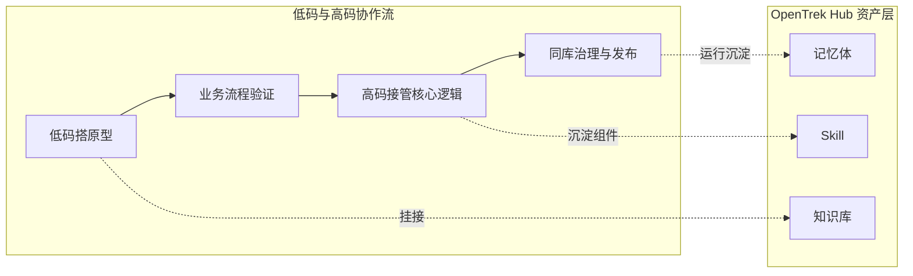

# OpenTrek 低码与高码工程化

> 中文简称：低码与高码工程化

> **一句话理解**: 运营用配置加少量脚本改流程，工程师把代码工程接进平台纳管——两边产物进同一个资产库。

---

## 一、低码定位：配置为主、脚本扩展

低码面向**运营/解决方案类角色**，位于零码与高码之间：

- **使用者**：运营/分析人员（含解决方案角色），有一定技术素养但不以写代码为业。
- **扩展方式**：配置为主 + 少量脚本扩展——多数改动通过配置完成，个别逻辑用脚本补齐。
- **适用场景**：需定制流程与轻度逻辑——审批链路、条件分派、多步骤编排、外部系统对接配置。
- **产物去向**：智能体应用 + 资产，与零码产物同级进入 Hub。

低码的典型工作模式（分析视角）：从零码模板或存量应用出发，「改流程不改代码」；某个环节配置表达不了时，用少量脚本补齐，而不是整体转交工程团队。适配的团队画像是「有少量技术人员的运营团队」：配置起步，用脚本逐步扩展。

---

## 二、高码定位：工程化开发与纳管

高码面向**工程师**，官网口径是「工程化开发」，并纳入「统一纳管」：

- **扩展方式**：完整代码工程接入纳管——不是在平台外另起炉灶，而是把代码工程接进平台的资产、治理与运行体系。
- **适用场景**：复杂逻辑、性能与集成要求高的场景；产物比零/低码多一类「可复用组件」。
- **工程化含义的定性展开（分析视角）**：按「统一纳管」口径推演，工程化开发通常意味着版本管理、代码评审、测试发布等软件工程实践延伸到智能体开发；OpenTrek 具体提供哪些工程化能力（代码仓库集成形态、评审流、测试框架），官网未展开，**待核实**。

按「统一纳管」口径定性拆解（分析视角），高码接入至少覆盖三层：

- **资产层**：代码工程产出的 Skill 与可复用组件注册进 Hub，可被零码/低码复用。
- **运行层**：工程化智能体与低码应用同样经平台托管调度与沙箱运行，观测口径一致。
- **治理层**：权限、审计、安全策略对代码工程与其他范式一视同仁。

高码的价值不在「写代码」本身，而在把智能体当软件资产对待：可版本回滚、可评审留痕、可测试回归——这是智能体从 Demo 走向生产的关键一跃（分析视角）。

与低码的关系是分工而非替代：低码覆盖多数流程定制，高码专注性能敏感与复杂集成的少数核心链路，并沉淀可复用组件反哺全平台。

---

## 三、低码与高码协作流

统一纳管后，低码与高码可以形成接力（分析视角）：

分工要点：低码快速搭出可用原型，用真实用户验证业务流程是否成立；流程定型后，把性能敏感或逻辑复杂的核心部分交给高码接管；两边产物进同一资产库、治理口径一致——原型不需要推倒重写，而是在同一资产基础上演进。

协作成立的前提是资产不迁移：知识库、Skill 在低码与高码之间是同一份，交接交的是「逻辑实现」，不是「从零重建」。

交接时的检查点（分析视角）：

- 原型期沉淀的知识库、提示词资产随交接直接沿用（同库，无需搬移）。
- 高码接管的核心逻辑要补齐测试与回滚方案，而不是只搬功能。
- 低码侧保留流程编排权，高码侧拥有组件实现权，避免两边同时改同一处。

---

## 四、工程化实践建议

以下为通用工程实践建议（分析视角），非官方手册：

| **实践域** | **建议** | **目的** |
| --- | --- | --- |
| **命名** | 智能体、Skill、知识库按「域-角色-用途」统一命名 | 资产可检索、可认领，避免同名混用 |
| **版本** | 应用与资产变更留版本记录，支持回滚 | 出问题可快速回退，变更可追溯 |
| **评审** | 上线前经第二人评审（提示词、知识库变更、高危 Skill） | 减少单人误操作进入生产 |
| **灰度** | 新版本先小范围试用，观测无异常再放量 | 控制变更影响面，配合托管调度与全景观测 |

四个实践域对应的是同一件事：智能体进入生产后，「变更是常态」——工程化就是把常态变更管起来。

---

## 五、信源声明

- 阿里云官网产品页：[https://www.aliyun.com/product/opentrek](https://www.aliyun.com/product/opentrek)（2026-11 检索）——低码/高码范式定位、「工程化开发」「统一纳管」口径。
- 版本/评审/测试等工程化细节、三层接入拆解、协作流与检查点、实践建议均为本页分析视角；OpenTrek 具体工程化功能清单官网未公开，待核实。

---

## 交叉引用

- [[12_架构基建/06_云厂商/Alibaba_Cloud/产品/14_OpenTrek/03_智能体开发/01_Three_Paradigms|三范式统一纳管总览]]
- [[12_架构基建/06_云厂商/Alibaba_Cloud/产品/14_OpenTrek/03_智能体开发/02_Zero_Code_Templates|零码与角色模板]]
- [[12_架构基建/06_云厂商/Alibaba_Cloud/产品/14_OpenTrek/03_智能体开发/04_AI_Asset_Model|AI 资产模型：Skill、知识库、记忆体]]
- [[12_架构基建/06_云厂商/Alibaba_Cloud/产品/14_OpenTrek/05_生产运行/01_Hosted_Scheduling_Observability|多 Agent 托管调度与全景观测]]
- [[12_架构基建/06_云厂商/Alibaba_Cloud/产品/13_百炼深度/13_Managed_Agent_IaC|百炼托管 Agent 与 IaC]]
- [[12_架构基建/06_云厂商/Alibaba_Cloud/产品/14_OpenTrek/08_选型与视角/03_Implementation_Playbook|落地实施手册]]

---

*Last updated: 2026-11-06*
