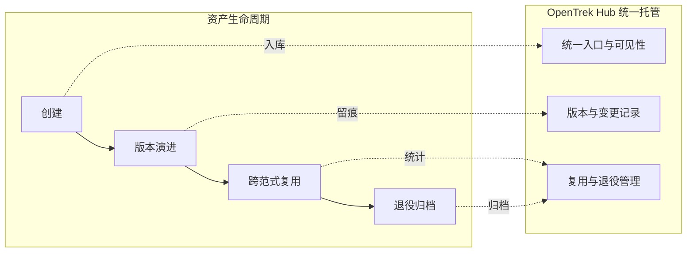

# OpenTrek AI 资产模型：Skill、知识库、记忆体

> 中文简称：AI 资产模型：Skill、知识库、记忆体

> **一句话理解**: 智能体「会什么、知道什么、经历过什么」分别封装成 Skill、知识库、记忆体三类资产，全公司复用。

---

## 一、三类资产定义

OpenTrek 把智能体开发沉淀的资产归为三类统一管理（官网资产清单的定性）：

| **资产类型** | **定义** | **复用方式** |
| --- | --- | --- |
| **Skill** | 能力/技能封装：智能体可调用的技能 | 跨智能体共享，一次沉淀多处调用 |
| **知识库** | 企业知识的 RAG 底座：企业知识与数据的加工产物 | 不同智能体挂接同一知识库 |
| **记忆体** | 运行经验沉淀：智能体运行中积累的经验 | 支撑长短期记忆与自我进化 |

三类资产的分工可用一句话记：「会什么（Skill）、知道什么（知识库）、经历过什么（记忆体）」——Skill 决定能力边界，知识库决定回答依据，记忆体决定「越用越好」的程度。

资产化的收益：智能体不再是一次性项目交付物，而是可组合、可迭代的企业资产；新智能体复用存量 Skill 与知识库，避免每次从零开始。

三类资产与数字员工能力构成的对应：Skills Hub 承载 Skill 资产，记忆体支撑长短期记忆自我进化，角色模板的知识挂接落在知识库上——资产模型是数字员工能力的产品化底座。

与百炼侧的技能复用思路同源（分析视角）：百炼用 MCP 市场做技能分发，OpenTrek 用 Hub 资产库做企业内复用——前者面向公有云生态，后者面向私有化资产治理。

---

## 二、资产生命周期与 Hub 托管

所有范式的产物都进入统一资产管理（OpenTrek Hub）——这是「统一纳管」的落点。生命周期各阶段为分析视角的定性推演：

四个阶段的含义（分析视角）：**创建**——任一范式产出即入库，零码模板、低码配置、高码工程同权；**版本演进**——资产随迭代留版本，可回溯；**跨范式复用**——被其他智能体与范式引用，是资产价值的主要体现；**退役归档**——下线不再使用，但保留追溯能力。Hub 托管让生命周期「有库可管」，而不是散在各项目里自生自灭。

Hub 层的具体管理功能（可见性控制、复用统计等）官网未逐一公开，以上为按「统一资产管理」口径的推演，待核实。

---

## 三、跨范式共享：同一资产服务三种范式

统一资产库的直接效果是跨范式共享（基于统一纳管口径的展开，具体交互形态待核实）：

| **资产** | **零码怎么用** | **低码怎么用** | **高码怎么用** |
| --- | --- | --- | --- |
| **Skill** | 模板预置，业务人员直接获得 | 配置挂接或替换技能 | 代码编排调用，沉淀新技能与组件 |
| **知识库** | 模板挂接，替换为企业知识 | 配置多库挂接与检索策略 | 工程化加工与增量更新 |
| **记忆体** | 随沙箱运行自动积累 | 配置记忆策略 | 编排记忆读写与审计 |

跨范式共享是「资产不迁移」的基础：零码模板起步的智能体升级到高码时，其知识库与 Skill 原样可用；高码沉淀的组件也能出现在零码模板里——范式升级交的是实现方式，不是资产重建。

一点辨析（分析视角）：Skill 与知识库的共享语义清晰（技能调用、知识检索）；记忆体更贴近「单个数字员工的运行经验」，跨范式复用时要注意它绑定的是岗位角色而非通用知识，直接搬用可能带入只对特定场景有效的经验。

---

## 四、资产治理价值

资产模型的治理价值（定性，分析视角）：

- **复用率可度量**：资产被多少智能体引用可统计，复用率是平台价值最直接的度量指标。
- **避免重复建设**：同类知识库与技能多处重建，是智能体规模化最大的隐性成本；统一资产库从机制上抑制重复。
- **组织沉淀**：人员流动时，知识、技能与运行经验留在平台而不是个人环境里，组织能力可累积。
- **治理一致性**：权限、审计、安全策略作用在资产层，对三种范式一视同仁，避免「零码应用绕过安全审查」。
- **成本归集清晰**：资产被谁复用、复用了多少，为 Token 与算力成本的内部归集提供依据（分析视角）。

对采购方的含义：评估 OpenTrek 时应把「资产模型」当核心考察项——问清三类资产的创建、权限、版本与退役机制，比看 demo 效果更能判断长期价值（分析视角）。

---

## 五、信源声明

- 阿里云官网产品页：[https://www.aliyun.com/product/opentrek](https://www.aliyun.com/product/opentrek)（2026-11 检索）——三类资产（Skill、知识库、记忆体）清单与统一管理口径。
- 生命周期、跨范式用法、治理价值为本页分析视角；Hub 具体功能细节官网未公开，待核实。

---

## 交叉引用

- [[12_架构基建/06_云厂商/Alibaba_Cloud/产品/14_OpenTrek/03_智能体开发/01_Three_Paradigms|三范式统一纳管总览]]
- [[12_架构基建/06_云厂商/Alibaba_Cloud/产品/14_OpenTrek/03_智能体开发/02_Zero_Code_Templates|零码与角色模板]]
- [[12_架构基建/06_云厂商/Alibaba_Cloud/产品/14_OpenTrek/03_智能体开发/03_Pro_Code_Engineering|低码与高码工程化]]
- [[12_架构基建/06_云厂商/Alibaba_Cloud/产品/14_OpenTrek/01_全景与演进/03_OpenTrek_Hub_Asset_Platform|OpenTrek Hub 资产平台]]
- [[12_架构基建/06_云厂商/Alibaba_Cloud/产品/14_OpenTrek/07_数据与模型/01_Knowledge_Base_Three_Steps|企业知识库三步走]]
- [[12_架构基建/06_云厂商/Alibaba_Cloud/产品/14_OpenTrek/06_市场生态/02_Internal_App_Store|内部应用商店]]
- [[12_架构基建/06_云厂商/Alibaba_Cloud/产品/13_百炼深度/16_MCP_Marketplace_Skills|百炼 MCP 市场与技能]]
- [[12_架构基建/06_云厂商/Alibaba_Cloud/架构方案/13_架构方案_企业知识库RAG|架构方案：企业知识库 RAG]]

---

*Last updated: 2026-11-06*
