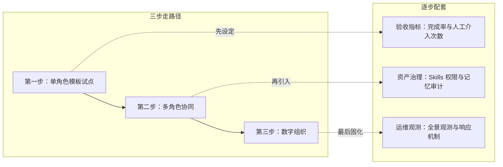

# OpenTrek 数字员工：理念与能力构成

> 中文简称：数字员工理念与能力构成

> **一句话理解**: 数字员工是住在沙箱里 7×24 小时干活、能自己积累经验的「目标驱动」员工。

---

## 一、理念：自规划 + 自进化

OpenTrek 对数字员工的核心理念是**「自规划 + 自进化」**：

- **自规划**：给定目标后，数字员工自行拆解任务、编排步骤，而不是按人写死的脚本逐步执行。
- **自进化**：基于运行历史沉淀经验（长短期记忆），下次遇到同类任务表现更好。
- **从数字员工到数字组织**：单个数字员工解决单岗位生产力；多个数字员工协同（分工、交接、互查）形成组织级生产力——这是官网叙事中数字员工的演进方向。

```text
演进主线：单角色数字员工 → 多角色协同 → 数字组织
驱动方式：规则驱动（RPA 时代）→ 目标驱动 + 记忆进化（Agent 时代）
```

「数字组织」的关键不是数字员工数量，而是协同结构：谁分派任务、谁校验产出、经验如何在成员间共享——这些组织设计问题直接决定规模化效果。组织化展开见《数字组织：从员工到组织》；与 RPA 的逐维对比见《数字员工与 RPA 之辨》。

---

## 二、能力构成

| **能力** | **说明** | **价值** |
| --- | --- | --- |
| **Skills Hub** | 技能资产沉淀与复用 | 一个技能多处调用，避免重复开发 |
| **7×24 小时沙箱运行** | 数字员工常驻沙箱环境持续工作 | 不占人力，风险受控在沙箱内 |
| **长短期记忆自我进化** | 基于运行历史沉淀经验 | 越用越好，而非越用越乱 |
| **角色模板** | 开箱即用：产品研发、财税管理、城市运营中心三类官方模板 | 从模板起步，降低冷启动成本 |

四项能力互相咬合：角色模板提供初始技能与工作骨架，Skills Hub 负责技能扩展，沙箱提供持续运行的隔离环境，记忆体把运行历史变成资产。

能力构成与资产模型的对应（分析视角）：Skills Hub 与记忆体就是三类资产中的 Skill 与记忆体在数字员工形态上的呈现，模板的知识挂接落在知识库上——数字员工跑在资产模型之上。

三类官方模板（产品研发、财税管理、城市运营中心）覆盖研发、职能、公共运营三种典型岗位形态，选型时可按「最接近的岗位 × 数据可得性」挑选首个试点。模板机制的零码侧展开见《零码与角色模板》。

---

## 三、三步走落地：试点 → 协同 → 数字组织



每一步展开：

- **第一步：单角色模板试点**。从三类官方模板（产品研发、财税管理、城市运营中心）中选一个与自身最接近的角色，小范围验证目标达成率与稳定性。
- **第二步：多角色协同**。扩展到 2-3 个数字员工协同的场景（如一个检索、一个撰写、一个审核），验证分工与交接机制。
- **第三步：数字组织**。把协同模式固化成组织级编排，配套资产治理与运维观测。

三步的共同结构（分析视角）：每一步都「先定验收、再扩范围」——第一步验收单角色稳定性，第二步验收分工交接机制，第三步验收组织级治理是否闭环。

试点期建议同时记录两组数据：任务级指标（完成率、耗时）与例外事件（人工介入原因分类），后者是判断能否进入第二步的关键证据。

扩围纪律（分析视角）：每一步先定可量化的验收指标，再扩大范围——没有度量的扩围只会放大混乱。

---

## 四、与 Agent 记忆/技能体系的一般原理联系

数字员工的能力构成不是 OpenTrek 独有，而是一般 Agent 基建原理的产品化封装：

- **沙箱运行**对应 Agent 沙箱隔离原理：常驻执行环境必须有安全边界，详见 [[15_智能体/20_Agentic_Infra/09_Sandbox_隔离技术与沙箱平台选型|Sandbox 隔离技术与沙箱平台选型]]。
- **长短期记忆**对应 Agent 记忆体系一般原理：短期记忆承载会话上下文，长期记忆沉淀为可复用经验。
- **Skills Hub** 对应技能资产化：与百炼 MCP 市场的技能复用思路同源，详见 [[12_架构基建/06_云厂商/Alibaba_Cloud/产品/13_百炼深度/16_MCP_Marketplace_Skills|百炼 MCP 市场与技能]]。
- **7×24 常驻运行**对应 Agent 宿主/运行时设计：长时运行需要状态持久化与故障恢复，这也是沙箱平台的通用命题。
- **角色模板**是「预置提示词 + 技能包 + 知识挂接」的组合封装，思路与本地办公 Agent 实战中的预设角色一致，参见 [[15_智能体/20_Agentic_Infra/04_本地千问办公Agent实战|本地千问办公 Agent 实战]]。

这一联系的实际意义（分析视角）：评估数字员工类产品时，可以直接用通用 Agent 基建的成熟度清单逐项对照——沙箱隔离、记忆架构、技能治理、运行时可靠性——而不是只看厂商话术。

---

## 五、信源声明

- 阿里云官网产品页：[https://www.aliyun.com/product/opentrek](https://www.aliyun.com/product/opentrek)（2026-11 检索）——数字员工理念、能力构成、三类角色模板。
- 三步走路径、扩围纪律与一般原理对照中的建议部分为分析视角，非官方实施方法论。

---

## 交叉引用

- [[12_架构基建/06_云厂商/Alibaba_Cloud/产品/14_OpenTrek/04_数字员工/02_Digital_Organization|数字组织：从员工到组织]]
- [[12_架构基建/06_云厂商/Alibaba_Cloud/产品/14_OpenTrek/04_数字员工/03_Vs_RPA|数字员工与 RPA 之辨]]
- [[12_架构基建/06_云厂商/Alibaba_Cloud/产品/14_OpenTrek/03_智能体开发/02_Zero_Code_Templates|零码与角色模板]]
- [[12_架构基建/06_云厂商/Alibaba_Cloud/产品/14_OpenTrek/03_智能体开发/04_AI_Asset_Model|AI 资产模型：Skill、知识库、记忆体]]
- [[12_架构基建/06_云厂商/Alibaba_Cloud/产品/14_OpenTrek/05_生产运行/04_AgentRuntime_Sandbox|AgentRuntime 沙箱]]
- [[15_智能体/20_Agentic_Infra/09_Sandbox_隔离技术与沙箱平台选型|Sandbox 隔离技术与沙箱平台选型]]
- [[15_智能体/20_Agentic_Infra/04_本地千问办公Agent实战|本地千问办公 Agent 实战]]
- [[12_架构基建/06_云厂商/Alibaba_Cloud/产品/13_百炼深度/16_MCP_Marketplace_Skills|百炼 MCP 市场与技能]]

---

*Last updated: 2026-11-06*
