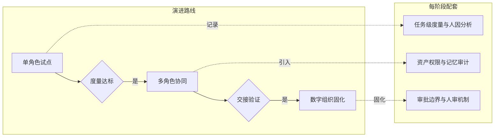

# OpenTrek 数字组织：从员工到组织

> 中文简称：数字组织：从员工到组织

> **一句话理解**: 一个数字员工是一个员工，多个数字员工有了分工、交接和汇报关系，就成了一个「数字部门」。

---

## 一、官网口径：从数字员工到数字组织

官网叙事中，数字员工的演进方向是**从数字员工到数字组织**：

- **单角色数字员工**解决单岗位生产力：一个岗位型智能体承担一类职责。
- **多数字员工协同**（分工、交接、互查）形成组织级生产力。
- 「数字组织」的关键不是数字员工数量，而是**协同结构**：谁分派任务、谁校验产出、经验如何在成员间共享——这些组织设计问题直接决定规模化效果。

换个说法（分析视角）：数字员工回答「一个智能体能干什么」，数字组织回答「一群智能体怎么一起干活」——后者是平台从工具走向生产关系的分界线。

---

## 二、数字组织形态推演（分析视角）

官网未公开数字组织的具体产品形态，以下按组织设计常识推演：

| **组织要素** | **单员工形态** | **组织化形态（推演）** |
| --- | --- | --- |
| **分工** | 一个员工包办整条任务链 | 按专长拆角色：检索、撰写、审核各司其职 |
| **协同** | 无协同对象 | 分工后交接中间产物，约定交接格式与验收口径 |
| **汇报** | 直接对人 | 设汇总角色：聚合各成员产出，向人输出统一结果 |
| **经验共享** | 记忆体只服务自己 | 成员经验回流共享资产库，新成员冷启动更快 |

协同场景的官方示例：三步走中的第二步即「扩展到 2-3 个数字员工协同的场景（如一个检索、一个撰写、一个审核），验证分工与交接机制」——这是数字组织的最小原型。

推演的边界（分析视角）：数字组织不等于「全自动组织」——角色分工越细，人对整体结果的验收责任越重；汇报关系里应保留一个明确的「对人接口」，避免多智能体系统变成无人负责的黑箱。

---

## 三、组织化的技术依赖

数字组织不是管理概念，底下压着一组平台能力（依赖关系为分析视角，能力项对应 OpenTrek 能力清单）：

| **技术依赖** | **解决什么问题** | **对应能力** |
| --- | --- | --- |
| **多 Agent 托管调度** | 多个数字员工常驻运行的资源调度与故障恢复 | 多 Agent 托管调度与全景观测 |
| **共享资产库** | 成员间共享 Skill、知识库与运行经验 | OpenTrek Hub 统一资产管理 |
| **统一网关与计费** | 多成员的模型访问统一接入、计量与成本归集 | AI 网关与 Token 治理 |
| **沙箱隔离** | 单个成员出错不拖垮整个组织 | 7×24 沙箱运行环境 |

四项依赖中，前两项是组织化的「骨架」——没有共享资产与统一调度，就只是一群各自为战的孤立智能体；后两项是「护栏」——成本与风险受控。逐项展开见生产运行与数据模型各页。

---

## 四、管理问题：绩效度量与审批边界

组织化的另一半是管理问题（分析视角）。**绩效度量**——数字组织要有组织级记分牌：

| **度量维度** | **度量内容** | **用途** |
| --- | --- | --- |
| **任务完成率** | 目标达成比例、返工率 | 衡量组织产出质量 |
| **成本** | Token 与算力消耗，按成员/任务归集 | 衡量组织运行成本与性价比 |
| **质量抽检** | 对产出抽样人工评分 | 兜底自动指标测不出的质量漂移 |

**边界与审批**——哪些动作必须人审，要在组织化之前定好，而不是出事后补（分析视角）：

- 对外发送类动作（邮件、对外文件、客户触达），建议默认人审。
- 资金与权限变更类动作（付款、授权、账号操作），必须人审。
- 写入生产系统的高危操作，按影响面分级：小影响可抽审，大影响全审。

度量与审批共同构成数字组织的「管理制度」——技术依赖决定能不能跑，管理制度决定敢不敢放量。

---

## 五、演进路线图

路线图为分析视角：每个阶段以可量化验收为门（完成率、人工介入次数、交接成功率），过门才扩围——与三步走落地的扩围纪律一致。数字组织不是一步建成的「终极形态」，而是带度量门控的渐进过程。

---

## 六、信源声明

- 阿里云官网产品页：[https://www.aliyun.com/product/opentrek](https://www.aliyun.com/product/opentrek)（2026-11 检索）——「从数字员工到数字组织」演进叙事、协同（分工、交接、互查）表述。
- 组织形态推演、技术依赖映射、管理问题与演进路线图均为本页分析视角；官网未公开数字组织产品细节，待核实。

---

## 交叉引用

- [[12_架构基建/06_云厂商/Alibaba_Cloud/产品/14_OpenTrek/04_数字员工/01_Digital_Workforce|数字员工理念与能力构成]]
- [[12_架构基建/06_云厂商/Alibaba_Cloud/产品/14_OpenTrek/04_数字员工/03_Vs_RPA|数字员工与 RPA 之辨]]
- [[12_架构基建/06_云厂商/Alibaba_Cloud/产品/14_OpenTrek/05_生产运行/01_Hosted_Scheduling_Observability|多 Agent 托管调度与全景观测]]
- [[12_架构基建/06_云厂商/Alibaba_Cloud/产品/14_OpenTrek/01_全景与演进/03_OpenTrek_Hub_Asset_Platform|OpenTrek Hub 资产平台]]
- [[12_架构基建/06_云厂商/Alibaba_Cloud/产品/14_OpenTrek/05_生产运行/02_AI_Gateway|AI 网关]]
- [[12_架构基建/06_云厂商/Alibaba_Cloud/产品/14_OpenTrek/05_生产运行/03_Token_Governance|Token 治理]]
- [[12_架构基建/06_云厂商/Alibaba_Cloud/产品/14_OpenTrek/03_智能体开发/04_AI_Asset_Model|AI 资产模型：Skill、知识库、记忆体]]
- [[12_架构基建/06_云厂商/Alibaba_Cloud/产品/14_OpenTrek/08_选型与视角/03_Implementation_Playbook|落地实施手册]]

---

*Last updated: 2026-11-06*
