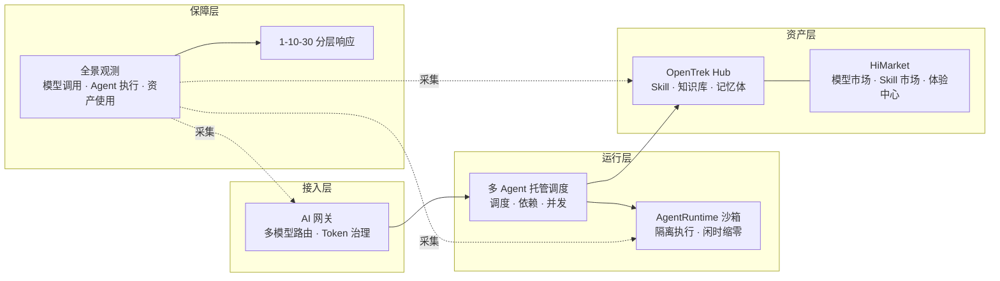

# 多 Agent 托管调度与全景观测（OpenTrek）

> 中文简称：多 Agent 托管调度与全景观测

> **一句话理解**: 智能体写出来只是 demo，能在生产环境里被调度、被观测、出了事能被兜住，才算真产品——OpenTrek 把这套保障打包成了平台能力。

---

## 一、定位：智能体从 demo 到生产的分水岭

一个 Agent 在笔记本上跑通，与它能在企业里 7×24 稳定干活，中间隔着整套运行保障体系。OpenTrek 官网产品页把生产运行保障作为企业级智能体平台的核心能力，口径上由两根支柱构成：

- **多 Agent 托管调度**：多个智能体的生命周期由平台托管，而不是散落在各处脚本里自生自灭；
- **全景观测**：从模型调用、Agent 执行到资产使用，一条链路全部可见。

这也是智能体项目的典型分水岭——demo 阶段追求「能跑」，生产阶段追求「敢用」：

| **维度** | **demo 阶段** | **生产阶段（OpenTrek 保障）** |
|---|---|---|
| **Agent 形态** | 单 Agent 手动触发 | 多 Agent 托管调度、依赖编排 |
| **可见性** | 打日志肉眼盯 | 模型/执行/资产三层全景观测 |
| **出错响应** | 报错后人工重跑 | 分层响应时效机制（1-10-30 类） |
| **资源形态** | 常驻进程占着资源 | 沙箱隔离执行、闲时缩零 |

本页是 05_生产运行 目录第一篇，聚焦调度与观测两根支柱；AI 网关、Token 治理、AgentRuntime 沙箱分别在本目录 02、03、04 页展开，分工见第六节总表。

---

## 二、多 Agent 托管调度：把生命周期交给平台

按官网口径，OpenTrek 提供多智能体的生命周期托管，定性拆开是四件事：

1. **生命周期**：Agent 的注册、启停、升级、下线由平台统一管理，每个 Agent 有唯一标识、责任人与业务归属，而不是某个人的私有脚本；
2. **调度**：任务到达后由平台决定哪个 Agent、何时、按什么顺序执行，企业不必为每个 Agent 单独维护守护进程或定时脚本；
3. **依赖**：Agent 之间存在上下游关系（例如取数 Agent → 分析 Agent → 报告 Agent），执行顺序与中间结果传递由平台托管；
4. **并发**：多任务并行时的资源分配与相互隔离，避免一个重任务拖垮其他 Agent。

治理意义在于：Agent 从「某个人写的脚本」变成「平台里的受管资源」——有登记、有状态、有归属，这是观测与响应机制能够生效的前提。

```yaml
# 多 Agent 托管调度的治理要点（示意）
lifecycle:
  登记: 每个 Agent 有唯一标识、责任人与业务归属
  调度: 平台统一触发，禁止绕开平台在宿主机跑常驻进程
  依赖: 上下游 Agent 之间的数据契约显式声明
  并发: 按业务线设置并发配额，防止互相挤占
```

具体调度策略（队列模型、优先级算法、配额粒度）官网产品页未展开，属待核实项；选型评估时应要求厂商演示多任务竞争与依赖编排场景。

与公有云侧对照：百炼的托管 Agent 解决的是云端单应用的运行托管，OpenTrek 面向私有化环境里的企业级多 Agent 编排，两者定位不同（分析视角，见交叉引用）。

---

## 三、全景观测：三个对象 × 四个维度

官网口径是「覆盖模型调用、Agent 执行、资产使用的全景可观测」。翻译成监控工程语言，就是三类观测对象 × 生产监控的四个一般维度（调用量、延迟、错误、成本）：

| **观测对象** | **看什么** | **对应监控维度** |
|---|---|---|
| **模型调用** | 走 AI 网关的大模型请求 | 调用量、P95 延迟、错误率、Token 成本 |
| **Agent 执行** | 任务与步骤的状态、耗时 | 成功率、执行时长、重试次数、卡死任务数 |
| **资产使用** | 知识库、Skill、记忆体的调用 | 检索量、调用方分布、命中率、成本归集 |

把这张矩阵铺满才谈得上「全景」——缺任何一格，故障定位就会在那一格断链：只看模型调用，看不出 Agent 卡在哪一步；只看 Agent 执行，回答不了「这个月成本上涨是哪个部门的用量涨的」。

观测落地的常见形态（示意，具体以官方文档为准）：

```yaml
# 全景观测看板与告警结构（示意）
dashboard:
  模型调用: [调用量, P95 延迟, 错误率, Token 成本]
  Agent执行: [任务成功率, 步骤耗时分布, 失败任务 TopN]
  资产使用: [知识库检索量, Skill 调用方分布, 记忆体占用]
alerts:
  错误率: 连续 5 分钟 > 5% 触发告警
  成本: 部门月度 Token 达预算 80% 预警
```

其中模型调用一层的用量账本、成本归集与预算控制如何搭建，见本目录 03 页 Token 治理。

---

## 四、「1-10-30」响应机制：分层响应时效

官网原文只给出了机制名「1-10-30」，各单位数字的含义官方未明说，应理解为「分层响应时效机制（具体口径以官方文档为准）」。行业里常见的解读如下（**推测，非官方口径**）：

- **1**：1 分钟级**发现**——观测与告警层在分钟级暴露异常；
- **10**：10 分钟级**定位**——靠全景观测把问题收敛到具体环节（是模型、Agent 还是资产）；
- **30**：30 分钟级**处置**——通过网关切换模型、重跑任务、扩缩资源完成恢复。

这三个数字对得上观测—响应链路的工程常识：发现靠告警（快）、定位靠三层链路数据（慢一些）、处置靠预案与权限（最慢），时效逐级放宽（分析视角）。落地时不必纠结官方数字本身，而应把自家的发现/定位/处置三段时效定义清楚，并逐段演练压测。

---

## 五、「运维提效 30%」：宣传口径与 MTTR 验证

「运维提效 30%」是**宣传口径**，验证方法用 MTTR 前后对比：

1. 接入前先测基线：固定周期（如 4 周）内统计 MTTR（平均故障恢复时间）、值班人力投入、故障工单量；
2. 接入后同口径复测，MTTR 降幅即真实提效值；
3. 注意前提：底子越薄的企业提升越明显，已有完善 AIOps 体系的企业可能远达不到 30%。

---

## 六、生产三件套关系与运行拓扑

生产运行保障是一套组合拳，本页（调度 + 观测）与其余三件套的分工：

| **模块** | **职责** | **与本页的关系** | **展开** |
|---|---|---|---|
| **AI 网关** | 统一接入大模型、Token 治理 | 模型调用观测与成本归集的数据源头 | 本目录 02/03 页 |
| **AgentRuntime 沙箱** | 安全隔离的执行环境 | 调度落地的载体，闲时缩零降本 | 本目录 04 页 |
| **Hub 与 HiMarket** | AI 资产管理与内部市场 | 资产使用观测的对象与供给端 | 01_全景与演进/03 页、06_市场生态 |
| **托管调度 + 全景观测** | 生命周期托管与三层观测 | 本页：串起以上三者的中枢 | 本页 |



请求经 AI 网关进入，由托管调度分发到沙箱里执行的 Agent，Agent 消费 Hub 沉淀的资产；全景观测采集三层埋点，异常进入 1-10-30 分层响应流程（机制名为官网口径，各单位数字含义的解读见第四节）。

---

## 交叉引用

- [[12_架构基建/06_云厂商/Alibaba_Cloud/产品/14_OpenTrek/05_生产运行/02_AI_Gateway|AI 网关]]
- [[12_架构基建/06_云厂商/Alibaba_Cloud/产品/14_OpenTrek/05_生产运行/03_Token_Governance|Token 治理与业务计费]]
- [[12_架构基建/06_云厂商/Alibaba_Cloud/产品/14_OpenTrek/05_生产运行/04_AgentRuntime_Sandbox|AgentRuntime 安全沙箱]]
- [[12_架构基建/06_云厂商/Alibaba_Cloud/产品/14_OpenTrek/01_全景与演进/03_OpenTrek_Hub_Asset_Platform|OpenTrek Hub 资产平台]]
- [[12_架构基建/06_云厂商/Alibaba_Cloud/产品/14_OpenTrek/README|OpenTrek 系列导读]]
- [[12_架构基建/06_云厂商/Alibaba_Cloud/产品/13_百炼深度/13_Managed_Agent_IaC|百炼托管 Agent 与 IaC]]

---

*Last updated: 2026-11-06*
