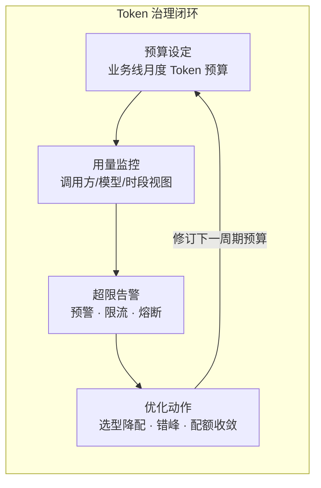

# Token 治理与业务计费（OpenTrek）

> 中文简称：Token 治理与业务计费

> **一句话理解**: Token 是用大模型的「水电气」——治理就是给每个部门装水表、定额度、超了关阀门：先看得见，再算得清，最后省得下。

---

## 一、Token 用量可观测：按调用方、模型、时段

接入 AI 网关（本目录 02 页）后，每一笔模型调用都留下记录。用量视图常见的三个切片：

| **切片** | **回答的问题** | **典型用法** |
|---|---|---|
| **按调用方** | 哪个应用、哪个 Agent、哪个部门在花钱 | 定位用量大户、下钻异常消耗 |
| **按模型** | 哪个模型消耗最多、性价比如何 | 模型选型与降配（大任务换小模型） |
| **按时段** | 高峰在哪、趋势怎么走 | 容量规划、批处理错峰 |

三个切片对应三类人的问题：管理者看按调用方（钱花在谁身上）、架构师看按模型（选型是否合理）、平台团队看按时段（容量与稳定性）。同一份调用记录，三种视角。

没有网关时，这些数据散落在各应用的日志里，拼一张全公司用量视图要靠人肉汇总；有网关后，它是每次调用的天然副产品。

```yaml
# 网关侧用量记录的最小字段（示意）
record:
  调用方: "业务标签，如 风控部-反洗钱Agent-prod"
  模型: "目标模型标识"
  时段: "请求时间戳"
  tokens: {输入: 0, 输出: 0}
  结果: {耗时: 0ms, 状态: 成功}
```

---

## 二、按业务维度计费：把 Token 成本算到部门

Token 成本的天然粒度是「一次调用」，而企业财务需要的粒度是「一条业务线」。按业务维度计费，就是网关在调用发生时打上业务标签、成本按标签归集，支撑两件事：

- **内部结算（chargeback）**：月底按业务线出账，各部门为自己的 Token 消耗付费，成本意识从口号变成账单；
- **预算控制**：给业务线设月度 Token 预算，达到阈值预警、超限限流或熔断，防止单个失控 Agent 拖垮整体成本。

账本形态举例（数字为示意，非官方定价）：某月网关总消耗 10 亿 Token，按标签归集后——风控线 4 亿、客服线 3 亿、研发工具链 2 亿、其他 1 亿——每条线还能按应用继续下钻。没有这套归集，这 10 亿在财务上只是一笔说不清的「AI 平台费」。

```yaml
# 业务维度计费规则（示意）
billing:
  标签体系: [业务线, 部门, 应用, 环境]
  归集周期: 月度出账，日度快照
  预算动作:
    - 80%: 预警通知责任人
    - 100%: 限流或熔断，需审批解锁
```

---

## 三、治理闭环：预算设定 → 用量监控 → 超限告警 → 优化动作

可观测与可归集只是地基，Token 治理要转成闭环才算落地（分析视角的框架展开，具体产品能力以官方文档为准）：

1. **预算设定**：按业务线定月度 Token 预算，初期参考历史用量基线，没有基线就先跑一个月只观测；
2. **用量监控**：按调用方/模型/时段的视图持续滚动，日度快照对齐财务口径；
3. **超限告警**：阈值分级动作——预警通知责任人、超限限流或熔断，白名单进看板接受监督；
4. **优化动作**：账单出来后的处置——模型降配（大任务换小模型）、批处理错峰、低价值调用方收敛配额，并把结论带回下一周期预算。



闭环四段循环：预算定水位，监控看消耗，告警兜异常，优化动作把结论带回下一轮预算——闭环转起来，Token 成本才从「事后算账」变成「事前可控」（分析视角）。

---

## 四、与百炼 usage/quota 体系的对照（分析视角）

| **对比项** | **百炼 usage/quota** | **OpenTrek Token 治理** |
|---|---|---|
| **治理主体** | 阿里云平台侧 | 企业自己（私有化侧） |
| **治理对象** | 本账户在百炼平台的用量与限额 | 企业内所有调用方接入的所有模型 |
| **计费口径** | 平台账户维度，向阿里云付费 | 业务标签维度，支撑内部结算 |
| **适合场景** | 公有云上快速起步的团队 | 多部门规模化用 AI 的中大型企业 |

一句话概括：百炼的 usage/quota 是「平台管你」，OpenTrek 的 Token 治理是「你当平台、管大家」。两者不互斥——完全可能公有云跑百炼、私有化跑 OpenTrek，两套账各管各的（百炼计费细节见交叉引用）。

---

## 五、Token 治理成熟度：无治理 / 可观测 / 可归集 / 可优化

拿这四档给企业自评定位（分析视角，整理自上文治理链路）：

| **档位** | **特征** | **典型症状/标志** |
|---|---|---|
| **无治理** | 账单只有一笔总数，用量黑箱 | 「AI 平台费」说不清，密钥散落各应用 |
| **可观测** | 有按调用方/模型/时段的用量视图 | 能回答「谁在花钱、花在哪个模型上」 |
| **可归集** | 成本归集到业务线与部门，内部结算与预算控制跑通 | 业务线月度出账，超限有预警与限流 |
| **可优化** | 优化动作常态化，成本进入架构设计约束 | 选型降配、错峰、配额收敛有例行机制 |

用法：先定位自家档位，再逐档爬坡——每上一档都有前置（可归集的前提是可观测，可优化的前提是可归集），跳档必翻车（对应 02 页「先观测后治理」的落地顺序）。

---

## 交叉引用

- [[12_架构基建/06_云厂商/Alibaba_Cloud/产品/14_OpenTrek/05_生产运行/02_AI_Gateway|AI 网关]]
- [[12_架构基建/06_云厂商/Alibaba_Cloud/产品/14_OpenTrek/05_生产运行/01_Hosted_Scheduling_Observability|多 Agent 托管调度与全景观测]]
- [[12_架构基建/06_云厂商/Alibaba_Cloud/产品/09_Token经济与商业化|Token 经济与商业化]]
- [[12_架构基建/06_云厂商/Alibaba_Cloud/产品/13_百炼深度/02_Billing_Plans_And_Cost|百炼计费与成本]]

---

*Last updated: 2026-11-06*
