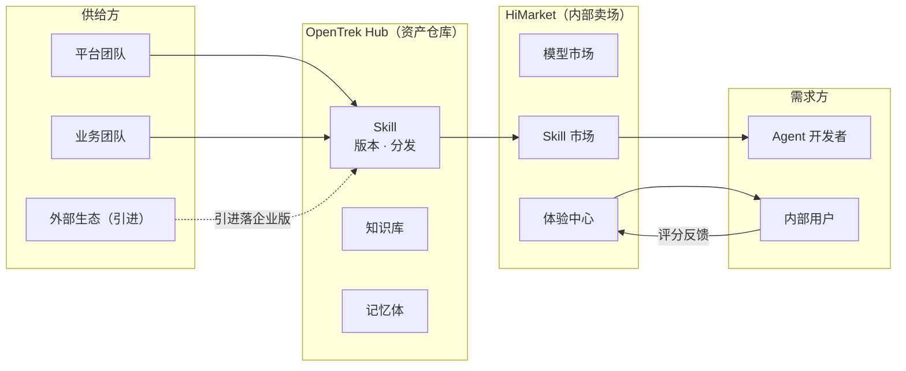

# HiMarket AI 开放平台（OpenTrek）

> 中文简称：HiMarket AI 开放平台

> **一句话理解**: HiMarket 是 OpenTrek 对内开的「AI 应用商店」——模型、Skill 摆上货架，业务同学试用、评分、采纳，好东西全公司复用。

---

## 一、定位：OpenTrek 的 AI 开放平台

官网口径：HiMarket 是 OpenTrek 的 AI 开放平台，由三个组件构成。官网公开信息是三个市场的名称与构成，下述定位与使用者展开为分析视角（基于内部市场通用模式）：

| **组件** | **定位** | **典型使用者** |
|---|---|---|
| **模型市场** | 企业可选模型的接入目录 | 平台团队选型，业务方看有哪些模型可用 |
| **Skill 市场** | 技能与插件的复用市场 | 供给方上架 Skill，Agent 开发者找现成能力 |
| **体验中心** | 内部用户的试用与评测入口 | 业务同学试用、评分、提反馈 |

三件套合成一条链路：模型市场回答「有什么模型可用」，Skill 市场回答「有什么现成能力可挂」，体验中心回答「好不好用、值不值得采纳」——从选型到采纳的决策链在平台内闭环。

HiMarket 的运营模式（谁来上架、怎么评审、怎么淘汰）见本目录 02 页。

---

## 二、三件套逐个展开（展开为分析视角）

**模型市场：企业可选模型的接入目录。** 它是平台团队维护的「模型菜单」：哪些模型经过审批接入、各自适合什么任务、当前状态如何，都在目录里可见。与 AI 网关（本目录 02 页）的分工是——市场管「目录与准入」，网关管「流量与治理」：模型先进市场登记上架，实际调用仍统一走网关，用量与成本因此可归集。

**Skill 市场：技能与插件的复用市场。** 供给方（平台团队、业务团队、外部供应商）把跑得好的 Skill 上架，Agent 开发者不再每个项目从零写工具调用。市场的价值不在「能上架」，而在复用：一次上架、多处挂载，同一个 Skill 服务多个 Agent 与多条业务线。

**体验中心：试用与评测入口。** 业务同学不写代码也能在这里试用模型与 Skill、留下评分与反馈。它是市场的「试衣间」——采纳决策发生在试用之后，评分沉淀又反哺推荐与淘汰，防止市场变成只进不出的仓库。

---

## 三、三市场与 Hub 资产库的供给关系

三件套与 OpenTrek Hub（见交叉引用资产平台页）的关系：Hub 是资产的「仓库与台账」，HiMarket 是资产的「货架与卖场」——仓库管版本与分发，市场管展示、试用与采纳。

拆开这条供给链：

1. **沉淀进 Hub**：跑得好的 Skill、验证过的知识库、调教出的记忆体进 Hub，成为组织资产，有版本序列与分发关系；
2. **上架到市场**：Hub 里的资产按权限摆上 HiMarket 货架——Skill 进 Skill 市场，模型目录进模型市场，试用入口统一在体验中心；
3. **采纳回数据**：需求方试用、评分、采纳后，使用行为进入观测与计费视野（本目录 05_生产运行 各页），反哺资产治理。

组合用法（分析视角）：外部生态市场的通用 Skill 引进后，先进 Hub 落成企业版本（过安全检查、对齐内部规范），再对内分发——「外部引进」与「内部沉淀」在 Hub 汇成同一条治理链。

---

## 四、对内对外开放差异：内部市场 vs 生态市场（分析视角）

HiMarket 本质是内部市场，与公有云生态市场（如百炼 MCP 市场）构成一组对照：

| **对比项** | **生态市场（如百炼 MCP 市场）** | **内部市场（HiMarket）** |
|---|---|---|
| **生态位** | 公有云生态市场 | 私有化内部市场 |
| **资产来源** | 阿里云与第三方生态伙伴上架 | 企业内部沉淀为主 |
| **治理主体** | 平台侧审核 | 企业自己定上架标准 |
| **数据边界** | 资产元数据在公有云 | 资产与使用数据都在企业内 |

选择逻辑（分析视角）：要借公有云生态的广度、快速接入外部能力，用生态市场；要沉淀企业私有 Skill 与知识、管控内部分发，用 HiMarket。两者不互斥——生态市场的通用能力引进企业后，经 Hub 落成企业版本再对内分发（见第三节）。

对外开放的想象空间（分析视角）：内部市场成熟后，也可以把企业自有 Skill 反向输出给生态伙伴——「内部市场 → 生态市场」的反向流动，是平台型企业的第二增长曲线，但这超出 OpenTrek 当前公开口径，属待核实项。

---

## 五、供给关系图

供给方把资产沉淀进 Hub（管版本与分发），HiMarket 三件套把资产摆上货架（模型目录、Skill 市场、体验中心），需求方试用采纳并留下评分；外部生态的通用能力先进 Hub 落成企业版本再对内上架——仓库与卖场分工，供给与采纳闭环。

---

## 交叉引用

- [[12_架构基建/06_云厂商/Alibaba_Cloud/产品/14_OpenTrek/06_市场生态/02_Internal_App_Store|内部应用商店运营模式]]
- [[12_架构基建/06_云厂商/Alibaba_Cloud/产品/14_OpenTrek/01_全景与演进/03_OpenTrek_Hub_Asset_Platform|OpenTrek Hub 资产平台]]
- [[12_架构基建/06_云厂商/Alibaba_Cloud/产品/14_OpenTrek/04_数字员工/01_Digital_Workforce|数字员工]]
- [[12_架构基建/06_云厂商/Alibaba_Cloud/产品/13_百炼深度/16_MCP_Marketplace_Skills|百炼 MCP 市场与 Skills]]
- [[12_架构基建/06_云厂商/Alibaba_Cloud/README|阿里云产品全景]]

---

*Last updated: 2026-11-06*
