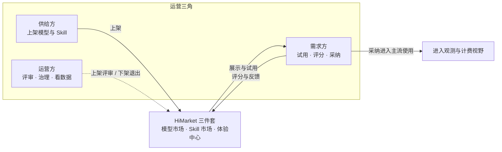

# 内部应用商店运营模式（OpenTrek）

> 中文简称：内部应用商店运营模式

> **一句话理解**: 把 AI 能力当产品运营——有人上架、有人试用、有人守闸门，好的 Skill 被复用，差的被下架，市场自己新陈代谢。

---

## 一、模式本质：把 AI 能力当产品运营

HiMarket（本目录 01 页）的本质是把 AI 能力当产品运营，形成三方闭环：

- **供给方**（平台团队、业务团队、外部供应商）把模型与 Skill 上架；
- **需求方**（内部用户、Agent 开发者）试用、评分、采纳；
- **运营方**（AI 平台团队）定标准、做评审、看数据，决定什么值得推。

这个模式解决的是企业 AI 扩散的经典难题：不是没有能力，而是能力没人知道、没人敢用、没人维护。商店把「发现—试用—采纳—淘汰」变成一条有人运营的流水线。



供给、需求、运营三方围着 HiMarket 的货架流转：上架要过评审，试用要留评分，采纳后进入生产观测与计费视野（05_生产运行 各页），低分低用的资产被下架——市场靠这条流水线保持信噪比。

---

## 二、运营机制：评审、反馈、版本、退出

四项机制撑住市场秩序（框架为分析视角，展开自运营实践通识）：

| **机制** | **做什么** | **防什么** |
|---|---|---|
| **上架评审** | 定最低门槛：文档、示例、责任人、安全检查；没有责任人的资产一律不上架 | 防垃圾资产进场，把问题挡在上架前 |
| **评分反馈** | 试用必须留评分与评论；评分是推荐与淘汰的核心信号 | 防市场变垃圾场，让质量信号流动起来 |
| **版本治理** | 资产升级走版本序列；破坏性变更提前公告，给下游留迁移窗口 | 防上游随意变更打断下游使用方 |
| **下架退出** | 低分低用的资产下架或降级 | 防货架无限膨胀，保持市场信噪比 |

```yaml
# 内部应用商店的运营节奏（示意）
loop:
  上架: 供给方提交，运营方评审通过后发布
  试用: 需求方在体验中心试用，产生评分与反馈
  采纳: 试用转化为主流使用，进入观测与计费视野
  淘汰: 低分低用的资产下架或降级，保持市场信噪比
```

四项机制里最容易被忽略的是下架退出：只上不下的市场会迅速失去可信度——用户试三次垃圾资产，就再也不来了。评审管入口，退出管出口，两头都要有人守。

---

## 三、与数字员工 Skills Hub 的分工：技能市场 vs 应用市场

数字员工的技能池从 HiMarket 取数——市场里的 Skill 是数字员工可挂载的技能来源，Hub 与 HiMarket 管供给，数字员工管使用（见交叉引用数字员工页）。

两者分工可以这么记（分析视角）：HiMarket 是**技能市场**，交易的是「能力单元」——一个个可复用的 Skill、插件、模型入口，买家是 Agent 开发者与平台团队；数字员工 Skills Hub 是**应用市场**，交付的是「岗位化的完整服务」——把多个技能组装成能顶岗干活的数字员工，买家是有用工需求的业务部门。技能市场管零件流通，应用市场管整机组装；零件越标准，整机越快上线。

这条分工链也解释了为什么供给质量重要：技能市场里一个评分高的 Skill，会被组装进多个数字员工——复用在应用层被进一步放大。

---

## 四、冷启动：先政策后市场

市场冷启动的常见路径是「先政策后市场」三步走（分析视角，运营通识）：

1. **行政推动**：初期靠行政力量定指标（如每个部门至少上架 N 个 Skill、优先沉淀高频场景），先把供给密度做起来——没有供给的市场没人逛；
2. **标杆示范**：挑高价值场景做标杆案例，公开其复用收益与账面数据（省了多少人天、复用了多少次），让需求方敢用、让供给方有动力；
3. **市场化流转**：供给与需求密度够了以后撤行政指标，靠评分、复用数据自然优胜劣汰，运营方退回守闸门的位置。

顺序反了会翻车（分析视角）：没有供给就搞市场化，市场空转；一直靠行政指标不撤，市场会被 KPI 带成摆设——上架数冲得很高，没人试用、没人复用。

---

## 五、度量指标：上架数、采纳率、复用率、满意度

运营指标看四样（框架整理，前三项对应旧有「上架数（供给活跃度）、试用转化率（需求匹配度）、复用次数（资产实际价值）」的口径，满意度来自评分反馈信号）：

| **指标** | **看什么** | **只看它的风险** |
|---|---|---|
| **上架数** | 供给活跃度 | 只看上架数的市场，一定会被 KPI 带成摆设 |
| **采纳率**（试用转化） | 需求匹配度 | 高试用低采纳说明货架与需求错配 |
| **复用率**（复用次数） | 资产实际价值 | 复用低的资产是「上架即巅峰」，该进退出流程 |
| **满意度**（评分） | 质量信号与淘汰依据 | 无评分约束的试用不会留下任何质量信号 |

四个指标要连起来读：上架数看供给、采纳率看匹配、复用率看价值、满意度看质量——单看任何一个都能被博弈。健康市场的形态是供给稳定增长、采纳与复用同步抬升、低分资产定期退出。

---

## 交叉引用

- [[12_架构基建/06_云厂商/Alibaba_Cloud/产品/14_OpenTrek/06_市场生态/01_HiMarket|HiMarket AI 开放平台]]
- [[12_架构基建/06_云厂商/Alibaba_Cloud/产品/14_OpenTrek/04_数字员工/01_Digital_Workforce|数字员工]]
- [[12_架构基建/06_云厂商/Alibaba_Cloud/产品/14_OpenTrek/01_全景与演进/03_OpenTrek_Hub_Asset_Platform|OpenTrek Hub 资产平台]]
- [[12_架构基建/06_云厂商/Alibaba_Cloud/产品/14_OpenTrek/05_生产运行/01_Hosted_Scheduling_Observability|多 Agent 托管调度与全景观测]]
- [[12_架构基建/06_云厂商/Alibaba_Cloud/产品/14_OpenTrek/08_选型与视角/03_Implementation_Playbook|OpenTrek 实施路线图]]

---

*Last updated: 2026-11-06*
