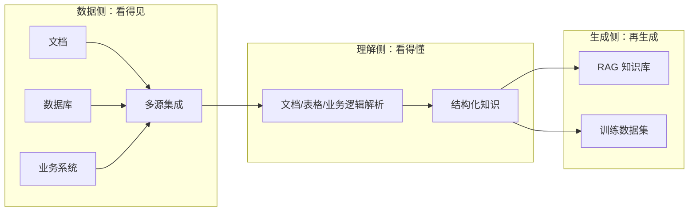

# OpenTrek 知识库三步法：看得见、看得懂、再生成

> 中文简称：知识库三步法

> **一句话理解**: 把散落在文档、数据库、业务系统里的企业数据先集中、再读懂，最后变成既能给 RAG 问答用、也能拿去喂模型训练的资产。

---

## 一、三步法框架：看得见、看得懂、再生成

官网用三步法概括企业数据知识库的建设路径，每一步对应一类能力：

| **阶段** | **官网口径** | **解决的问题** | **产出** |
| --- | --- | --- | --- |
| 看得见 | 多源异构数据集成管理 | 数据散落在文档、数据库、业务系统，先统一纳管 | 集中后的多源数据资产 |
| 看得懂 | 文档、表格、业务逻辑解析 | 非结构化内容机器读不懂 | 结构化、可计算的知识表示 |
| 再生成 | 高质量知识库与数据集合成 | 知识既要能被检索、也要能喂训练 | RAG 知识库 + 训练数据集 |

三步是递进关系：没有「看得见」的集成，解析就没有原料；没有「看得懂」的结构化，知识只能停留在关键词层面；「再生成」把前两步产物变成两类可消费资产——检索用的知识库与训练用的数据集。



图解：多源数据经集成与解析成为结构化知识，末端分成两路——RAG 知识库供检索增强消费，训练数据集供微调流水线消费（训练侧消费端见本目录「全谱系训练与算法」页）。

---

## 二、企业知识处理模板与全模态处理

官网强调内置行业知识处理模板，开箱即用，减少从零配置解析规则的成本。对企业的直接价值：不必为每种文档版式、每类表格结构手写解析配置。

```text
模板典型覆盖（按官网「开箱即用」口径归纳，非官方明细）：
- 常见文档版式的解析预处理
- 表格类内容的结构化抽取
- 业务系统字段的映射与清洗
- 行业维度预置，冷启动不从零开始
```

全模态处理是另一条主线：处理对象不限于纯文本，还包含图像、表格等多模态内容。扫描件、报表截图、图文混排文档也能进入同一条解析链路，而不是只服务干净的纯文本。

两点分析视角：

- 模板降低冷启动门槛，但行业模板与企业的真实文档风格仍可能有偏差，上线初期要靠人工抽检校准
- 多模态解析的准确率通常低于纯文本，质量验收要分模态设定口径，不能拿文本指标外推

---

## 三、知识库的三种用途

「再生成」产出的知识库在 OpenTrek 体系里有三个明确消费方：

| **用途** | **下游消费方** | **关键质量要求** |
| --- | --- | --- |
| RAG 检索增强 | 问答/搜索链路 | 召回准确、引用可溯源 |
| 数据集合成（喂微调） | 训练/微调流水线 | 样本干净、指令与答案对齐 |
| Agent 记忆素材 | Agent 长期记忆与任务上下文 | 结构化、可增量更新、按需检索 |

三种用途的质量口径不同：RAG 看召回与引用，数据集看样本分布与标注质量，Agent 记忆看更新机制与检索粒度。同一份知识资产通常要按用途分别做后处理，而不是一份通吃。

```text
用途侧的后处理差异（示例）：
- 给 RAG：切块粒度调优、出处元数据保真
- 给数据集：去重、脱敏、指令-答案对齐校验
- 给 Agent 记忆：按实体/事件组织、支持增量更新
```

---

## 四、与通用 RAG 链路的映射

通用 RAG 链路可拆为五步：解析→切块→索引→检索→引用。三步法与它的对应关系：

| **通用 RAG 环节** | **对应三步法位置** | **说明** |
| --- | --- | --- |
| 解析 | 看得见 + 看得懂 | 先集成多源数据，再做文档/表格/业务逻辑解析 |
| 切块 | 看得懂 | 解析产物切分为可检索单元 |
| 索引 | 再生成（入库侧） | 构建向量/结构化索引，形成知识库 |
| 检索 | 再生成（消费侧） | RAG 问答时按查询召回 |
| 引用 | 再生成（消费侧） | 答案附出处，实现可溯源 |

映射的价值：评估 OpenTrek 知识库时可直接套用通用 RAG 各环节的成熟评测方法（切块质量、索引召回、引用忠实度），不必依赖厂商话术。库内企业知识库 RAG 架构方案有组件级拆解，可对照阅读。

---

## 五、「高质量」的验证口径（分析视角）

官网把产出定性为「高质量知识库/数据集」，属宣传用语，落地要自建验证口径。建议的最小验证集：

```text
召回评测（针对 RAG 知识库）：
- 构造查询-标准出处对，覆盖高频/长尾/跨文档三类
- 指标：Recall@K、引用命中准确率
人工抽检（针对解析与切块）：
- 分模态抽样：纯文本、表格、图像类文档分开抽
- 检查项：字段抽取正确性、切块边界、元数据完整度
数据集侧（针对训练数据集）：
- 抽检指令-答案对齐度、重复率、敏感信息残留
```

分析视角：厂商演示多用最干净的样例文档，企业真实数据的版式复杂度更高；验收基线应以自家历史文档的抽检结果为准，而不是厂商 Demo 数字。

---

## 六、与库内 RAG 架构方案的衔接

OpenTrek 企业数据知识库可视为「架构方案：企业知识库 RAG」在私有化套件里的产品化实现候选之一。选型对照：

- 已有方案文档给出自建 RAG 的完整组件拆解，每个环节有独立选型项；OpenTrek 提供的是集成好的三步法流水线
- 倾向私有化交付、想减少自研解析与索引工程量的企业，套件是合理候选；需要极致定制或已有成熟自建链路的，自建仍占优
- 无论哪条路，第五节的验证口径都适用——质量验收的方法论不随交付形态改变

---

## 交叉引用

- [[12_架构基建/06_云厂商/Alibaba_Cloud/产品/14_OpenTrek/07_数据与模型/02_Training_Full_Spectrum|全谱系训练与算法]]
- [[12_架构基建/06_云厂商/Alibaba_Cloud/产品/14_OpenTrek/07_数据与模型/03_Evaluation_BadCase_Loop|模型评测与 BadCase 闭环]]
- [[12_架构基建/06_云厂商/Alibaba_Cloud/架构方案/13_架构方案_企业知识库RAG|架构方案：企业知识库 RAG]]
- [[12_架构基建/06_云厂商/Alibaba_Cloud/产品/13_百炼深度/09_Finetune_Pipeline|百炼深度：微调流水线]]
- [[12_架构基建/06_云厂商/Alibaba_Cloud/产品/14_OpenTrek/01_全景与演进/01_Product_Overview|OpenTrek 产品概览]]

---

*Last updated: 2026-11-06*
