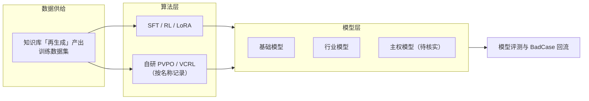

# OpenTrek 全谱系训练与算法矩阵

> 中文简称：全谱系训练与算法

> **一句话理解**: 在企业自己可控的环境里，把模型训练成懂行业、可审计的专用模型——基础、行业、主权三类模型，文本、图像、视频、音频四种模态都在训练版图内。

---

## 一、全谱系训练矩阵

官网把训练能力表述为「全谱系」，按模型类型与模态两个维度展开：

| **模型类型** | **定位** | **模态覆盖（官网口径）** |
| --- | --- | --- |
| 基础模型 | 通用基座能力的训练 | 文本、图像、视频、音频 |
| 行业模型 | 面向行业场景的定制训练 | 文本、图像、视频、音频 |
| 主权模型 | 面向主权可控场景的模型（按字面定性，具体口径以官方文档为准） | 文本、图像、视频、音频 |

关于「主权模型」的口径说明：

```text
公开资料未对「主权模型」给出展开定义。
本页按字面定性：面向数据主权/自主可控场景的模型。
具体口径（模型清单、交付形态、与行业模型的关系）以官方文档为准——待核实。
```

矩阵的实际意义：训练不限于「拿开源模型做 LoRA」一条路——基础模型级继续训练、行业模型深度定制、主权可控场景完整训练都在版图内；模态维度同样不止文本，图像/视频/音频在列。

---

## 二、算法清单：通用算法与自研算法

| **算法** | **类别** | **公开资料展开程度** |
| --- | --- | --- |
| SFT | 监督微调 | 通用算法，链路为业界标准做法 |
| RL（强化学习） | 强化学习训练 | 通用框架，官网未披露奖励设定等细节 |
| LoRA | 参数高效微调 | 通用算法 |
| PVPO | 自研算法 | 官网仅列名：公开资料未展开算法细节，按名称记录 |
| VCRL | 自研算法 | 官网仅列名：公开资料未展开算法细节，按名称记录 |

事实纪律：PVPO 与 VCRL 的全称、目标函数、适用阶段均无公开展开资料。本页按名称记录，不推测展开式；官方文档后续补充时再更新。

---

## 三、训练链路全景

数据、算法、模型、评测四层首尾相接（图示为本库整理的分析视角）：



图解：训练数据集来自企业数据知识库「再生成」一侧（见本目录「知识库三步法」页）；算法层通用与自研并用；产出的模型进入评测闭环，坏例回流再训练——训练不是终点站，是飞轮的一段（闭环机制见本目录「模型评测与 BadCase 闭环」页）。

---

## 四、与百炼微调链路对照（分析视角）

百炼与 OpenTrek 在训练侧是互补而非替代（分析视角，非官方对比表）：

| **维度** | **百炼（公有云）** | **OpenTrek（私有化）** |
| --- | --- | --- |
| 交付形态 | 公有云控制台/API | 私有化部署在企业域内 |
| 微调闭环 | SFT/DPO/LoRA 微调闭环 | 全谱系训练，含 RL 与自研算法（PVPO/VCRL 按名称记录） |
| 数据边界 | 数据上云，平台侧处理 | 数据不出域 |
| 典型场景 | 快速验证、弹性算力、标准链路 | 主权可控、深度定制、全谱系训练 |

选型口径：验证期用百炼跑通 SFT/LoRA 链路，确认数据与效果；进入主权/深度定制阶段再迁到 OpenTrek 做全谱系训练。两条链路的微调工艺细节可对照库内百炼深度系列。

---

## 五、训练基础设施关联

全谱系训练（尤其含 RL 的多轮训练）对算力规模、互联带宽与稳定性要求高。OpenTrek 背靠阿里云算力体系：

- 大规模训练底座以阿里云智能计算基础设施（含灵骏智算集群）为背景，细节见库内「算力与基础设施」页
- 训练工艺（数据配比、超参、断点续训）在库内「模型微调与行业定制」架构方案有沉淀，可与本页矩阵对照
- 训练对象若是 Qwen 系模型，底座能力可对照 Qwen 模型家族页；PAI 作为阿里云机器学习平台的纵深亦可参照

---

## 交叉引用

- [[12_架构基建/06_云厂商/Alibaba_Cloud/产品/14_OpenTrek/07_数据与模型/01_Knowledge_Base_Three_Steps|知识库三步法]]
- [[12_架构基建/06_云厂商/Alibaba_Cloud/产品/14_OpenTrek/07_数据与模型/03_Evaluation_BadCase_Loop|模型评测与 BadCase 闭环]]
- [[12_架构基建/06_云厂商/Alibaba_Cloud/产品/13_百炼深度/09_Finetune_Pipeline|百炼深度：微调流水线]]
- [[12_架构基建/06_云厂商/Alibaba_Cloud/产品/10_算力与基础设施|阿里云：算力与基础设施]]
- [[12_架构基建/06_云厂商/Alibaba_Cloud/架构方案/18_架构方案_模型微调与行业定制|架构方案：模型微调与行业定制]]
- [[12_架构基建/06_云厂商/Alibaba_Cloud/产品/06_Qwen模型家族_2026|Qwen 模型家族 2026]]
- [[12_架构基建/06_云厂商/Alibaba_Cloud/专有云/04_阿里云_PAI_深入分析|专有云：PAI 深入分析]]

---

*Last updated: 2026-11-06*
