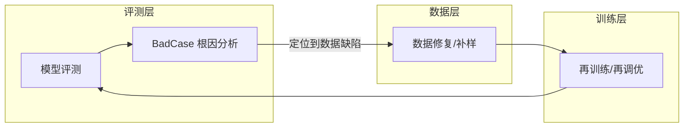

# OpenTrek 模型评测与 BadCase 闭环

> 中文简称：模型评测与 BadCase 闭环

> **一句话理解**: 评测的价值不在打分而在驱动迭代——「评测找坏例、定位根因、修数据、再训练」的循环让模型持续变好；一致性数字是宣传口径，自家抽样双评才算数。

---

## 一、官网评测口径：两个能力点

官网评测侧有两个能力点，性质不同，要分开对待：

| **能力点** | **官网口径** | **性质** |
| --- | --- | --- |
| 人机评分一致性 >95% | 同一批模型输出，人工评分与机器评分结论一致的占比 | 宣传口径数字，需自测验证 |
| BadCase 根因分析 | 对坏例定位原因，回流到数据修复与训练迭代 | 能力定性，闭环机制描述 |

前者是数字承诺，后者是机制承诺。数字承诺必须在自家场景复测（第二节）；机制承诺要看坏例是否真能定位到根因并回流（第四节）。

---

## 二、「>95%」的抽样双评验证方法

「>95%」的验证方法建议（宣传数字必须自测）：

```text
抽样双评对比：
1. 从真实业务场景抽分层样本，覆盖高频/长尾/边界场景
2. 同一批输出分别做人工评分与机器评分
3. 统计结论一致的样本占比，得到自家口径的一致性数字
4. 与宣传的 >95% 对照，差值即「宣传口径 vs 自家场景」的落差
```

注意：官网未公布评测集构成与一致性的计算口径（结论完全一致还是分档一致），横向对比前应先对齐口径再比数字。

---

## 三、评测体系三层定性（分析视角）

官网未公开评测体系全貌。按评测工程常识，一套完整的模型评测体系通常分三层（本节为分析视角定性，非官方口径）：

| **层次** | **回答的问题** | **典型手段** | **与官网口径的对应** |
| --- | --- | --- | --- |
| 基准集层 | 模型能力是否达标 | 静态基准数据集自动打分、版本间对比 | 官网未公开对应信息 |
| 人工评审层 | 输出质量与业务对齐度 | 人工评分、双评仲裁，人机一致性在此层度量 | 人机评分一致性 >95% 所在层 |
| 在线指标层 | 上线后真实效果 | 业务指标埋点、A/B 对比、用户反馈采集 | 与全景观测体系衔接 |

三层互为校验：基准集快但易过拟合，人工评审准但贵，在线指标真实但滞后。企业落地时三层都要有，只做一层都会盲。

---

## 四、BadCase 根因分析与数据回流

BadCase 根因分析要回答「坏例为什么坏」。常见根因类型（分析视角，评测工程常识）：

```text
- 数据缺失：知识库没覆盖该问题，检索不到依据
- 知识过期：库内信息陈旧，答案与现实不符
- 对齐偏差：模型行为与业务预期不一致，需调优
- 检索失败：知识在库但没召回，切块/索引环节问题
```

根因不同，回流路径不同：数据缺失与知识过期回流到知识库补数据；对齐偏差回流到训练/微调；检索失败回流到 RAG 链路调参。定位到根因，修复才有靶子——这是「根因分析」比「收集坏例」值钱的地方。

---

## 五、训练-评测-迭代飞轮

评测的价值不在打分，而在驱动迭代。OpenTrek 把评测、BadCase 根因、数据修复、再训练串成飞轮：



图解：评测暴露 BadCase，根因分析判断是数据缺陷还是训练问题；数据修复后回流再训练，新模型再进入评测，形成「评测→修复→再训练→再评测」的闭环飞轮。

闭环成立的两个前提：一是 BadCase 能定位到具体根因（数据缺失、知识过期、对齐偏差）；二是修复后的数据能顺畅回流训练流水线——这正是企业数据知识库「数据集合成」用途在训练侧的消费端。

---

## 六、评测数据治理（分析视角）

评测要长期跑，靠的不是一次性测试集，而是评测数据治理。三件套（分析视角，评测工程常识）：

| **资产** | **管什么** | **没有它会怎样** |
| --- | --- | --- |
| 坏例库 | BadCase 统一归档、根因标签、去重、状态跟踪 | 坏例散在聊天记录里，重复踩坑无法追溯 |
| 标注规范 | 评分维度、分档标准、双评与仲裁机制 | 评分口径漂移，人机一致性无从谈起 |
| 回归集 | 修复验证用例沉淀，每次迭代后重跑 | 修好旧问题引入新问题，无人察觉 |

治理与第二节的关系：抽样双评的「双评」之所以可比，前提是标注规范统一了口径；回归集则是飞轮的防倒转装置——迭代越快，回归集越重要。

---

## 交叉引用

- [[12_架构基建/06_云厂商/Alibaba_Cloud/产品/14_OpenTrek/07_数据与模型/02_Training_Full_Spectrum|全谱系训练与算法]]
- [[12_架构基建/06_云厂商/Alibaba_Cloud/产品/14_OpenTrek/07_数据与模型/01_Knowledge_Base_Three_Steps|知识库三步法]]
- [[12_架构基建/06_云厂商/Alibaba_Cloud/产品/14_OpenTrek/05_生产运行/01_Hosted_Scheduling_Observability|托管调度与全景观测]]
- [[12_架构基建/06_云厂商/Alibaba_Cloud/产品/14_OpenTrek/08_选型与视角/03_Implementation_Playbook|落地实施五阶段]]
- [[12_架构基建/06_云厂商/Alibaba_Cloud/架构方案/18_架构方案_模型微调与行业定制|架构方案：模型微调与行业定制]]

---

*Last updated: 2026-11-06*
