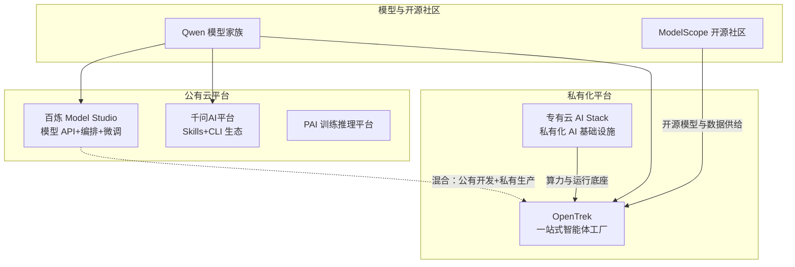

# OpenTrek 与阿里云 AI 家族协同定位

> 中文简称：与阿里云 AI 家族协同

> **一句话理解**: 阿里云把 AI 能力分给六个角色——公有云租百炼、Agent 生态用千问 AI 平台、私有化建智能体工厂选 OpenTrek、训练推理上 PAI、私有化底座用专有云 AI Stack、找开源模型逛 ModelScope。

---

## 一、家族分工总表

口径先行：OpenTrek 官网产品页没有写明它与百炼的官方分工，下表的「分工」是本库的分析视角，用于选型推理，不是官方定义。

| **成员** | **定位** | **核心能力** | **典型使用者** |
|---|---|---|---|
| **百炼 Model Studio** | 公有云 MaaS | 模型 API+应用编排+微调部署，控制台优先 | 公有云租户、快速验证团队 |
| **千问AI平台** | Agent 优先的新 MaaS | Skills+CLI 生态 | Agent 开发者、效率工具用户 |
| **OpenTrek** | 企业级一站式智能体工厂 | 私有化/专有云，数据-开发-部署-运维全链路闭环 | 政务、金融、能源等私有化客户 |
| **PAI** | 机器学习训练推理平台 | 训练与推理的算力调度 | 算法与平台工程团队 |
| **专有云 AI Stack** | 私有化 AI 基础设施 | 私有化底座，含 A-Speed 加速推理套件 | 企业私有化底座建设方 |
| **ModelScope** | 开源社区 | 模型与数据集开放供给 | 开源社区与二次开发者 |

分层读法：

```
模型层：Qwen 模型家族——供给各家平台
平台层：百炼 / 千问AI平台 / OpenTrek / PAI——各管一段
基础设施层：专有云 AI Stack + A-Speed——私有化算力与加速
社区层：ModelScope——开源模型与数据集供给
```

一句话边界（分析视角）：数据能出域、求快，用百炼；数据不能出域、要企业级全链路闭环，用 OpenTrek。两个 MaaS 平台的展开见 [[12_架构基建/06_云厂商/Alibaba_Cloud/产品/07_MaaS平台_百炼与千问AI平台|MaaS 平台：百炼与千问AI平台]]，模型侧背景见 [[12_架构基建/06_云厂商/Alibaba_Cloud/产品/06_Qwen模型家族_2026|Qwen 模型家族 2026]]。

---

## 二、家族关系图



图解：实线是供给与承载关系，虚线是混合模式下的组合用法（分析视角）。PAI 同时有公有云与专有云形态，图中按主要使用场景归位示意。

---

## 三、命名纠偏：OpenTrek-LLM 只见于营销材料

库内已有纠偏记录（背景见 [[12_架构基建/06_云厂商/Alibaba_Cloud/专有云/01_阿里云_AI技术栈_深入分析|阿里云 AI 技术栈深入分析]]）：

```
现象：AI Stack 营销材料中曾出现「OpenTrek-LLM」命名
核对：官方指南 V2.14.0 中未出现该命名
结论：评估材料时分清三种口径——
  营销口径：PPT / 白皮书 / 新闻稿，命名可能拼合或超前
  官方口径：产品文档与部署指南，落地方案以此为准
  分析口径：本库对产品边界的推理，一律标注「分析视角」
```

这条纪律直接影响选型与方案评审：材料里见到 OpenTrek-LLM 字样，先回官方指南核对再引用，避免把营销命名写进架构文档。

---

## 四、组合模式：四条典型路径

| **模式** | **构成** | **适用前提** | **提示** |
|---|---|---|---|
| **纯公有云** | 百炼直用 | 数据可出域、无强合规约束 | 上手最快、成本最低 |
| **纯私有化** | OpenTrek + 专有云 AI Stack | 数据强隔离、行业监管要求 | 需自备算力与运维力量 |
| **混合** | 公有百炼开发 + 私有 OpenTrek 生产 | 开发试错在公有云、生产数据不出域 | 双平台资产同步机制官网未写明（分析视角） |
| **轻量化** | ZStack + OpenTrek 组件化 | 中小规模私有化、按需组件化交付 | 按 ZStack 合作口径，灵活选组件而非全家桶 |

纯公有云的成本口径见 [[12_架构基建/06_云厂商/Alibaba_Cloud/产品/13_百炼深度/02_Billing_Plans_And_Cost|百炼计费与成本]]；纯私有化的交付要点见 [[12_架构基建/06_云厂商/Alibaba_Cloud/产品/14_OpenTrek/08_选型与视角/03_Implementation_Playbook|落地实施五阶段]]；轻量化组合展开见 [[12_架构基建/06_云厂商/Alibaba_Cloud/产品/14_OpenTrek/02_部署与行业/05_ZStack_Partnership|ZStack 轻量化合作]]；私有化底座背景见 [[12_架构基建/06_云厂商/Alibaba_Cloud/专有云/README|阿里云专有云总览]]。

---

## 五、选型四问

```
1. 数据能不能出域？——能：百炼优先；不能：OpenTrek 或混合模式
2. 要不要自有模型？——要：PAI 训练 + OpenTrek 承载；不要：直接用 Qwen 系列 API
3. 团队工程能力如何？——偏业务：零码范式+角色模板起步；有工程团队：三范式全开
4. 合规审计要求多严？——政务/金融级：逐项对表 OpenTrek 安全合规能力再签约
```

四问之后的下一步：六维对表看 [[12_架构基建/06_云厂商/Alibaba_Cloud/产品/14_OpenTrek/08_选型与视角/02_Competitor_Selection|竞品对比与选型]]，路径展开看 [[12_架构基建/06_云厂商/Alibaba_Cloud/产品/14_OpenTrek/08_选型与视角/03_Implementation_Playbook|落地实施五阶段]]，面试表达看 [[12_架构基建/06_云厂商/Alibaba_Cloud/产品/14_OpenTrek/08_选型与视角/04_Interview_Angle|面试视角（OpenTrek 15 题）]]。

---

## 交叉引用

- [[12_架构基建/06_云厂商/Alibaba_Cloud/产品/14_OpenTrek/01_全景与演进/01_Product_Overview|OpenTrek 产品概览]]
- [[12_架构基建/06_云厂商/Alibaba_Cloud/产品/14_OpenTrek/08_选型与视角/02_Competitor_Selection|竞品对比与选型]]
- [[12_架构基建/06_云厂商/Alibaba_Cloud/专有云/04_阿里云_PAI_深入分析|阿里云 PAI 深入分析]]
- [[概念/General/a-speed|A-Speed 概念页]]
- [[概念/General/bailian-exclusive|百炼专有云概念页]]
- [[12_架构基建/06_云厂商/Alibaba_Cloud/产品/13_百炼深度/README|百炼深度系列总览]]
- [[12_架构基建/06_云厂商/Alibaba_Cloud/README|阿里云知识总览]]

---

*Last updated: 2026-11-06*
