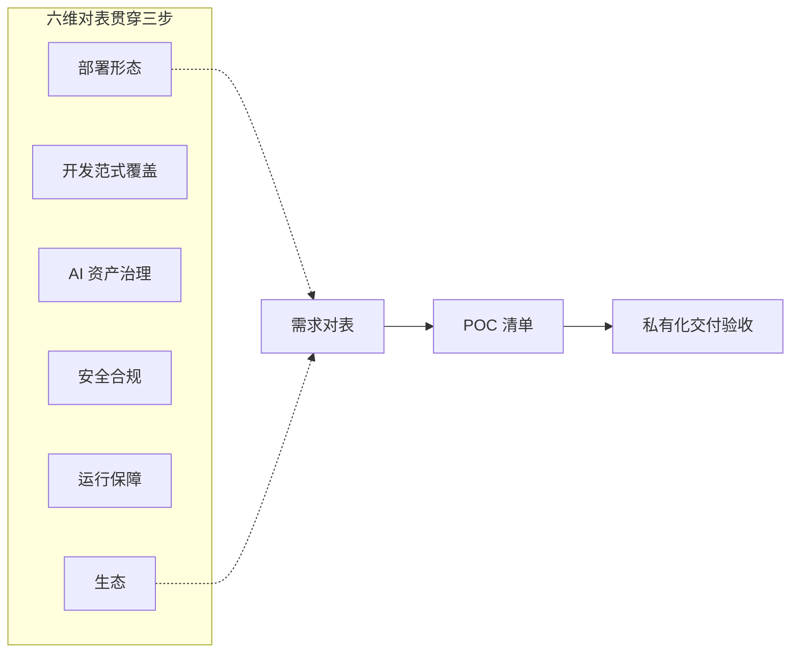

# OpenTrek 竞品对比与选型

> 中文简称：竞品对比与选型

> **一句话理解**: 选型不比嗓门比维度——把部署、范式、资产、安全、运行、生态做成一张六维对表，让每家候选平台按同一张表交证据。

---

## 一、六维选型框架

私有化智能体平台选型，先定维度再谈产品。六个维度与每格要看的证据：

| **维度** | **对表问题** | **看什么证据** |
|---|---|---|
| **部署形态** | 私有化、专有云、混合是否都支持？ | 部署架构文档、网络隔离方案、参考环境 |
| **开发范式覆盖** | 零码、低码、高码是否统一纳管？ | 三类人群是否同一平台、同一资产库 |
| **AI 资产治理** | Skill、知识库、记忆体有无统一资产库与市场？ | 资产复用机制、跨智能体共享能力 |
| **安全合规** | 沙箱隔离、凭证统管、护栏、审计齐不齐？ | 安全白皮书、审计日志样例、护栏演示 |
| **运行保障** | 托管调度、可观测、计费治理有没有？ | 运维手册、观测台演示、计费口径 |
| **生态** | 模型市场、Skill 市场、伙伴方案有没有？ | 市场在架资产、伙伴落地案例 |

用法：把这张表发给每家候选厂商，要求逐格填「官方口径原文+证据材料」，不接受口头承诺。

---

## 二、OpenTrek 六维能力对表（全部官网口径）

下表能力全部来自 OpenTrek 官网产品页表述，逐维对齐：

| **维度** | **OpenTrek 能力（官网口径）** |
|---|---|
| **部署形态** | 私有化/专有云交付，行业差异化方案 |
| **开发范式覆盖** | 零码、低码、高码三范式统一纳管 |
| **AI 资产治理** | Hub 资产平台统一沉淀与复用资产 |
| **安全合规** | 沙箱级隔离+凭证统管+多模态护栏 |
| **运行保障** | 多 Agent 托管调度+全景观测；「1-10-30」为宣传口径，单位含义公开资料未展开（待核实） |
| **生态** | HiMarket 三市场+ZStack 合作；三市场覆盖模型、Skill、伙伴方案类生态 |

逐维详解：

- 部署形态：[[12_架构基建/06_云厂商/Alibaba_Cloud/产品/14_OpenTrek/02_部署与行业/01_Deployment_Matrix|部署矩阵]]
- 开发范式：[[12_架构基建/06_云厂商/Alibaba_Cloud/产品/14_OpenTrek/03_智能体开发/01_Three_Paradigms|智能体开发三范式]]
- 资产治理：[[12_架构基建/06_云厂商/Alibaba_Cloud/产品/14_OpenTrek/01_全景与演进/03_OpenTrek_Hub_Asset_Platform|OpenTrek Hub 资产平台]]
- 安全合规：[[12_架构基建/06_云厂商/Alibaba_Cloud/产品/14_OpenTrek/07_数据与模型/04_Security_Compliance|安全合规体系]]
- 运行保障：[[12_架构基建/06_云厂商/Alibaba_Cloud/产品/14_OpenTrek/05_生产运行/01_Hosted_Scheduling_Observability|托管调度与全景观测]]
- 生态：[[12_架构基建/06_云厂商/Alibaba_Cloud/产品/14_OpenTrek/06_市场生态/01_HiMarket|HiMarket 市场生态]]

注意：上表是「官网说了什么」的清单，不是「竞品缺什么」的判断——拿它去对任何候选平台都成立。

---

## 三、竞品类型定性（公开常识，不点名功能）

```
开源 Dify 类自建：
  优势——源码可控、起步快、无厂商锁定
  代价——企业级能力（凭证统管/审计/计费治理/SLA）自建自担
大模型厂商自带平台类：
  优势——与自家模型协同强、迭代快
  风险——异构模型纳管与私有化成熟度需逐项对表验证
云厂商私有化套件类：
  优势——底座、算力与合规体系协同强
  风险——智能体层三范式与资产市场是否统一纳管需逐项验证
```

纪律：不点名编造任何竞品的具名功能；对表时要求对方按第一节六维表逐格提供官方口径证据。沙箱维度的横向展开可参考 [[15_智能体/20_Agentic_Infra/09_Sandbox_隔离技术与沙箱平台选型|Sandbox 隔离技术与沙箱平台选型]]，Skill 市场生态可对照 [[12_架构基建/06_云厂商/Alibaba_Cloud/产品/13_百炼深度/16_MCP_Marketplace_Skills|百炼 MCP 市场与 Skills]]。

---

## 四、选型流程：对表 → POC → 交付验收



图解：六维表在需求对表阶段打分、在 POC 阶段验证、在交付验收阶段复核——同一张表贯穿三步，避免每轮换标准。

三步展开：

```
需求对表：六维逐格打分，输出 2-3 家候选短名单
POC 清单：选 1-2 个真实业务场景，限时跑通并采集指标
私有化交付验收：按合同口径逐项验收环境、组件、培训与文档
```

---

## 五、POC 验收建议表：宣传数字转可测指标

宣传数字不能直接当验收标准，先转成可测指标再写进 POC 方案：

| **宣传口径** | **转成的可测指标** | **怎么验** |
|---|---|---|
| **天级交付** | 真实角色模板从需求到上线的计时 | POC 期间现场计时，含数据接入、调试、上线全过程 |
| **提效 30%（宣传口径）** | MTTR、人力投入前后对比 | 固定业务线，使用前后各记录 2-4 周数据再对比 |
| **1-10-30（宣传口径，单位待核实）** | 事件响应各阶段耗时 | POC 环境注入典型故障，实测响应、处理、恢复计时 |

验收纪律：同一业务线、同一统计口径、前后对比；数字写进合同前必须先过一轮 POC 实测。

---

## 交叉引用

- [[12_架构基建/06_云厂商/Alibaba_Cloud/产品/14_OpenTrek/08_选型与视角/01_Family_Fit|与阿里云 AI 家族协同]]
- [[12_架构基建/06_云厂商/Alibaba_Cloud/产品/14_OpenTrek/08_选型与视角/03_Implementation_Playbook|落地实施五阶段]]
- [[12_架构基建/06_云厂商/Alibaba_Cloud/产品/14_OpenTrek/08_选型与视角/04_Interview_Angle|面试视角（OpenTrek 15 题）]]
- [[12_架构基建/06_云厂商/Alibaba_Cloud/产品/14_OpenTrek/05_生产运行/04_AgentRuntime_Sandbox|AgentRuntime 沙箱]]
- [[12_架构基建/06_云厂商/Alibaba_Cloud/架构方案/16_架构方案_私有化部署|架构方案：私有化部署]]
- [[12_架构基建/06_云厂商/Alibaba_Cloud/架构方案/14_架构方案_Agent智能体平台|架构方案：Agent 智能体平台]]
- [[21_面试岗位/27_技术解决方案工程师/05_正式面试技术案例准备|正式面试技术案例准备]]

---

*Last updated: 2026-11-06*
