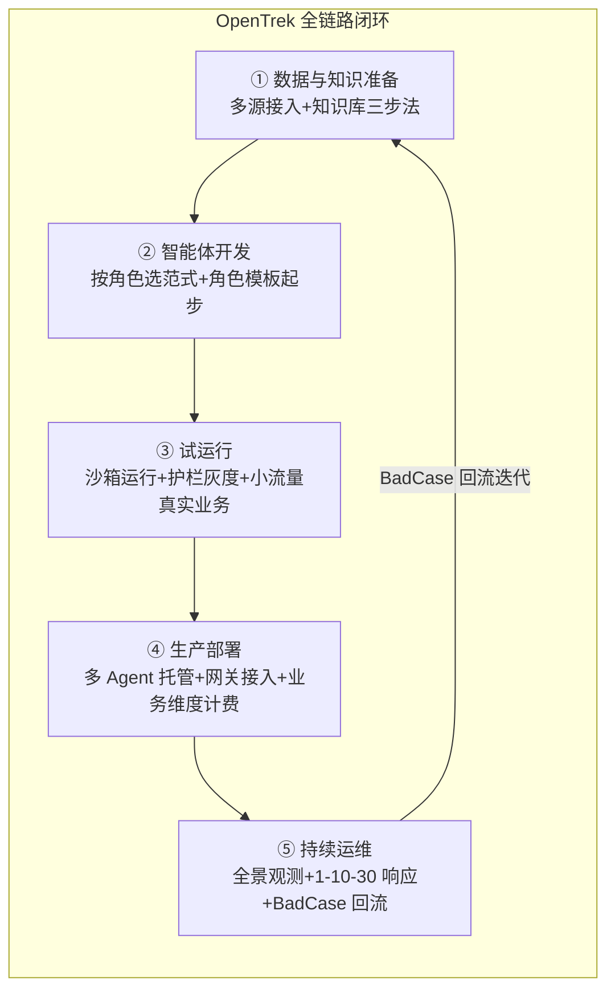

# OpenTrek 落地实施五阶段手册

> 中文简称：落地实施五阶段

> **一句话理解**: 落地五步走——先把数据和知识理干净，按人选范式开发智能体，沙箱试跑灰度上线，托管进生产，再靠观测和 BadCase 回流持续迭代；买平台只是第一步。

---

## 一、全链路闭环五阶段

OpenTrek 的核心卖点是数据-开发-部署-运维全链路闭环（官网口径），落到项目上拆成五个阶段：



图解：五阶段首尾相接成环，「BadCase 回流」是闭环的关键一跃——生产问题回流成知识与训练素材，而不是停在工单里。「1-10-30」为宣传口径，单位含义公开资料未展开（待核实）。

各阶段动作清单：

```
① 数据与知识准备：多源数据接入；按知识库三步法建设
② 智能体开发：业务人员零码、运营人员低码、工程人员高码；用角色模板起步
③ 试运行：先沙箱运行，护栏灰度放开，再接小流量真实业务
④ 生产部署：多 Agent 托管调度；AI 网关接入；按业务维度计费
⑤ 持续运维：全景观测；按 1-10-30 响应机制运转（宣传口径）；BadCase 回流迭代
```

阶段详解：知识库三步法见 [[12_架构基建/06_云厂商/Alibaba_Cloud/产品/14_OpenTrek/07_数据与模型/01_Knowledge_Base_Three_Steps|知识库三步法]]，范式选择见 [[12_架构基建/06_云厂商/Alibaba_Cloud/产品/14_OpenTrek/03_智能体开发/01_Three_Paradigms|智能体开发三范式]]，角色模板见 [[12_架构基建/06_云厂商/Alibaba_Cloud/产品/14_OpenTrek/03_智能体开发/02_Zero_Code_Templates|零码与角色模板]]，沙箱试运行见 [[12_架构基建/06_云厂商/Alibaba_Cloud/产品/14_OpenTrek/05_生产运行/04_AgentRuntime_Sandbox|AgentRuntime 沙箱]]，网关见 [[12_架构基建/06_云厂商/Alibaba_Cloud/产品/14_OpenTrek/05_生产运行/02_AI_Gateway|AI 网关]]、计费治理见 [[12_架构基建/06_云厂商/Alibaba_Cloud/产品/14_OpenTrek/05_生产运行/03_Token_Governance|Token 治理]]，观测与响应见 [[12_架构基建/06_云厂商/Alibaba_Cloud/产品/14_OpenTrek/05_生产运行/01_Hosted_Scheduling_Observability|托管调度与全景观测]]。

---

## 二、实施节奏建议表

一口吃不成数字组织，按三期推进：

| **阶段** | **做什么** | **标志性产出** | **退出标准** |
|---|---|---|---|
| **试点期** | 单角色模板起步：选 1 个高频角色，跑通全链路 | 1 个上线的数字员工 | 单角色上线且效果指标可量化 |
| **扩展期** | 多角色协同：组建数字员工团队，形成数字组织雏形 | 跨角色协同流程 | 多角色接力流程跑通并稳定运行 |
| **平台期** | 资产市场运营：Hub 沉淀资产，HiMarket 引入生态 | 可复用资产库 | 资产复用可统计、有跨部门消费 |

数字员工成组建制的展开见 [[12_架构基建/06_云厂商/Alibaba_Cloud/产品/14_OpenTrek/04_数字员工/01_Digital_Workforce|数字员工]] 与 [[12_架构基建/06_云厂商/Alibaba_Cloud/产品/14_OpenTrek/04_数字员工/02_Digital_Organization|数字组织]]，资产沉淀见 [[12_架构基建/06_云厂商/Alibaba_Cloud/产品/14_OpenTrek/01_全景与演进/03_OpenTrek_Hub_Asset_Platform|OpenTrek Hub 资产平台]]，市场运营见 [[12_架构基建/06_云厂商/Alibaba_Cloud/产品/14_OpenTrek/06_市场生态/01_HiMarket|HiMarket 市场生态]]。

---

## 三、私有化交付要点

```
环境准备：算力规划先行；网络隔离边界画清楚——哪些数据可出域、哪些绝不
组件选择：按业务需求灵活选组件（ZStack 合作口径），不强制全家桶
行业差异化：
  政务——审计留痕与分级权限优先
  金融——监管合规与数据隔离优先
  能源——与既有业务系统、工控系统集成优先
```

提醒：行业要点为通用交付关注点与本库整理（分析视角），具体以厂商交付文档与合同口径为准；部署形态细节见 [[12_架构基建/06_云厂商/Alibaba_Cloud/产品/14_OpenTrek/02_部署与行业/01_Deployment_Matrix|部署矩阵]]，ZStack 组件化细节见 [[12_架构基建/06_云厂商/Alibaba_Cloud/产品/14_OpenTrek/02_部署与行业/05_ZStack_Partnership|ZStack 轻量化合作]]。

---

## 四、风险与对策表

| **风险** | **典型表现** | **对策** |
|---|---|---|
| **数据质量差** | 检索不准、答非所问，业务方失去信任 | 知识库先行治理，数据干净再开发智能体 |
| **范式错配** | 业务人员被推进高码，工程人员困在零码 | 按人群选范式，三范式统一纳管下各走各道 |
| **无运维体系** | 上线后无人接管，故障无人响应 | 多 Agent 托管调度+沙箱缩零，减少常驻运维人力 |
| **效果不达预期** | demo 很好、生产拉胯 | 评测一致性验证+BadCase 回流闭环，指标持续复测 |

效果不达预期的量化处理见第五节；评测一致性与训练迭代见 [[12_架构基建/06_云厂商/Alibaba_Cloud/产品/14_OpenTrek/07_数据与模型/03_Evaluation_BadCase_Loop|模型评测与 BadCase 闭环]]，训练侧全貌见 [[12_架构基建/06_云厂商/Alibaba_Cloud/产品/14_OpenTrek/07_数据与模型/02_Training_Full_Spectrum|全谱系训练与算法]]。

---

## 五、ROI 验证方法：宣传数字转可测指标

ROI 不能停在 PPT 里，四条可测指标与测量方法：

| **可测指标** | **对应宣传口径** | **测量方法** |
|---|---|---|
| **交付周期** | 天级交付（宣传口径） | 记录角色模板从需求到上线的实际计时，POC 现场测 |
| **MTTR** | 提效 30%（宣传口径） | 固定业务线，使用前后各采 2-4 周故障恢复数据对比 |
| **人力投入** | 提效 30%（宣传口径） | 同一业务线人时统计，使用前后口径不变 |
| **资源成本** | 缩零等成本叙事（宣传口径） | 按业务维度计费数据核算闲时资源回收效果 |

三条纪律：

```
同一业务线：指标只与自己比，不跨线比
同一口径：统计方法在使用前后保持不变
前后对比：先测基线再上线，POC 实测数据写进合同
```

---

## 交叉引用

- [[12_架构基建/06_云厂商/Alibaba_Cloud/产品/14_OpenTrek/08_选型与视角/01_Family_Fit|与阿里云 AI 家族协同]]
- [[12_架构基建/06_云厂商/Alibaba_Cloud/产品/14_OpenTrek/08_选型与视角/02_Competitor_Selection|竞品对比与选型]]
- [[12_架构基建/06_云厂商/Alibaba_Cloud/产品/14_OpenTrek/08_选型与视角/04_Interview_Angle|面试视角（OpenTrek 15 题）]]
- [[12_架构基建/06_云厂商/Alibaba_Cloud/架构方案/13_架构方案_企业知识库RAG|架构方案：企业知识库 RAG]]
- [[12_架构基建/06_云厂商/Alibaba_Cloud/架构方案/16_架构方案_私有化部署|架构方案：私有化部署]]
- [[12_架构基建/06_云厂商/Alibaba_Cloud/架构方案/14_架构方案_Agent智能体平台|架构方案：Agent 智能体平台]]
- [[15_智能体/20_Agentic_Infra/04_本地千问办公Agent实战|本地千问办公 Agent 实战]]
- [[12_架构基建/06_云厂商/Alibaba_Cloud/产品/14_OpenTrek/README|OpenTrek 系列总览]]

---

*Last updated: 2026-11-06*
