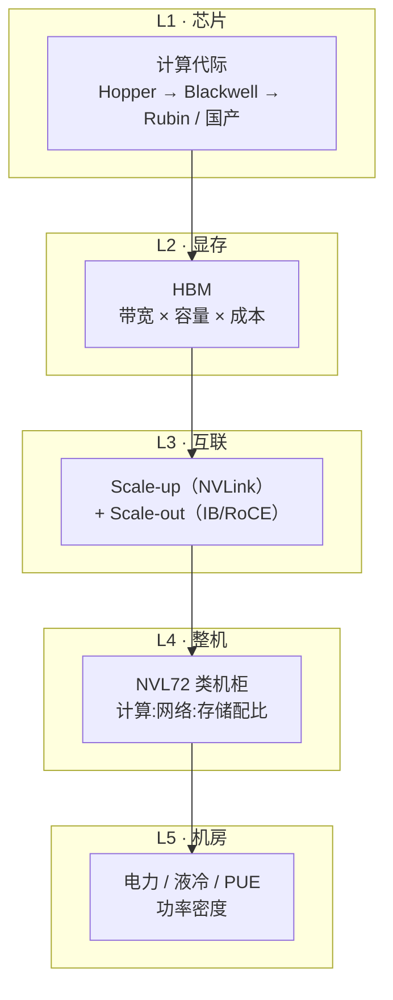

# 算力系统栈全景 2026（地图页）

> 中文简称：算力系统栈全景

> **一句话理解**: AI 算力不是一颗 GPU，而是五层栈——芯片、HBM、互联、整机、机房，任何一层的短板都直接变成推理时延或训练吞吐的账单；本页是这张地图的索引，每层告诉你去哪读深度内容。

---

## 1. 五层栈一张图

图解：**瓶颈沿栈向上传递**——HBM 带宽不够，芯片算力白给（见 [[12_架构基建/07_硬件与算力/14_HBM_深潜_存墙与带宽|HBM 深潜]]）；scale-up 域不够大，张量并行切不开；机房供电跟不上，再多的机柜也只是期货。评估任何算力方案，五层各看一眼再下结论。

---

## 2. 每层一句话 + 深度导航

| 层 | 本质一句话 | 本库深度内容 |
|----|-----------|-------------|
| **L1 芯片** | 决定「每秒能算多少」，看 FP 算力密度与代际节奏 | [[01_数学基础/10_AI硬件/01_AI硬件_2026\|AI 硬件 2026]] ｜ [[01_数学基础/10_AI硬件/07_NVIDIA_AMD_GPU_深入分析\|NVIDIA/AMD GPU 深入]] ｜ [[12_架构基建/07_硬件与算力/16_国产算力_2026\|国产算力（本目录）]] |
| **L2 显存（HBM）** | 决定「大模型装不装得下、喂不喂得饱」，推理的真正瓶颈 | [[12_架构基建/07_硬件与算力/14_HBM_深潜_存墙与带宽\|14 HBM 深潜（本目录·核心）]] |
| **L3 互联** | 决定「多少颗芯片能当一颗用」——scale-up 域大小与 scale-out 拓扑 | [[12_架构基建/08_网络/07_GPU_高网设计/01_分层体系/01_Scale_Up_NVLink_NVSwitch\|Scale-Up NVLink/NVSwitch]] ｜ [[12_架构基建/08_网络/07_GPU_高网设计/01_分层体系/02_Scale_Out_IB_RoCE_TCP\|Scale-Out IB/RoCE]] ｜ [[12_架构基建/08_网络/07_GPU_高网设计/01_分层体系/06_Bandwidth_Latency_Cheat_Sheet\|带宽时延速查]] |
| **L4 整机** | 决定「配比与成本」——GPU:光模块:NIC 的 BOM 账 | [[12_架构基建/08_网络/07_GPU_高网设计/02_物理层硬件/04_Component_Ratio_Cost\|部件配比与成本]] ｜ [[12_架构基建/08_网络/07_GPU_高网设计/02_物理层硬件/03_Optical_Modules\|光模块]] ｜ [[12_架构基建/08_网络/07_GPU_高网设计/02_物理层硬件/01_Switch_Generations\|交换机代际]] |
| **L5 机房** | 决定「能不能部署」——功率密度、液冷、PUE | [[12_架构基建/07_硬件与算力/15_数据中心_电力_液冷\|15 电力与液冷（本目录）]] |

---

## 3. 本目录（07_硬件与算力）的分工声明

本目录 = **硬件系统栈视角**（芯片 → HBM → 整机 → 机房 + GPU 虚拟化）。三个相邻视角，互链不重复：

| 目录 | 视角 | 什么时候去 |
|------|------|-----------|
| `08_网络/07_GPU_高网设计/` | **网络工程视角**（61 页：分层体系/物理层/拓扑/协议/集合通信/成本/厂家） | 造网络、算 BOM、查厂家时 |
| `08_网络/PPU与高网/` | **国产芯片互联视角**（23 页：ICN/HCCS/MLU-Link 等卡间互联与超节点） | 研究国产互联时 |
| [[10_部署推理/05_硬件与算力/README\|10 章/05 硬件与算力]] | **推理选型视角**（GPUStack/昇腾推理/国产芯推理矩阵） | 部署推理服务时 |
| [[01_数学基础/10_AI硬件/README\|01 章/10 AI 硬件]] | **入门通俗层**（硬件综述/TPU/CUDA/PPU） | 刚入门时 |

**路由规则**：先想清楚要的是「栈的哪一层、什么视角」，再进对应目录——五个入口（含本页）已经把全库算力内容网住，不要再新建同主题目录。

---

## 4. 两条主线判断（2026）

1. **推理时代的瓶颈在 L2/L3 交界**：长上下文把 KV Cache 显存推成第一瓶颈（带宽决定 TTFT、容量决定并发），scale-up 域大小决定专家并行能切多开——这是 [[12_架构基建/07_硬件与算力/14_HBM_深潜_存墙与带宽|14 HBM 深潜]] 的主论点。
2. **L5 从「选址问题」变成「架构约束」**：单机柜 120kW+ 让液冷从可选项变成默认项，电力成为中国与美国算力叙事的分水岭——详见 [[12_架构基建/07_硬件与算力/15_数据中心_电力_液冷|15 电力与液冷]]。

## Related

- [[概念/GPU/gpu|GPU（概念卡）]]
- [[概念/GPU/nvlink|NVLink]] ｜ [[概念/GPU/gpu-interconnect|GPU Interconnect]]
- [[12_架构基建/08_网络/07_GPU_高网设计/01_分层体系/06_Bandwidth_Latency_Cheat_Sheet|带宽时延速查表]]
- [[10_部署推理/05_硬件与算力/README|推理选型视角（分工兄弟目录）]]
- [[12_架构基建/README|架构基建（章节）]]

---

*Last updated: 2026-11-04*
