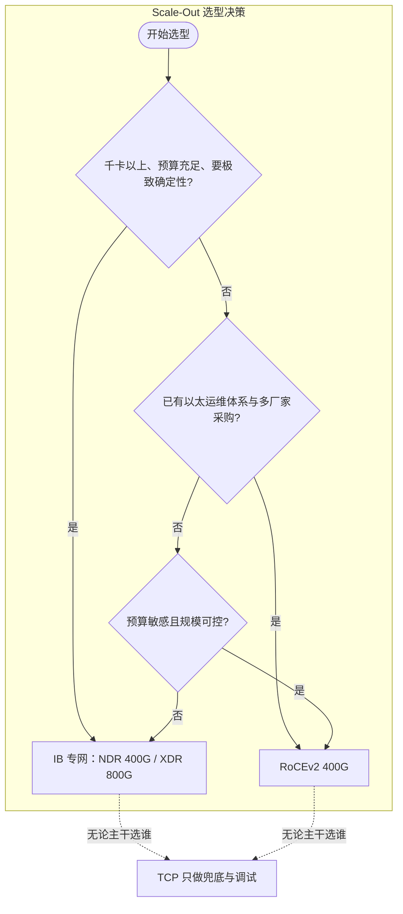

# Scale-Out 互联三档选型：IB、RoCE 与 TCP

> 中文简称：Scale-Out 互联三档选型

> **一句话理解**: 跨机架把成千上万张 GPU 连起来只有三档可选——InfiniBand 专网性能最好也最贵、RoCEv2 用以太网承载 RDMA 是主流折中、TCP 只能兜底，永远不上训练主干。

---

## 一、三档定位总览

Scale-Out（横向扩展）解决「一个 scale-up 域装不下的部分怎么连」：跨节点、跨机架、跨机房。承载技术只有三档，定位一句话分清：

| **维度** | **InfiniBand（专网）** | **RoCEv2（以太承载 RDMA）** | **TCP Socket** |
|---|---|---|---|
| 定位 | 性能最好、成本最高 | 主流折中 | 兜底与调试 |
| 承载网络 | Quantum 系列专用 IB 交换机 | 标准以太交换机（如 Tomahawk 5 51.2T） | 任意 IP 网络 |
| 单口速率 | NDR 400G / XDR 800G | 100G-400G，向 800G 演进 | 与物理口相同但有效吞吐低 |
| 跨机延迟 | ~2µs 级 | 2-5µs | 30µs 起 |
| CPU 开销 | RDMA 卸载，近零拷贝 | RDMA 卸载，需无损调优 | 内核协议栈 + 拷贝 + 中断，开销高 |
| 生态 | NVIDIA 一家端到端 | 多厂家（Broadcom、Cisco 等） | 全通用 |
| 典型角色 | 大规模训练主干 | 训练/推理主干的主流选择 | 参数面兜底、小规模验证 |

三档的共同底线：训练主干必须走 RDMA（IB 或 RoCEv2 二选一），TCP 不进主干，原因见第四节。判断一个集群的网络水位，先看主干走的是哪一档。

---

## 二、InfiniBand：专网路线

IB 是为 HPC/AI 设计的专用网络协议族，物理层到传输层整套自研、与以太网不兼容，用整网确定性换性能：

- **天生无损**：链路层信用流控（credit-based flow control），发方只在收方给信用时才发——不丢包是设计出来的，不是调出来的。
- **自适应路由**：交换机按端口队列情况逐包选路，天然均摊集合通信的微突发。
- **SHARP 网内计算**：归约在交换机内完成，AllReduce 的网内数据量随归约递减。

代际与速率（单端口线路速率）：

| **代际** | **单端口速率** | **代表网卡 / 交换机** |
|---|---|---|
| EDR | 100G | ConnectX-4 / EDR 交换机 |
| HDR | 200G | ConnectX-6 / Quantum |
| NDR | 400G | ConnectX-7 / Quantum-2 |
| XDR | 800G | ConnectX-8 / Quantum-3 |

代价：交换机与网卡溢价明显，整网方案单厂家供应，规模越大锁定越深。千卡以上、集合通信占比高的场景，溢价换来的确定性与 SHARP 收益才划算；中小规模则未必。

---

## 三、RoCEv2：以太承载 RDMA

RoCEv2 把 RDMA 报文封装进 UDP 跑在以太网上：硬件复用以太生态（交换机、光模块多厂家竞争），软件上 NCCL 走与 IB 相同的 verbs 接口，对上层几乎无感。

以太天生有损而 RDMA 要求近无损，RoCEv2 的全部复杂性集中在无损以太这一步：

- **PFC**：按优先级反压防丢包；配置失衡会引发背压级联，head-of-line 阻塞沿链路向上游扩散。
- **ECN + DCQCN**：拥塞显式通知与端侧速率回退，压制 incast 突发。
- **深 buffer 交换机**：突发吸收能力是无损以太的物理前提，Tomahawk 5 51.2T 一代平台普遍按此设计。

选 RoCEv2 的隐性成本是调优人力与跨厂家一致性验证；换来的是采购议价空间与以太运维体系的复用。Spectrum-X（自适应路由 + 精细遥测）与 UEC 标准，是以太阵营继续逼近 IB 确定性的两条演进路线。

---

## 四、TCP：为什么只配兜底

TCP 走内核协议栈，三笔账算下来都不适合训练主干：

1. **延迟账**：同机房 socket RTT 30µs 起（内核栈、中断、上下文切换层层叠加），梯度同步对微秒级敏感，差出一个数量级以上。
2. **CPU 账**：协议栈处理与内存拷贝吃掉大量 CPU 核，挤占数据预处理与编译算力；网卡流量一上来，CPU 侧先成为瓶颈。
3. **吞吐账**：NCCL 退化为 Socket 传输后没有 RDMA 的零拷贝与多通道并行，实测总线带宽（busbw）远低于线速。

TCP 的合理位置：NCCL 的兜底与降级通道、小规模功能验证、参数面与日志面。生产训练主干里出现 TCP 通道，本身就应触发告警。

---

## 五、NCCL 对三档的支持

NCCL 通过两类传输承载上述网络：RDMA（verbs，同时覆盖 IB 与 RoCEv2）与 Socket（TCP）。常用环境变量：

```bash
# IB / RoCE：指定 RDMA 网卡（IB 与 RoCE 都通过 mlx5 verbs 接入）
export NCCL_IB_HCA=mlx5_0,mlx5_1,mlx5_2,mlx5_3

# RoCE 场景常需指定 RoCEv2 的 GID 索引
export NCCL_IB_GID_INDEX=3

# TCP 兜底通道（仅调试与降级，主干不要依赖）
export NCCL_SOCKET_IFNAME=eth0

# 打开 INFO 日志可看到每个 channel 实际选择的传输
export NCCL_DEBUG=INFO
```

判断集群实际在走哪条路：看 INFO 日志里每个 ring/tree channel 的 transport 字样，via Device 表示 verbs/RDMA，via Socket 表示 TCP。IB 与 RoCE 对 NCCL 透明——同为 RDMA 语义，差别全在交换网的行为（自适应路由、SHARP、拥塞控制）。

---

## 六、选型三问与典型组合

**问题一：规模与并行策略是什么？** 千卡以上、EP/DP 为主、集合通信占比高，IB 的 SHARP 与自适应路由收益最大；几百卡、TP/PP 为主（热路径多在 NVLink 域内），RoCEv2 足够。

**问题二：团队生态是什么？** 已有以太运维体系（自动化、监控、备件、多厂家采购框架）选 RoCEv2 顺势；愿意建 IB 工具链（ibstat、perfquery、ibdump 等）并要端到端确定性，选 IB。

**问题三：预算怎么算？** IB 溢价要按交换机 + 网卡 + 多轨布线整体算；RoCE 硬件便宜，但无损调优的人力与周期是隐性成本，小团队最容易低估这块。



图示含义：主干在 IB 与 RoCEv2 之间二选一，决策变量就是规模、生态、预算三问；TCP 不进入主干候选，只作为旁路兜底存在。

典型组合（平面拆分详见下一页）：

- 计算网（训练/推理主干）：IB NDR 400G 或 RoCEv2 400G，8 卡节点常见每卡一轨 8×400G 或等量聚合方案。
- 存储网：100G 以太承载并行文件系统与 checkpoint 流量。
- 带外管理网：25G 独立平面，独立交换机与供电。
- 业务前端网：25-100G，按 API 吞吐弹性设计。

---

## 交叉引用

- [[12_架构基建/08_网络/07_GPU_高网设计/01_分层体系/01_Scale_Up_NVLink_NVSwitch|Scale-Up 互联 NVLink 与 NVSwitch]]
- [[12_架构基建/08_网络/07_GPU_高网设计/01_分层体系/03_Multi_Plane_Network_Segmentation|多网络平面分离]]
- [[12_架构基建/08_网络/07_GPU_高网设计/04_协议传输/05_IB_vs_Ethernet_SpectrumX_UEC|IB 与以太阵营对比]]
- [[12_架构基建/08_网络/07_GPU_高网设计/04_协议传输/02_Lossless_Ethernet_PFC_ECN_DCQCN|无损以太 PFC/ECN/DCQCN]]
- [[概念/GPU/infiniband-roce-2|InfiniBand 与 RoCE 概念]]
- [[12_架构基建/08_网络/06_RDMA_and_RoCE_for_AI|RDMA 与 RoCE for AI]]

---

*Last updated: 2026-10-27*
