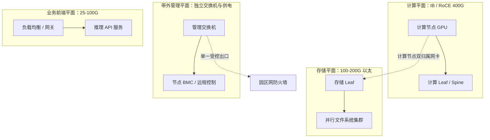

# 多网络平面分离：计算、存储、管理、业务

> 中文简称：多网络平面分离

> **一句话理解**: GPU 集群里跑着四种脾气完全不同的流量——让它们各走各的物理网络，一次 PFC 风暴或一台交换机故障才不会把训练、存储、带外管理一起拖下水。

---

## 一、四个平面各管什么

GPU 集群的网络按「流量脾气」拆成四个平面，先看一张总表：

| **平面** | **承载业务** | **典型技术** | **带宽量级** | **设计要点** |
|---|---|---|---|---|
| 计算平面（东西向） | GPU 集合通信、参数与激活同步 | IB NDR 400G / RoCEv2 400G | 每节点 400G-3.2T 聚合 | 拓扑对齐、无损或近无损 |
| 存储平面 | 并行文件系统读写、checkpoint | 以太 100-200G | 每节点 100-200G | 吞吐导向、突发吸收 |
| 带外管理平面 | BMC/IPMI/Redfish、装机、硬件监控 | 独立 1G/10G/25G 交换机 | 每节点 1G 起步 | 独立交换机、独立供电 |
| 业务前端平面 | 推理 API、南北向流量 | 以太 25-100G | 按吞吐弹性 | 挂载点可快速切流 |

四个平面不是 VLAN 级的逻辑隔离，而是物理分离：独立网卡、独立交换机、独立线缆；带外管理平面还要独立供电，生产网整体瘫痪时 BMC 仍可达。



实线是平面内主干，虚线是仅有的两类跨平面接触点：计算节点在存储平面的双归属网卡，与管理平面的单一受控出口。除显式设计的互通点外，平面之间没有数据路径。

---

## 二、为什么必须物理分离

四个理由，每个都对应一类真实故障：

- **PFC 风暴不跨界**：无损以太的 PFC 在拥塞失衡时形成背压级联，反压沿链路向上游扩散；计算与存储共网时，一次集合通信的 incast 突发能把 checkpoint 写入一起压死。物理分离后，风暴被限制在单平面内。
- **故障域切割**：一个平面的交换机、网卡、线缆、光模块故障只在平面内传播；排障按平面切割定位，不在一张大网里大海捞针。
- **安全域隔离**：BMC 面漏洞多、固件更新慢，不应暴露在生产流量域；业务前端直面外部流量，与内部东西向之间必须有硬边界。
- **性能确定性**：计算平面按集合通信的微突发调 PFC/ECN 门限与 buffer 划分，存储平面按大吞吐长流调优；两类流量混跑必然互相伤害——不是丢性能，就是丢确定性。

| **维度** | **共网（VLAN 逻辑隔离）** | **物理分离** |
|---|---|---|
| PFC 风暴 | 跨业务波及 | 平面内闭环 |
| 故障定位 | 全网混查 | 按平面切割 |
| 安全边界 | 依赖 VLAN/ACL 配置纪律 | 物理无路径 |
| 性能确定性 | 互相干扰、互相妥协 | 各自独立调优 |
| 成本 | 低 | 交换机与布线近似翻倍 |

---

## 三、共网的风险：三个定性案例

- **案例一（性能型）**：训练与存储共网，checkpoint 突发写入触发 PFC 暂停帧扩散，集合通信降速、step time 翻倍。
  - 表象：GPU 利用率周期性掉坑，与 checkpoint 周期吻合。
  - 教训：吞吐型与微突发型流量共网，无损参数没有双赢解。
- **案例二（可运维型）**：管理流量走计算网 in-band，某计算 Leaf 故障时带外同时失联。
  - 表象：远程手段全部失效，只能进机房物理接触。
  - 教训：带外的价值在生产网故障时才兑现，平时看不出差别。
- **案例三（业务型）**：推理 API 与训练共用网卡队列，业务高峰挤占队列，梯度同步尾延迟抖动。
  - 表象：训练与业务互相拖慢，双方各自排查都「没有问题」。
  - 教训：任何共享点（网卡、队列、交换机）都会重新引入跨平面耦合。

共性：共网省的是几台交换机的钱，付出的是故障跨平面传播与成倍的排障时间。

---

## 四、跨平面互通点设计

平面之间不是绝对孤立，而是只在明确设计的点受控互通：

- **计算 ↔ 存储**：计算节点插双平面网卡（计算面 + 存储面），读写经节点内存中转、不经交换网互通；对象存储等少数入口由网关做受控转换。
- **管理 → 园区网**：单一出口，防火墙 + 跳板机，所有带外访问留审计日志。
- **业务前端 → DMZ/LB**：与计算平面无直连路径，进集群内部必须经服务网关鉴权。

两条纪律：互通走显式网关、默认拒绝；严禁「临时拉一根线」式的跨平面捷径——它们最后都会变成故障时的隐形路径。

---

## 五、带宽量级配比经验

- **计算:存储 ≈ 4:1 到 8:1**：例：每节点 8×400G 计算网，配 2×100G 存储网。训练负载读多写少，checkpoint 是主要写流量。
- **checkpoint 预算反推存储带宽**：模型大小 × checkpoint 频率 ÷ 可容忍暂停时长 = 集群平均写入速率，再按并行度摊到每节点。
- **管理平面 1G/节点起步**：BMC、固件、日志、Redfish 流量都很小；管理平面的重点是带外可达性，不是带宽。
- **前端平面按业务算**：token 吞吐 × 副本数 × 冗余系数，与计算平面解耦、独立扩容。

部署后用路由表自检平面是否真的分离：

```bash
# 各平面网卡应落在各自网段；管理网段不得出现在计算/存储路由表
ip -br addr | grep -E 'ib|ens|bmc|mgmt'

# 到存储集群的路由应走存储网卡（如 ens1f0），而不是计算网卡
ip route get <存储集群网段>
```

---

## 六、什么时候可以合并平面

小集群（如 64 卡以内）可以适当合并，但各平面的底线不同：

- 计算与存储可合并为一张 RoCE 网（接受 checkpoint 期间训练降速），用 QoS 优先级兜底。
- 业务前端在小规模下可暂挂计算网，但要限速隔离。
- 带外管理永远独立——这是唯一不可合并的平面，省它的钱等于放弃故障时刻的控制权。

平面分离是「用硬件换确定性」：交换机数量与布线复杂度上升，换来故障域、安全域与性能的三重确定性。千卡规模以上，这笔账几乎没有争议。

---

## 交叉引用

- [[12_架构基建/08_网络/07_GPU_高网设计/01_分层体系/02_Scale_Out_IB_RoCE_TCP|Scale-Out 互联三档选型]]
- [[12_架构基建/08_网络/07_GPU_高网设计/01_分层体系/01_Scale_Up_NVLink_NVSwitch|Scale-Up 互联 NVLink 与 NVSwitch]]
- [[12_架构基建/08_网络/07_GPU_高网设计/02_物理层硬件/02_NIC_and_DPU|网卡与 DPU]]
- [[12_架构基建/08_网络/07_GPU_高网设计/07_运维故障/04_Lossless_Config_Audit|无损配置审计]]
- [[12_架构基建/08_网络/07_GPU_高网设计/08_容量成本/04_Traffic_Modeling|流量建模]]
- [[13_运维/02_SRE与可靠性/10_GPU_集群_Operations_2026|GPU 集群 Operations 2026]]
- [[12_架构基建/08_网络/02_AI_网络|AI 网络]]

---

*Last updated: 2026-10-27*
