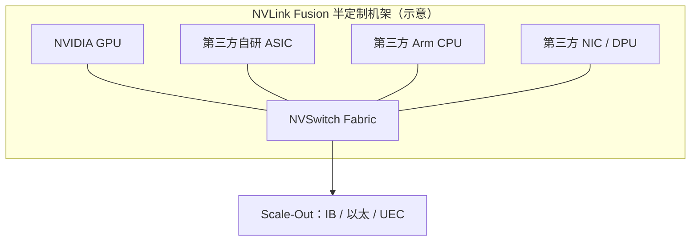

# NVLink Fusion：NVLink 开放生态

> 中文简称：NVLink Fusion 开放生态

> **一句话理解**: NVLink Fusion 让别家的 CPU 和自研芯片也能插进 NVIDIA 的机架内高速互联——生态开了个口子，但总闸仍握在 NVIDIA 手里。

---

## 一、宣布背景：为什么 NVLink 要开放

2025 年 5 月 Computex 上，NVIDIA 宣布 NVLink Fusion。此前近十年，NVLink 只连 NVIDIA 自家 family：自家 GPU、Grace CPU、NVSwitch，第三方芯片无法接入 NVLink 域。

开放的直接压力来自两处：

- **竞争侧**：2024 年 AMD、Broadcom 等牵头成立 UALink Consortium，开放 scale-up 标准开始成建制推进；超大规模云厂的自研 ASIC 各自建柜内互联，绕开 NVLink。
- **客户侧**：NVLink 域性能领先，但「进域 = 全套买 NVIDIA」的锁定让大客户做自研芯片时被迫放弃这套互联，对 NVIDIA 是生态流失。

宣布时点也值得注意：恰在 UALink 1.0 规范（2025-04）发布之后一个月内，节奏上是一次精准的生态卡位。

NVLink Fusion 的本质：把 NVLink 从「自家总线」重新定位为「可授权接入的机架内互联生态」——用开放接入权换生态位，正面应对开放联盟的竞争（UALink 详见下一页）。

---

## 二、开放了什么、没开放什么

```text
NVLink Fusion 速记
announced : 2025-05 Computex
opens     : 第三方 CPU / 自研 ASIC / NIC 与 DPU 接入 NVLink fabric
keeps     : NVLink 协议与 NVSwitch 仍由 NVIDIA 主导授权
goal      : 半定制 scale-up 机架（NVIDIA 与第三方芯片混搭）
```

- **开放的是接入权**：第三方可以制造接到 NVLink / NVSwitch fabric 上的芯片——自研加速器、第三方 CPU、网卡与 DPU 都在名单上。
- **没开放的是控制权**：NVSwitch、NVLink 主协议与配套软件栈仍由 NVIDIA 掌控。这是商业授权的定向开放，不是开源标准，更不是联盟治理。
- **形态是半定制机架**：客户可以在一个 scale-up 域里混搭 NVIDIA GPU 与自研/第三方芯片，按自己的负载配比组机架。
- **与域内优化的关系**：Fusion 机架仍是 NVLink 域，NVSwitch 的集合通信能力对混入的第三方芯片是否生效，取决于这些芯片实现到哪个接口层级——采购时要问清。

---

## 三、首批合作伙伴与各自角色

首批公开的合作伙伴覆盖三类角色：

- **MediaTek**：与 NVIDIA 协作开发接入 NVLink 生态的 AI 加速器相关产品，代表芯片设计侧的接入。
- **Marvell**：定制 ASIC 大厂，帮助云厂把自研加速器接进 NVLink 域，代表定制芯片通道。
- **Fujitsu**：Arm CPU 大厂，代表第三方 CPU 接入 NVLink 域的路线。
- **Qualcomm**：AI 加速器厂商，代表自研算力接入 NVLink 生态的路线。
- 此外还有一批连接与 IP 厂商在名单上，共同点都是「有算力或连接产品、缺机架级互联与软件生态」的玩家。

定性解读：这份名单覆盖「芯片设计（MediaTek）—定制通道（Marvell）—CPU（Fujitsu）—整卡算力（Qualcomm）」四个层面，说明 Fusion 想做的是一条完整的接入产业链，而不是单点合作。

对 partner 的意义：不必自建柜内互联与集合通信软件栈，就能让自己的芯片享受 NVLink 域的带宽，以及与 NVIDIA 软件生态的协同。

---

## 四、对超大规模自研芯片的意义

超大规模云厂自研 ASIC 的最大短板之一是 scale-up 互联与配套软件栈。NVLink Fusion 提供了一条中间路线：

- **路线 A（Fusion）**：自研芯片接入 NVLink 域，共用 NVSwitch 与 NVIDIA 软件栈协同——生态风险小，代价是接受 NVIDIA 的授权与节奏。
- **路线 B（UALink/自建）**：完全开放或自建互联——自主可控，但生态、验证与软件栈都要自己扛。

两条路线不互斥：同一个云厂完全可以主力自建、个别业务用 Fusion 快速补位——机架内互联从此进入多轨并存时代。

对 NVIDIA：把 NVLink 变成事实上的「机架内标准接口」，护城河从卖 GPU 扩展到第三方芯片的互联生态。对二线云与运营商：不必自研互联，也能组织差异化硬件。

判断这条路线成色的观察点：第一批非 NVIDIA 主芯片的 Fusion 系统何时落地、落地规模多大。

---

## 五、与 UALink 的竞争

| **维度** | **NVLink Fusion** | **UALink** |
|---|---|---|
| 开放方式 | 商业授权接入，NVIDIA 主导 | 联盟开放规范，多家共建 |
| 技术成熟度 | 基于量产多代的 NVLink / NVSwitch | 1.0 规范 2025 年才发布 |
| 接入对象 | 第三方 CPU / ASIC / NIC | 任何成员按规范实现 |
| 单点风险 | NVIDIA 控制授权、路线与节奏 | 无单一厂家，但协调成本高 |
| 落地节奏 | 合作伙伴已公开，产品节奏随 NVIDIA | 首批系统预计 2026 年前后 |

两者的竞争焦点是同一批客户：要做自研加速器的超大规模与大型云厂。Fusion 卖「现成的成熟与生态」，UALink 卖「自主与多厂家供货」——胜负不看发布会，看首批系统的实测表现与总成本。

---

## 六、对网络设计的影响



图示含义：Fusion 只改机架内——第三方芯片经授权接入 NVSwitch fabric 组成异构 scale-up 域；机架间 scale-out 仍是 IB/以太/UEC 的既有格局。

对设计者的四点影响：

- **异构成为常态**：同一 NVLink 域内 NVIDIA GPU 与自研 ASIC 的接入带宽可能不对称，拓扑感知调度与集合通信库要能识别带宽差异。
- **机架设计变化**：供电、散热、背板走线要兼容多家托盘形态，铜背板预算与 NVSwitch 托盘配比可能调整。
- **故障定界变难**：多厂家混搭后，「谁的托盘、谁的链路」的责任边界要提前写进验收标准。
- **规划口径更复杂**：scale-up 域规模不再只有 8/72 两档，容量规划要按实际混配域重新算流量。

短期看，首批系统未落地前，影响停留在采购选项表；长期看，机架内互联从「整机采购」变成「按授权组装」，网络团队的选型清单会多出「谁的芯片能进域」这一栏。

---

## 交叉引用

- [[12_架构基建/08_网络/07_GPU_高网设计/01_分层体系/05_UALink|UALink 开放互联标准]]
- [[12_架构基建/08_网络/07_GPU_高网设计/01_分层体系/01_Scale_Up_NVLink_NVSwitch|Scale-Up 互联 NVLink 与 NVSwitch]]
- [[12_架构基建/08_网络/07_GPU_高网设计/09_厂家/06_MediaTek_NVLink_Fusion|MediaTek 与 NVLink Fusion]]
- [[12_架构基建/08_网络/07_GPU_高网设计/09_厂家/03_AMD_UALink_Pensando|AMD UALink 与 Pensando]]
- [[概念/GPU/nvlink|NVLink 概念页]]

---

*Last updated: 2026-10-27*
