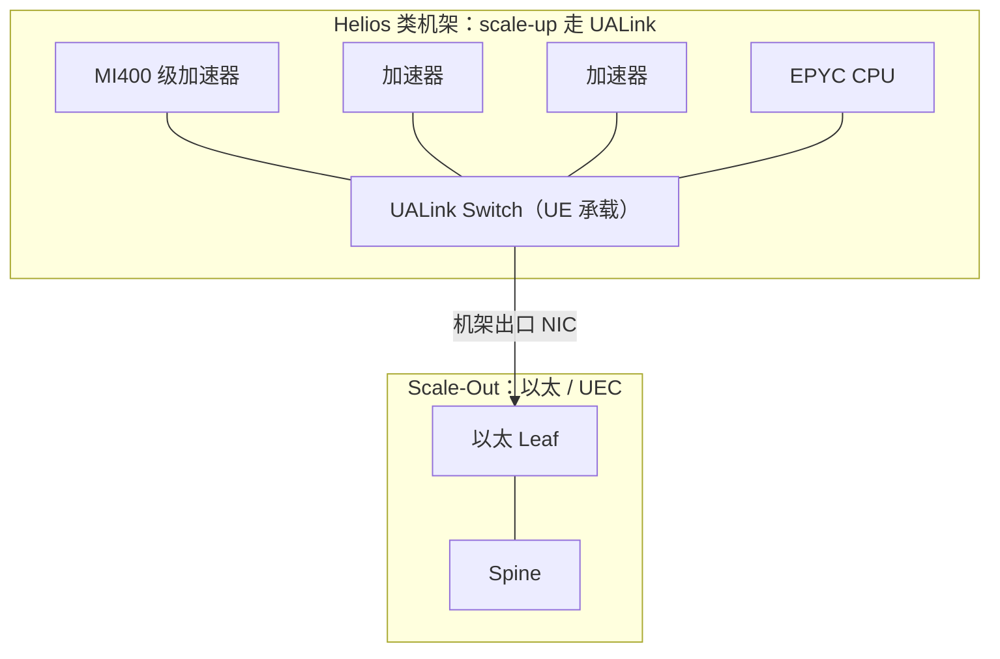

# UALink：开放互联标准

> 中文简称：UALink 开放互联标准

> **一句话理解**: UALink 是 AMD、Broadcom 等厂商组团制定的「开放版 NVLink」——机架内把最多上千个加速器连成一个域，不锁定在 NVIDIA 一家手里。

---

## 一、背景与动机

2024 年，AMD、Broadcom 等发起 UALink Consortium，随后多家芯片与云厂商加入，对标对象非常明确：NVLink 的封闭。

行业痛点在 scale-up 层没有开放标准：

- 自研芯片厂商要么自建柜内互联（成本与生态自担），要么被排除在 NVLink 生态之外。
- 超大规模玩家各自造私有互联，规模越小越造不起；二线云厂几乎没有可选的开放机架内互联。

时间线：2024 年联盟成立 → 2025-04 1.0 规范发布 → 2026 年前后首批系统（AMD Helios 为代表）。从立项到系统约两年，速度不慢，但对手 NVLink 已量产五代。

目标因此清晰：给行业一个开放、可多厂家供货的机架内加速器互联标准，让 scale-up 域不再是 NVIDIA 专属。

---

## 二、1.0 规范要点

```text
UALink 1.0 速记（2025-04 发布）
lane_rate   : 约 200Gbps / lane（规范宣称口径）
domain_size : 64 - 1024 个加速器
topology    : 交换式（UALink Switch）
semantics   : 内存语义（load / store / 原子操作）
lineage     : AMD Infinity Fabric 与 Broadcom 交换经验
```

要点解读：

- **单域 64-1024 个加速器**：规范视野远超当前商用 NVLink 域（NVL72 = 72），直指「一柜到多柜合一域」的未来形态。
- **内存语义直通对端显存**：load/store 与原子操作，定位与 NVLink 同类，服务张量并行这类高频小包通信。
- **技术血统**：AMD Infinity Fabric 的多加速器扩展经验，叠加 Broadcom 的交换芯片积累，起点不是从零画标准。
- **先有规范后有产品**：1.0 定义的是加速器到交换、交换到交换的协议层；商用硅片、网卡与软件栈要等成员逐个兑现。
- **口径提醒**：200Gbps/lane 是规范宣称值，与 NVLink「每链路 GB/s 双向」口径不可直接相除对比——先统一单位与方向再比（方法见速查页三步法）。

---

## 三、生态分工：UALink 与 UEC 各管哪段

开放阵营把网络拆成两段、两个标准各管一段：

- **scale-up（机架内）**：UALink，对标 NVLink/NVSwitch。
- **scale-out（跨机架）**：UEC（Ultra Ethernet）与传统以太（以及既有 IB），对标 Quantum 与 Spectrum-X。

一句话记忆：UALink 管「柜内一台大机器」，UEC 管「柜间一张大网」。两者拼起来才是完整的开放栈，分别对应 NVIDIA 体系里的 NVLink 域与 IB/以太 scale-out 网。

与 NVLink Fusion 的边界也要分清：Fusion 是把第三方芯片接进 NVIDIA 的私有 fabric；UALink 是换一套开放 fabric。两者解决同一个问题，路径相反。

---

## 四、与 NVLink 对比

| **维度** | **NVLink（NVIDIA）** | **UALink 1.0** |
|---|---|---|
| 授权模式 | 闭源私有（Fusion 定向开放） | 开放规范，成员授权实现 |
| 速率口径 | NVLink5 每链路 100GB/s 双向（4 lane） | 约 200Gbps / lane |
| 单域规模 | 商用 NVL72 = 72 GPU | 规范支持 64-1024 加速器 |
| 集合卸载 | NVSwitch 内 NVLS/SHARP | 1.0 以内存语义为主，网内计算待演进 |
| 生态成熟度 | 量产五代，NCCL/CUDA 全适配 | 规范发布初期，软件栈待建 |
| 多厂家供货 | 否（NVSwitch 仅 NVIDIA） | 是（AMD、Broadcom 等） |

读这张表的方法：性能列先换算口径再比，生态列才是当下真正的差距——NVLink 的护城河不只是速率，更是与之绑定的整套通信与调度软件。

---

## 五、AMD Helios 机架进展

AMD Helios 是首个公开绑定 UALink 的机架级方案，计划 2026 年随 MI400 系列加速器登场：

- 机架内多 GPU 以 UALink 互联，并采用 UALink over Ethernet 的承载方式——用以太网物理基础设施跑 UALink 协议，换取以太交换机与光模块的成熟供应链。
- 配套新一代 EPYC 服务器 CPU，机架形态向开放标准靠拢。
- 对设计者的信号：scale-up 专用协议与以太物理层开始「解耦」，机架内 fabric 的物理选型空间变大。
- 机架出口与 scale-out 的衔接（NIC 形态、rail 对齐）目前公开细节有限，设计时要等系统级白皮书。



图示含义：机架内 UALink 成域，机架间回归以太/UEC；UALink over Ethernet 让「域内协议」与「域间网络」可以共享一部分以太供应链。

---

## 六、风险与不确定性

1. **时间风险**：规范到芯片到系统的周期长，首批产品能否如期对标 NVLink5 代际存疑。
2. **软件生态**：NCCL 深度绑定 NVIDIA，ROCm 侧通信栈对 UALink 的支持成熟度未知，集合通信性能要实测说话。
3. **性能口径**：200G/lane 是规范宣称值，商用系统的实测持续带宽才是有效信息。
4. **联盟协调**：成员各有自研路线与商业利益，推进节奏可能分化。
5. **互操作碎片化**：多厂家 Switch/NIC 互操作的认证体系尚未经受大规模验证，早期采购要盯互操作测试结果。
6. **被以太路线收编的风险**：如果 UALink over Ethernet 形态成为主流，独立 UALink 交换芯片的空间可能被压缩，标准价值向协议层收缩。

---

## 交叉引用

- [[12_架构基建/08_网络/07_GPU_高网设计/01_分层体系/04_NVLink_Fusion|NVLink Fusion 开放生态]]
- [[12_架构基建/08_网络/07_GPU_高网设计/01_分层体系/01_Scale_Up_NVLink_NVSwitch|Scale-Up 互联 NVLink 与 NVSwitch]]
- [[12_架构基建/08_网络/07_GPU_高网设计/09_厂家/03_AMD_UALink_Pensando|AMD UALink 与 Pensando]]
- [[12_架构基建/08_网络/07_GPU_高网设计/04_协议传输/05_IB_vs_Ethernet_SpectrumX_UEC|IB 与以太阵营对比]]
- [[01_数学基础/10_AI硬件/07_NVIDIA_AMD_GPU_深入分析|NVIDIA 与 AMD GPU 深入分析]]

---

*Last updated: 2026-10-27*
