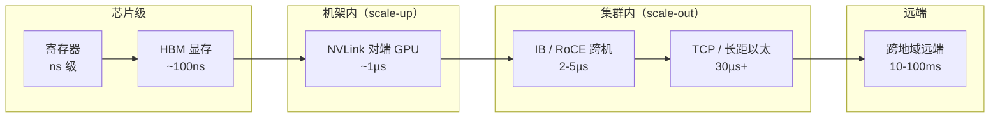

# 带宽延迟数量级速查

> 中文简称：带宽延迟数量级速查

> **一句话理解**: GPU 集群里从寄存器到跨地域机房，每远一层大约慢一个数量级——把这张表的量级背下来，看任何架构方案先在心里对一遍数。

---

## 一、主表：带宽数量级速查

| **互联 / 介质** | **带宽** | **口径** | **层级** | **典型用途** |
|---|---|---|---|---|
| HBM3e 显存（B200 级） | ~8TB/s | 每 GPU 聚合读写 | 芯片内 | 权重与激活读写 |
| NVLink5 | 1.8TB/s | 每 GPU 双向聚合 | 机内 scale-up | TP/EP 通信 |
| NVLink4 | 900GB/s | 每 GPU 双向聚合 | 机内 scale-up | TP/EP 通信 |
| NVLink3 | 600GB/s | 每 GPU 双向聚合 | 机内 scale-up | 节点内集合通信 |
| DDR5 内存 | ~0.5TB/s | 每 CPU 聚合读写 | 主机 | 数据预处理与 CPU 侧暂存 |
| PCIe 5.0 x16 | 128GB/s | 双向合计（单向 64GB/s） | CPU-GPU 之间 | 网卡、NVMe、CPU 交换 |
| IB XDR | 800G ≈ 100GB/s | 每方向线路速率 | 跨机 | 新一代集群主干 |
| IB NDR | 400G ≈ 50GB/s | 每方向线路速率 | 跨机 | 当前主流主干 |
| 200G 以太 | ≈ 25GB/s | 每方向线路速率 | 跨机 | 存储与中低配计算 |

用法说明：这张表只用来比数量级，不比小数——同一层内的差异靠实测，层与层之间差 10 倍以上就是架构问题，不是调优问题。

数量级体感：HBM3e 是 NVLink5 的 4 倍多、是 200G 以太端口的 300 倍量级；训练吞吐的瓶颈常常不在「最宽的那层」，而在「数据要跨几层」。

---

## 二、延迟档位速查

| **路径 / 操作** | **典型延迟** | **口径** |
|---|---|---|
| 寄存器 / 片上 SRAM | <1ns | 单次访问 |
| HBM 显存访问 | ~100-200ns | 单次访问 |
| NVLink 访问机内对端 GPU 显存 | ~1µs 级 | 单程，含 NVSwitch 一跳 |
| 交换机转发 | ~0.3-0.5µs | 每跳，端口到端口 |
| 跨机 RDMA 单程 | ~2-5µs | 单程，含一至两跳交换 |
| TCP socket | 30µs 起 | 同机房 RTT |
| 跨可用区 | ~1ms | RTT |
| 跨地域内存访问 | 10-100ms | RTT |

两个直接推论：交换机每跳 0.3-0.5µs，意味着 CLOS 每加一层都要付真实延迟预算；TCP 与 RDMA 差约一个数量级，这就是训练主干必须走 RDMA 的原因。

读延迟表同样先看口径列：同机房 TCP 的 30µs 是 RTT，跨机 RDMA 的 2-5µs 是单程，两个数直接相减会高估差距一倍。

---

## 三、「越近越快」层级图



图的读法：越靠左越快也越贵。高网架构的本质，就是把热数据与热通信不断往左搬——放不下的部分才逐级向右溢出，每向右一级都要付一个数量级的代价。

---

## 四、读数字先问口径：三步法

发布会与规格书里的数字不可直接比，按顺序问三个问题：

1. **第一步问方向**：单向还是双向？NVLink 官方口径全部是双向（1.8TB/s 即单向 900GB/s）；PCIe 的 128GB/s 是双向合计；而网络端口的 400G/800G 习惯上指每方向线路速率——三套习惯并存，最易踩坑。
2. **第二步问峰值还是持续**：标称峰值与实测持续是两回事。NCCL 的 busbw 达到线速几成才是健康指标；编码开销（如 64b/66b）让有效载荷天然低于线路速率。
3. **第三步问聚合还是单链路**：130TB/s 是 NVL72 的机架聚合口径（72 × 1.8TB/s），单卡可用仍是 1.8TB/s；每节点 8×400G = 3.2T 是节点聚合口径，单条链路只有 400G。

一个练习：看到「800G 端口」先过一遍三步——每方向线路速率 100GB/s、扣编码与协议开销有效再降、NCCL busbw 实测又是另一层口径。

三步走完，两个「看起来可比」的数字才真正可比。

---

## 五、常见误读与换算陷阱

- **误读一**：把 NVL72 的 130TB/s 当单卡可用带宽——那是 72 卡聚合口径。
- **误读二**：拿 HBM 8TB/s 与 NVLink 1.8TB/s 相除得「通信只慢 4 倍」——忽略集合通信的放大系数与排队效应。
- **误读三**：把 400G 端口速率当有效吞吐——400G 是每方向线路速率，扣编码与协议开销后有效低于 50GB/s，集合通信还要再打折。
- **误读四**：跨机房链路「带宽够就行」——ms 级 RTT 下单流吞吐受带宽时延积限制，必须靠并行流摊。
- **误读五**：拿不同体系的口径直接比代际——NVLink 的每链路 GB/s 双向口径与 UALink 的 Gbps/lane 口径混着除，得出的「倍数」没有意义。
- **换算锚点**：Gb/s ÷ 8 = GB/s；1TB = 1000GB。直传 1GB 数据在单向 50GB/s 线路速率下约 20ms——大对象搬运永远要靠并行链路摊。

实测自己集群的持续带宽：

```bash
# 用 NCCL 实测：busbw 即总线带宽口径，直接对标理论线速
all_reduce_perf -b 512M -e 8G -f 2 -g 8
# 看输出里 algbw 与 busbw 两列：busbw 达到线速七成以上为健康，低于五成先查拓扑与链路
```

---

## 交叉引用

- [[12_架构基建/08_网络/07_GPU_高网设计/01_分层体系/01_Scale_Up_NVLink_NVSwitch|Scale-Up 互联 NVLink 与 NVSwitch]]
- [[12_架构基建/08_网络/07_GPU_高网设计/01_分层体系/02_Scale_Out_IB_RoCE_TCP|Scale-Out 互联三档选型]]
- [[12_架构基建/08_网络/07_GPU_高网设计/05_集合通信/06_NCCL_Tests_Reading|NCCL 测试结果解读]]
- [[12_架构基建/08_网络/07_GPU_高网设计/05_集合通信/02_Ring_vs_Tree_AllReduce|Ring 与 Tree AllReduce]]
- [[12_架构基建/08_网络/07_GPU_高网设计/06_推理网络/01_Training_vs_Inference_Traffic|训练与推理流量对比]]
- [[概念/GPU/gpu-interconnect|GPU 互联]]

---

*Last updated: 2026-10-27*
