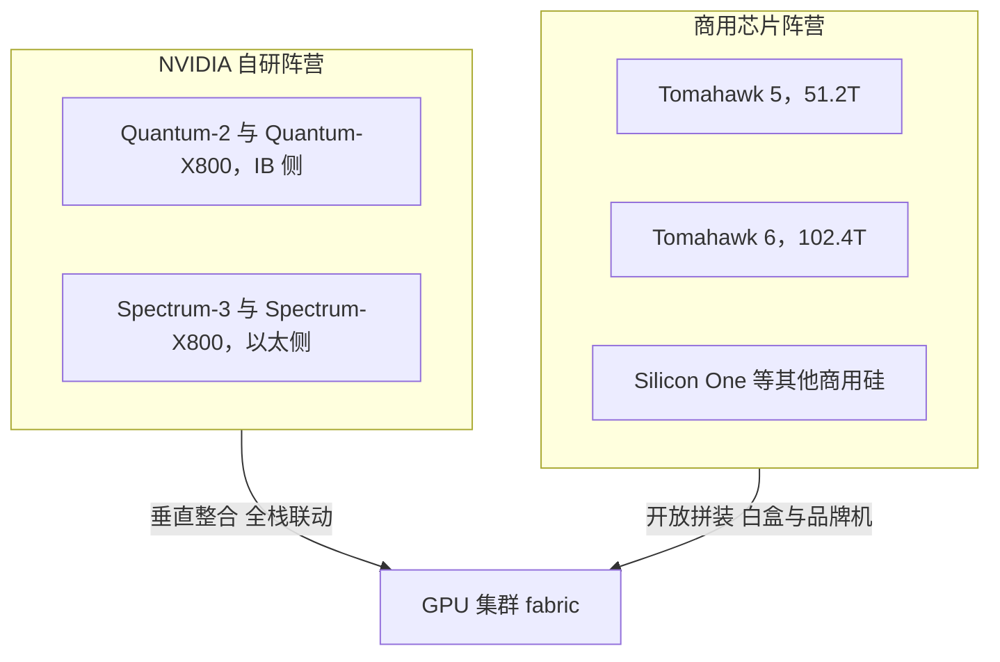

# 交换机代际与阵营

> 中文简称：交换机代际与阵营

> **一句话理解**: 交换机是 GPU 集群的"路网"——先分清 NVIDIA 自研与商用芯片两大阵营，再用容量、端口、buffer 三个参数对号入座，选型就不会跑偏。

---

## 一、两大阵营：NVIDIA 自研 vs 商用芯片

GPU 高性能网络的交换机供给侧只有两条主线：NVIDIA 用自研芯片把 InfiniBand 与 AI 以太（Spectrum-X）做成垂直整合的全家桶；Broadcom 等商用芯片厂商提供开放硅片，由品牌商与白盒 OEM 拼成整机，跑 SONiC / CUMULUS 等网络 OS。两条路线决定了采购、运维乃至故障定位的整套玩法。

| 阵营 | 产品 | 侧别 | 芯片容量 | 端口形态 | 典型生态位 |
|---|---|---|---|---|---|
| **NVIDIA IB** | Quantum-2 | InfiniBand | 25.6T 级 | 64 × 400G（NDR） | 当前主力训练集群 |
| **NVIDIA IB** | Quantum-X800 | InfiniBand | 115.2T（百 T 级） | 144 × 800G（XDR） | 万卡级新一代 |
| **NVIDIA 以太** | Spectrum-3 | 以太 | 51.2T | 64 × 800G 或 128 × 400G | AI 以太与通用负载兼用 |
| **NVIDIA 以太** | Spectrum-X800 | 以太 | 百 T 级 | 800G 口 | 与 BlueField 网卡联动的 Spectrum-X 生态 |
| **商用芯片** | Tomahawk 5 | 以太 | 51.2T | 512 条 100G 电通道灵活切分 | 白盒与品牌机的主力芯片 |
| **商用芯片** | Tomahawk 6 | 以太 | 102.4T | 面向 1.6T 端口方向 | 2025 年发布，首个 102.4T 以太芯片 |

读这张表的三个要点：

- IB 侧 Quantum 系列绑定 SHARP 在网计算、自适应路由与自愈网络，是"网络替集合通信干活"的极致路线。
- 以太侧 Spectrum-X 的定位是"以太侧的 IB 化"：自适应路由加性能隔离，配合 NVIDIA 自家网卡端到端调优。
- 商用芯片阵营不绑定网卡：Broadcom 交换配任意 RoCE 网卡都能组网，胜在开放生态与议价空间，是云厂商大规模部署的主流选择。



上半部分是"芯片-网卡-协议栈"的垂直整合路线，下半部分是商用硅片加白盒或品牌机加开源网络 OS 的水平分工路线；两条路线在同一个集群里通常不混用。

---

## 二、交换芯片三个关键参数

看一颗交换芯片，先盯住三个数：

1. **总容量（Tbps）**：决定这一代芯片能撑多大规模的集群。25.6T 是 400G 口主力，51.2T 对应 800G 口当代，102.4T 面向 1.6T 端口方向。
2. **端口数 × 单口速率**：决定组网形态。同为 51.2T，64 × 800G 与 128 × 400G 的 leaf 下行带卡数完全不同，直接影响 CLOS 层数与台数（见 [[12_架构基建/08_网络/07_GPU_高网设计/03_拓扑设计/04_CLOS_Two_Three_Layer_Scaling|CLOS 两三层扩展]]）。
3. **buffer 深度与 RoCE 适配**：buffer 越深越能吸收 AllReduce incast 的多打一突发；RoCE 无损依赖 PFC/ECN 精细调优，芯片的 buffer 共享策略（静态分片还是全共享）决定突发上限与 PFC 风暴的破坏力。

| 参数 | 怎么看 | 对集群的影响 |
|---|---|---|
| **总容量** | 25.6T、51.2T、102.4T 三档 | 同规模集群的层数或台数随容量翻倍减半 |
| **端口配置** | 64 × 400G、64 × 800G、128 × 400G | 决定每台 leaf 下行带卡数与 spine 收敛比 |
| **buffer 与无损** | 深浅、共享策略、PFC/ECN 粒度 | incast 吸收能力，决定整网有效带宽 |

一个常被忽略的点：容量相近的两颗芯片，buffer 行为差异能让实际 AllReduce 性能差出两位数百分比——纸面容量只保证"能跑"，buffer 与调优决定"跑满"。

---

## 三、代际翻倍节奏

以太交换芯片容量按"每代 ×2"推进：12.8T → 25.6T → 51.2T → 102.4T（Tomahawk 6 于 2025 年发布）。节奏约 2-3 年一代，驱动因素是 SerDes 电通道速率与光模块速率同步翻倍——芯片代际、端口速率、光模块封装三者绑死，跨代混配要么浪费投资、要么制造瓶颈。

容量换算的算术：

```text
51.2 Tbps = 512 条 100G 电通道 = 64 × 800G = 128 × 400G
102.4 Tbps = 51.2T × 2（靠电通道速率翻倍或通道数翻倍实现）
```

代际选择的实操含义：买交换机本质是"买代际"。芯片容量定死这一代 fabric 的端口速率上限，超过上限的扩容只能整代替换；因此规模规划通常让交换代际略超前于网卡代际半步。

---

## 四、白盒 vs 品牌机

同一颗商用芯片（如 Tomahawk 5）既能出现在品牌交换机里，也能出现在白盒整机里，差别在整机工程、软件栈与责任界面：

| 维度 | 白盒（商用芯片 + ODM） | 品牌机（NVIDIA / 思科 / Juniper 等） |
|---|---|---|
| **硬件成本** | 低三到五成（同芯片） | 高，含品牌溢价与整机验证成本 |
| **网络 OS** | SONiC / CUMULUS / FBOSS | MLNX-OS / EOS / NX-OS 原厂绑定 |
| **无损调优** | 社区配置基线，需自研调优 | 厂商出厂调优，IB 天然无损 |
| **故障责任** | 多方界面（芯片、ODM、NOS 社区） | 单一厂商 TAC 兜底 |
| **供货周期** | 随代工产能波动，需锁产能 | 品牌队列，大客户优先 |
| **适用场景** | 大规模且有自研网络团队 | 追求确定性与快速交付 |

经验法则：有自研网络团队、追求极限单位成本的大规模集群走白盒加 SONiC；追求交付确定性与单一责任界面的中小集群走品牌机。IB 侧没有白盒选项，Quantum 全系 NVIDIA 整机。

---

## 五、选型清单

落地选型按清单逐项过，避免只看容量一个数：

1. **容量与端口形态**：卡数 × NIC 速率 ÷ 每 leaf 下行口数得出台数；leaf 与 spine 尽量同代芯片，避免上行口速率错配。
2. **功耗**：整机功耗数千 W 级，重点核对满配光模块后的整机上限——光模块功耗常占整机三分之一以上，风量与供电都按满配预留。
3. **生态**：SONiC 社区对该芯片的 SAI 支持深度、CUMULUS 授权模式、与现有 gNMI streaming telemetry 监控栈的对接成本。
4. **无损特性**：PFC 水位、ECN 阈值能否逐端口精细配置；buffer 共享行为有无公开文档。
5. **供货周期**：高峰期整机交付以季度计，必须有第二供应源或提前锁产能。
6. **与网卡代际配套**：ConnectX-7（400G）对应 Quantum-2 与 Spectrum-3 代；ConnectX-8（800G）对应 Quantum-X800 与 Spectrum-X800 代，错配会浪费一侧投资。

```bash
# 交付验收 sanity check（SONiC 示例）
show interface status            # 端口速率与连接状态
show interfaces counters errors  # 错包计数，交付时应为 0
# CUMULUS 示例
nv show interface --view=summary
```

验收口径两条：端口数 × 单口速率不超过芯片标称容量；任何端口错误计数非零都要在交付阶段清零或换件。

---

## 交叉引用

- [[12_架构基建/08_网络/07_GPU_高网设计/02_物理层硬件/02_NIC_and_DPU|网卡与 DPU]]
- [[12_架构基建/08_网络/07_GPU_高网设计/02_物理层硬件/03_Optical_Modules|光模块与光互连]]
- [[12_架构基建/08_网络/07_GPU_高网设计/03_拓扑设计/01_Fat_Tree_CLOS|胖树 CLOS 拓扑]]
- [[12_架构基建/08_网络/07_GPU_高网设计/09_厂家/01_NVIDIA_Networking_Stack|NVIDIA 网络全家桶]]
- [[12_架构基建/08_网络/07_GPU_高网设计/09_厂家/02_Broadcom_Switching|Broadcom 交换]]
- [[12_架构基建/08_网络/07_GPU_高网设计/README|GPU 高网设计总索引]]

---

*Last updated: 2026-10-27*
