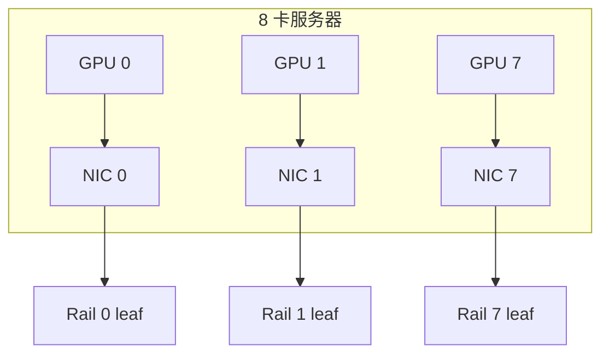

# 网卡与 DPU

> 中文简称：网卡与 DPU

> **一句话理解**: 网卡是 GPU 数据出口的"闸口"，8 卡机 1:1 配 8 张高速网卡是行业共识；DPU 则是在网卡基础上再挂一层卸载引擎。

---

## 一、代际与阵营

ConnectX 系列是 GPU 集群网卡的事实标准，代际与交换机代际一一对应：

| 产品 | 端口速率 | PCIe 通道 | 配套交换机 | 典型场景 |
|---|---|---|---|---|
| **ConnectX-7** | 400G（单口 400G 或 2 × 200G） | Gen5 x16 | Quantum-2 / Spectrum-3 | H100/H200 集群标配 |
| **ConnectX-8** | 800G | Gen5 x16 | Quantum-X800 / Spectrum-X800 | Blackwell 代大集群 |
| **BlueField-3（DPU）** | 400G 级 | Gen5 x16 | 与 CX-7 同代 | 存储、安全卸载节点 |

带宽口径备注：PCIe Gen5 x16 双向 128GB/s（单向 64GB/s）。400G 网卡单向 50GB/s，Gen5 x16 尚有余量；800G 网卡单向 100GB/s，把 Gen5 x16 基本吃满——800G 代际下 PCIe 通道本身成为需要盯的瓶颈，跨 PCIe switch 的拓扑安排更显重要。

NVIDIA 之外的选项，定性了解即可：

- **Intel E810**：100G/200G 以太 RoCEv2 网卡，常见于 Gaudi 生态；RoCE 卸载与队列规模弱于 ConnectX，需在真实负载下实测打满能力。
- **Broadcom NetXtreme 系列**：商用以太网卡，支持 RoCE，主力场景是通用云而非 GPU 集群。
- 国产 DPU 与网卡在通用云场景可用性尚可，但 GPUDirect、SHARP 这类 GPU 网络专属能力的软件栈成熟度要逐项验证，不能只看端口速率。

---

## 二、为什么 8 卡机配 8 张网卡（1:1）

三个原因都指向同一件事：让每张 GPU 独享一条高速出口。

1. **rail 对齐**：8 张网卡分别上到 8 个 rail（网络平面）的 leaf，NCCL 的 ring/tree 通信尽量在同一个 rail 内闭环，把跨 rail 流量压到最小。
2. **避免上行汇聚瓶颈**：若 8 张 GPU 共享 1-2 张网卡，PCIe 与网卡端口两级排队；1:1 时每卡独占 400G 出口，与单卡 scale-out 带宽预期匹配。
3. **PCIe 通道匹配**：8 卡服务器是多 PCIe switch 拓扑，每张 GPU 所在的 PCIe switch 旁恰好放一张网卡，Gen5 x16 点对点直连，不绕行 root complex。



每个 GPU 与自己的网卡同处一个 PCIe switch 域，再各自上行到所在 rail 的 leaf——这是 rail-optimized 拓扑在物理层的根基，拓扑侧展开见 [[12_架构基建/08_网络/07_GPU_高网设计/03_拓扑设计/03_Rail_Optimized_Topology|Rail-Optimized 拓扑]]。

反面教材：2 张 400G 网卡带 8 张 GPU，单卡平均出口只有 100G，且任一网卡故障会同时打残 4 张 GPU 的 scale-out 通道——性能与故障域双双恶化。

---

## 三、网卡关键参数怎么看

| 参数 | 量级或口径 | 为什么重要 |
|---|---|---|
| **端口速率** | ConnectX-7 400G；ConnectX-8 800G | 与交换机代际、光模块封装联动，决定 fabric 上限 |
| **RDMA 引擎与队列数** | 硬件队列数百至数千 | 多进程并发与多租户隔离时能否打满线速 |
| **SHARP 支持** | ConnectX 配合 Quantum 交换机 | AllReduce 在网聚合，降时延、省上行带宽 |
| **GPUDirect 家族** | GPUDirect RDMA / Storage | 显存与网络直通，省 CPU 中转拷贝 |
| **PCIe Gen5 x16** | 双向 128GB/s | 800G 网卡下通道利用率逼近上限 |
| **自适应路由与自愈** | IB 侧特性 | 链路降级时流量自动绕行，训练不 hang |

参数背后是三个能力位阶：线速（能不能跑满）、卸载（CPU 是否零参与）、韧性（坏了怎么办）。选型时按这三个位阶逐项追问供应商，比背参数表有效。

---

## 四、BlueField DPU：比普通 NIC 多做什么

普通 ConnectX 已经把 RDMA 完整卸载到硬件；DPU（BlueField 系列）是在 NIC 基础上加了可编程 ARM 核与独立操作系统，额外接管四类工作：

1. **存储**：NVMe-oF 卸载，配合 GPUDirect Storage 让远端盘直达显存。
2. **安全**：line-rate 的 IPsec/TLS 线速加解密，不占宿主 CPU。
3. **遥测**：flow 级 telemetry 在 DPU 侧聚合上报，减少主 CPU 与管理网开销。
4. **控制面隔离**：OVS、防火墙、DDoS 防护跑在 DPU 独立 OS 上，宿主机出问题不影响网络控制面。

| 能力 | 普通 NIC（ConnectX） | DPU（BlueField） |
|---|---|---|
| **RDMA 卸载** | 有 | 有 |
| **存储卸载** | 基础 | NVMe-oF 全卸载 |
| **安全加解密** | 有限或无 | line-rate IPsec/TLS |
| **控制面隔离** | 无 | 独立 OS 加 ARM 核 |
| **功耗与成本** | 低一档 | 高一档 |

部署上的经验：GPU 训练算力节点大多用普通 ConnectX（RDMA 已够用、功耗更低）；DPU 更适合存储节点、多租户云宿主机与需要网络侧安全隔离的推理平台。

---

## 五、故障模式

网卡三类高发故障，按隐蔽程度排序：

1. **降速（downshift）**：链路某条 lane 误码超标后整体掉档，400G 掉到 200G 甚至 100G，业务不中断但带宽腰斩。最隐蔽，必须靠定时速率核对抓出来。
2. **链路抖动（flapping）**：端口反复 up/down，多与光模块、线缆、金手指接触相关；表现为 NCCL 训练周期性 hang，是最容易误判为软件问题的硬件故障。
3. **固件坑**：固件与驱动、网络 OS 版本不匹配，出现队列异常、RoCE 卸载失效、重启丢配置等怪象。

```bash
# 网卡巡检三件套
ibstat                    # IB 端口状态与实际协商速率
ethtool ens1f0            # 链路速率与双工
ethtool -i ens1f0         # 驱动与固件版本
```

巡检要点：核对"实际协商速率"与"配置速率"一致；固件版本与集群基线版本逐一比对。完整诊断命令链见 [[12_架构基建/08_网络/07_GPU_高网设计/07_运维故障/02_Network_Diagnostics_Command_Chain|网络诊断命令链]]。

---

## 六、固件管理

固件是网卡稳定性的第一变量，管理要点三条：

1. **版本矩阵先行**：固件 + 驱动（MLNX_OFED）+ 交换机 OS 的三方兼容矩阵，升级前先核对，不在矩阵内的组合不进生产。
2. **全集群统一版本**：混版本是疑难杂症的头号来源；灰度顺序为 spare 节点、单机柜、全量。
3. **staged 升级**：先烧录到 staged 分区，在维护窗口重启生效，失败可回退，避免"升级即事故"。

```bash
mlxfwmanager --query                          # 全量清点固件版本
mlxfwmanager -i fw-ConnectX7_rel.mlx --staged # 预烧 staged 分区，重启生效
mlxconfig -d /dev/mft/mt4129 query | grep -E "LINK_TYPE|SRIOV"  # 关键配置核对
```

与交换机代际的配套关系、网卡与光模块的数量配比推算，分别见 [[12_架构基建/08_网络/07_GPU_高网设计/02_物理层硬件/01_Switch_Generations|交换机代际与阵营]] 与 [[12_架构基建/08_网络/07_GPU_高网设计/02_物理层硬件/04_Component_Ratio_Cost|器件配比与成本结构]]。

---

## 交叉引用

- [[12_架构基建/08_网络/07_GPU_高网设计/02_物理层硬件/01_Switch_Generations|交换机代际与阵营]]
- [[12_架构基建/08_网络/07_GPU_高网设计/02_物理层硬件/04_Component_Ratio_Cost|器件配比与成本结构]]
- [[12_架构基建/08_网络/07_GPU_高网设计/03_拓扑设计/03_Rail_Optimized_Topology|Rail-Optimized 拓扑]]
- [[12_架构基建/08_网络/07_GPU_高网设计/04_协议传输/06_GPUDirect_Family|GPUDirect 家族]]
- [[12_架构基建/08_网络/07_GPU_高网设计/04_协议传输/04_SHARP_In_Network_Computing|SHARP 在网计算]]
- [[12_架构基建/08_网络/07_GPU_高网设计/09_厂家/01_NVIDIA_Networking_Stack|NVIDIA 网络全家桶]]
- [[概念/GPU/gpu-direct|GPUDirect]]
- [[12_架构基建/08_网络/07_GPU_高网设计/README|GPU 高网设计总索引]]

---

*Last updated: 2026-10-27*
