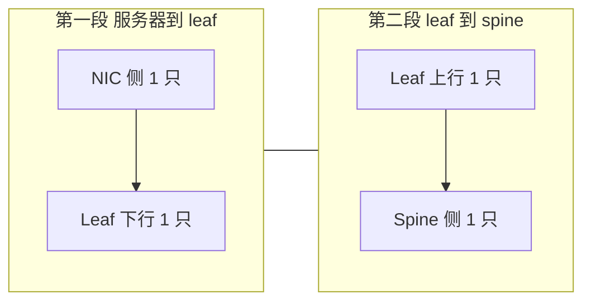

# 器件配比与成本结构

> 中文简称：器件配比与成本结构

> **一句话理解**: 数一遍两层胖树里每条 GPU 链路穿过的器件，就能推出"光模块是 GPU 的 3-5 倍"，网络占集群 CAPEX 的账也就算得清了。

---

## 一、配比怎么算

### 一条链路穿 4 个光模块

两层胖树（leaf-spine）下，一条 GPU 跨 leaf 流量的路径是 NIC → leaf → spine → 对端 leaf → 对端 NIC。全光部署时每段链路两端各一只模块：

- NIC 侧 1 只 + leaf 下行 1 只：第一段（服务器到 leaf）共 2 只；
- leaf 上行 1 只 + spine 侧 1 只：第二段（leaf 到 spine）共 2 只；
- 一来一回共用同一组布线，单条 GPU 链路合计 4 只光模块。



图示：一条 GPU 链路在两层胖树里穿越两段链路、消耗 4 只光模块。若 NIC 到 leaf 同柜改用 DAC，第一段的 2 只省去，配比降为每 GPU 3 只；再叠加管理网、带外、备件与跨柜光缆，就得到"光模块为 GPU 数 3-5 倍"的经验区间。

### 台数与收敛比公式

```text
网卡数     = GPU 数 × 1（1:1 配比）
leaf 台数  = GPU 数 ÷ 每 leaf 下行口数
spine 台数 = (leaf 台数 × 每 leaf 上行口数) ÷ 每 spine 端口数
收敛比     = 全网下行总带宽 : 全网上行总带宽
```

联动关系：spine 台数与收敛比强耦合——收敛比放宽一档，spine 台数与 leaf 上行侧模块数同比例下降，这是降本最直接的杠杆。收敛比设计的业务侧权衡见 [[12_架构基建/08_网络/07_GPU_高网设计/03_拓扑设计/02_Oversubscription_Design|收敛比设计]]，拓扑基础见 [[12_架构基建/08_网络/07_GPU_高网设计/03_拓扑设计/01_Fat_Tree_CLOS|胖树 CLOS 拓扑]]。

---

## 二、网络在 CAPEX 里的位置

- 网络占集群总 CAPEX 约 10%-20%（口径：网卡 + 交换机 + 光模块 + 线缆与配线 + 接入，不含 GPU 服务器本体）。
- IB 方案相对以太方案存在结构性溢价：专网设备（Quantum 与通用以太不混用）+ 软件许可（UFM 等管理套件）+ 封闭生态的议价劣势；换来无损、SHARP 与自适应路由的开箱能力，协议路线对比见 [[12_架构基建/08_网络/07_GPU_高网设计/04_协议传输/05_IB_vs_Ethernet_SpectrumX_UEC|IB vs 以太]]。

| 成本块 | 大头项 | 弹性来源 |
|---|---|---|
| **交换机** | leaf 与 spine 台数 × 单价 | 拓扑层数与收敛比 |
| **光模块** | 数量为 GPU 的 3-5 倍 | DAC/LPO 替换、代际选择 |
| **网卡** | 1:1 配比，线性于 GPU 数 | 代际与 DPU 取舍 |
| **线缆与施工** | 光纤跳线、MPO、配线架 | 常被低估一成上下 |

---

## 三、1024 卡集群 BOM 数量级

口径：400G、两层胖树、收敛比 1:1、128 台 8 卡机；leaf 用 64 口（32 下行 + 32 上行）、spine 用 64 口。

```python
gpus = 1024
servers = gpus // 8                  # 128 台
nics = gpus                          # 1:1 配比 → 1024 张
cards_per_leaf = 32                  # 每 leaf 下行带 32 卡
leafs = gpus // cards_per_leaf       # 32 台
uplinks = leafs * 32                 # leaf 上行共 1024 条
spines = uplinks // 64               # 16 台
modules = nics + gpus * 2 + uplinks  # NIC 侧 + leaf 两排 + spine 侧
# modules = 1024 + 2048 + 1024 = 4096 ≈ 4 × GPU
```

| 物料 | 数量级 | 备注 |
|---|---|---|
| **GPU 服务器** | 128 台 | 8 卡每台 |
| **400G 网卡** | 1024 张 | 1:1 配比 |
| **leaf 交换机** | 32 台 | 64 口：32 下行 + 32 上行 |
| **spine 交换机** | 16 台 | 64 口 |
| **400G 光模块** | 约 4100-4300 只 | 4 × GPU，另加 1%-3% 备件 |
| **DAC** | 0-1024 条 | NIC 与 leaf 同柜走铜时光模块降为 3 × GPU |
| **光纤跳线与 MPO** | 2000 根以上 | leaf-spine 1024 条链路两端 |

两个敏感性：收敛比放宽到 2:1，spine 台数与上行侧模块近乎减半；换 800G 代际，网卡与模块数量减半但单价与功耗上升，总账要按当期行情重算。

---

## 四、OPEX：功耗、备件、专线

1. **功耗**：800G 光模块每只 10-20W 级，数千只即数十 kW 级；加上整机数千 W 的交换机，网络总功耗常占集群 5%-10%，电费与散热容量都要按此预留。
2. **备件**：光模块按在网 1%-3%、交换机按 N+1；备件是持续性现金流占用而非一次性 CAPEX。
3. **专线与 DCI**：多园区训练与 PD 分离推理的 KV 传输对专线带宽与时延敏感，专线月租在 OPEX 里随规模线性上涨（见 [[12_架构基建/08_网络/07_GPU_高网设计/06_推理网络/03_PD_Disaggregation_KV_Transfer|PD 分离 KV 传输]]）。

---

## 五、降本四杠杆

| 杠杆 | 做法 | 直接效果 | 代价 |
|---|---|---|---|
| **收敛比放宽** | 1:1 放到 2:1 或 3:1 | spine 台数与上行模块按比例减 | 跨 leaf 高峰排队，需与通信模式匹配 |
| **DAC 与 LPO 替换** | 机柜内铜缆、短距 LPO | 模块数量与功耗双降 | 距离受限，LPO 互操作要验证 |
| **白盒 + SONiC** | 商用芯片 + 开源 NOS | 硬件折价、供应多元化 | 需要自研网络团队与调优能力 |
| **复用以太运维体系** | 与通用云共用监控、备件、技能 | 双体系 OPEX 显著低于并行 | 放弃 IB 侧 SHARP 等专有能力 |

典型组合：训练主 fabric 保留 IB 求性能确定性，存储、管理、推理周边流量走以太白盒摊薄成本——双网并存时必须把双轨运维成本算进总账，否则省下的 CAPEX 会从 OPEX 漏出去。

模型化的 CAPEX 测算与逐条 walkthrough 见 [[12_架构基建/08_网络/07_GPU_高网设计/08_容量成本/02_Network_CAPEX_Model|网络 CAPEX 模型]] 与 [[12_架构基建/08_网络/07_GPU_高网设计/08_容量成本/01_Topology_Sizing_Walkthrough|拓扑容量推演]]。

---

## 交叉引用

- [[12_架构基建/08_网络/07_GPU_高网设计/02_物理层硬件/03_Optical_Modules|光模块与光互连]]
- [[12_架构基建/08_网络/07_GPU_高网设计/02_物理层硬件/05_Intra_Rack_Copper|机柜内互连与铜缆]]
- [[12_架构基建/08_网络/07_GPU_高网设计/03_拓扑设计/01_Fat_Tree_CLOS|胖树 CLOS 拓扑]]
- [[12_架构基建/08_网络/07_GPU_高网设计/03_拓扑设计/02_Oversubscription_Design|收敛比设计]]
- [[12_架构基建/08_网络/07_GPU_高网设计/08_容量成本/01_Topology_Sizing_Walkthrough|拓扑容量推演]]
- [[12_架构基建/08_网络/07_GPU_高网设计/08_容量成本/02_Network_CAPEX_Model|网络 CAPEX 模型]]
- [[12_架构基建/08_网络/02_AI_网络|AI 网络总览]]
- [[12_架构基建/08_网络/07_GPU_高网设计/README|GPU 高网设计总索引]]

---

*Last updated: 2026-10-27*
