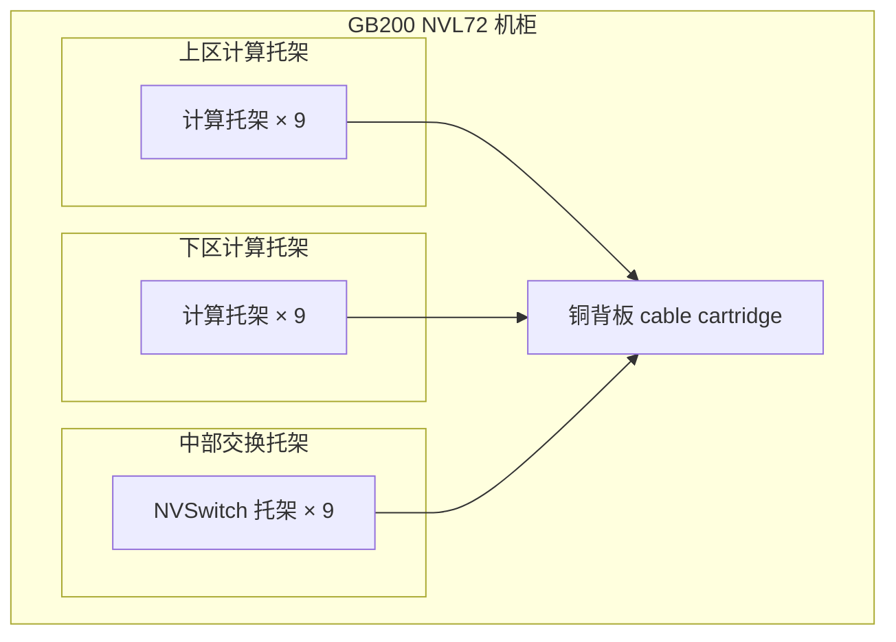

# 机柜内互连与铜缆

> 中文简称：机柜内互连与铜缆

> **一句话理解**: 机柜内的 scale-up 域优先用铜——功耗和成本比光低一个量级，GB200 NVL72 的铜背板就是把这件事做到极致。

---

## 一、机柜内为什么优先铜

四个理由，按权重排序：

1. **功耗低一个量级**：无源铜缆近零功耗；同速率链路走光模块每只要吃 10-20W 级。scale-up 域链路数量巨大（NVL72 内部有 5000 余条 NVLink 铜缆），全光化的功耗与散热根本不可接受。
2. **成本低**：DAC 单价是同速率光模块的零头，乘上巨大的链路数后节省显著。
3. **误码率低**：短距铜传输信号完整性天然好，没有光电转换环节；故障模式简单——要么好、要么断，很少有"慢慢劣化"的中间态。
4. **免光模块运维**：连带免掉清洁、光功率监控、光备件这一整套负担，机柜内故障面大幅收窄。

对比口径：NVLink4 双向 900GB/s、NVLink5 双向 1.8TB/s（NVIDIA 官方口径均为双向）。scale-up 域总带宽需求随 GPU 代际翻倍，铜用"短距离"换"低功耗与低成本"的交易越显划算。

---

## 二、GB200 NVL72 铜背板设计

GB200 NVL72 把 72 张 Blackwell GPU 与 36 颗 Grace CPU 装进一个液冷机柜，scale-up 域用铜背板完成 NVLink 互联：

- **托架布局**：18 个计算托架分布在上、下两区，9 个 NVSwitch 托架居中——交换居中让铜缆到各计算托架的距离最短且均衡。
- **可维护铜缆托架（cable cartridge）**：5000 余条 NVLink 铜缆收束到机柜后部的线缆托架与背板模块，支持整组件拆装维护，不需要逐根拔线。
- **机电统筹**：机柜级供电母排与液冷 manifold 在机柜设计期就与铜缆通道统一规划，避免投产后加装冲突。



计算托架从上、下两个方向向中部 NVSwitch 收束，全部 NVLink 互连经铜背板完成；scale-up 域的 NVLink/NVSwitch 体系见 [[12_架构基建/08_网络/07_GPU_高网设计/01_分层体系/01_Scale_Up_NVLink_NVSwitch|Scale-Up：NVLink 与 NVSwitch]]。

---

## 三、DAC 距离极限与布线密度

- **距离**：无源 DAC 在 400G/800G 下有效距离约 2-3m（800G 更短），超过即信号完整性崩塌。这就是"机柜内用铜、出柜走光"的物理边界。
- **密度**：800G DAC 内含 8 对差分线，线径粗、弯曲半径大；单柜几十上百条时，理线架、束线与风道的冲突成为工程难点。
- **工艺**：铜缆束的弯曲半径与理线工艺要在机柜设计期排布，投产后"塞不进"没有解药。
- **实操口径**：计算托架与 leaf 同柜或紧邻柜才规划 DAC；跨柜一律 AOC 或光模块。

```text
400G DAC：约 3m 内可用，1-2m 最稳
800G DAC：约 2m 内可用，常见 1m 规格
AEC：约 3-7m，再往上用光
```

---

## 四、无源 DAC vs 有源 AEC

| 维度 | 无源 DAC | 有源 AEC |
|---|---|---|
| **内部结构** | 纯铜缆、无芯片 | 两端内置 retimer 或 redriver |
| **有效距离** | 约 2-3m | 约 3-7m |
| **功耗** | 近零 | 每端数 W 级，仍远低于光模块 |
| **成本** | 最低 | 介于 DAC 与光模块之间 |
| **信号质量** | 依赖收发端均衡 | retimer 重定时，眼图重生 |
| **典型位置** | 机柜内 scale-up 与上行 | 同排相邻机柜的 400G/800G |

AEC 的价值是把"铜的经济学"从 3m 拓到 7m，正好覆盖同排相邻机柜这段最尴尬的距离。

---

## 五、液冷机柜对网络的影响

液冷解决了 GPU 与交换机本体的散热，但网络侧仍有三个热区与工程约束：

1. **光模块出机柜仍是热区**：scale-up 走铜后，scale-out 的 NIC 与 leaf 侧光模块（每只 10-20W 级）仍挂在托架边缘，需要风冷或冷板专项照顾，是液冷机柜里残留的"高温小岛"。
2. **冷板与线缆走向冲突**：冷板管路、快接头（QD）与铜缆、光纤的通道必须机柜设计期统筹；投产后再加线往往要动管路。
3. **维护窗口重构**：换线缆可能涉及冷板环路操作——泄压、拔插、复压、排气，窗口时长与 SOP 都与风冷时代完全不同。

功耗与液冷的系统性设计见 [[12_架构基建/08_网络/07_GPU_高网设计/08_容量成本/03_Power_Liquid_Cooling_Network|功耗、液冷与网络]]。

---

## 六、下一代趋势：背板走光与 CPO

- **背板走光**：scale-up 带宽继续翻倍（NVLink 双向口径从 900GB/s 到 1.8TB/s 再向上）时，铜的距离边界进一步压缩到 1-2m 内；多机柜 Supernode 的柜间 scale-up 将引入光背板，拓扑形态见 [[12_架构基建/08_网络/07_GPU_高网设计/03_拓扑设计/06_Supernode_MegaPod_MultiPlane|Supernod 与 MegaPod]]。
- **CPO 共封装光学**：光引擎与交换芯片共封装成熟后，机柜边界上的光电转换功耗大幅下降，"柜内铜、柜外光"的分工界面会重新划分（光侧演进见 [[12_架构基建/08_网络/07_GPU_高网设计/02_物理层硬件/03_Optical_Modules|光模块与光互连]] 与 [[12_架构基建/08_网络/07_GPU_高网设计/09_厂家/04_Marvell_Networking_Optics|Marvell 网络与光器件]]）。

一句话收束：铜的边界由信号完整性决定，光的边界由功耗与成本决定——两条边界线的交点随代际右移，就是机柜内互连的演进主线。

---

## 交叉引用

- [[12_架构基建/08_网络/07_GPU_高网设计/01_分层体系/01_Scale_Up_NVLink_NVSwitch|Scale-Up：NVLink 与 NVSwitch]]
- [[12_架构基建/08_网络/07_GPU_高网设计/02_物理层硬件/03_Optical_Modules|光模块与光互连]]
- [[12_架构基建/08_网络/07_GPU_高网设计/02_物理层硬件/04_Component_Ratio_Cost|器件配比与成本结构]]
- [[12_架构基建/08_网络/07_GPU_高网设计/03_拓扑设计/06_Supernode_MegaPod_MultiPlane|Supernod 与 MegaPod]]
- [[12_架构基建/08_网络/07_GPU_高网设计/08_容量成本/03_Power_Liquid_Cooling_Network|功耗、液冷与网络]]
- [[概念/GPU/nvlink|NVLink]]
- [[12_架构基建/08_网络/07_GPU_高网设计/README|GPU 高网设计总索引]]

---

*Last updated: 2026-10-27*
