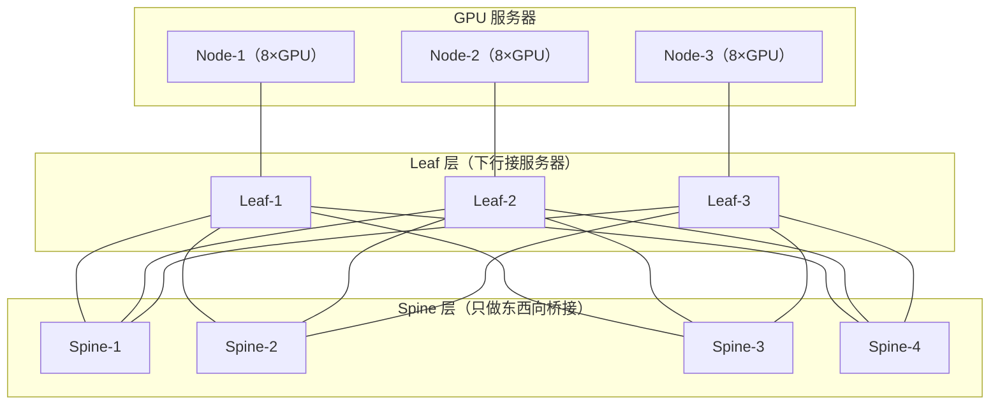

# Fat-Tree 与 CLOS 无阻塞网络

> 中文简称：Fat-Tree 与 CLOS 无阻塞

> **一句话理解**: 把小交换机组织成一张「上行和下行一样粗」的网，让任意两台 GPU 服务器之间都能跑满端口速率。

---

## 一、CLOS 的历史与无阻塞思想

1953 年，贝尔实验室的 Charles Clos 在《Bell System Technical Journal》发表《A Study of Non-blocking Switching Networks》，背景是电话交换网：单级大交换矩阵的成本随端口数平方增长，交换机做不大也做不起。Clos 的答案是用三级小交换机（输入级—中间级—输出级）级联，替代单级大矩阵。

无阻塞的核心条件是「中间级资源 ≥ 需求」。对称三级 CLOS 中，输入/输出级每个模块有 n 个端口、系统有 m 个中间级模块时：

- m ≥ 2n-1：严格无阻塞（strictly non-blocking），任何新连接不必打扰已有连接；
- m ≥ n：可重排无阻塞（rearrangeably non-blocking），必要时搬动已有连接腾路。

数据中心把这套思想反向使用：传统三层园区网越往上越细（收敛），fat-tree 让上行总带宽与下行相等甚至更粗（fat，胖），因此得名「胖树」。GPU 集群的 scale-out 层、八轨 rail、多平面组网，本质上都是 CLOS 的变体。

---

## 二、两层 fat-tree（spine-leaf）结构

两层 fat-tree 就是标准 spine-leaf：leaf 下行接 GPU 服务器、上行全连接所有 spine；spine 不接任何服务器，只做 leaf 之间的东西向桥接。任意两台服务器之间固定走 leaf→spine→leaf 三跳交换，路径多且等价，靠 ECMP 负载分担。



每台 leaf 与每台 spine 都有链路，任意两台服务器之间存在多条等价路径；交换跳数恒定为 3，这是无阻塞判定的结构基础。

---

## 三、1:1 无阻塞的判定方法

判定分两个口径，都满足才算 1:1：

- **逐端口口径（每 GPU 感知）**：任一 leaf 的任一下行口，对应的可用上行带宽 ≥ 下行端口速率。极端表述：每张 400G 网卡在跨机方向随时拿得到 400G，就是 1:1。
- **总量口径（整网）**：全网上行总带宽 = 下行总带宽，且这些上行链路在 ECMP 下能被均匀使用。

```text
# 以 64×400G 交换机作 leaf 的两种切法
# 切法 A：32 下行 + 32 上行
收敛比 = (32×400G) : (32×400G) = 1:1  → 无阻塞
# 切法 B：48 下行 + 16 上行
收敛比 = (48×400G) : (16×400G) = 3:1  → 每 GPU 稳态跨机带宽约 133G
```

注意 1:1 说的是「能力」不是「保证」：哈希不均或单条大流仍可能让某条上行先饱和，所以无阻塞判定必须叠加 ECMP 均衡性检查。

---

## 四、ECMP 哈希与极化问题

fat-tree 的等价路径靠 ECMP（Equal-Cost Multi-Path）按流分担：交换机对五元组做哈希，结果对等价路径数取模。粒度是「流」不是「包」：一条 NCCL 大流只走一条路径，两条流哈希到同一路径就碰撞。

**极化（polarization）** 是多级 CLOS 的放大器：若 leaf 与 spine 用同样的哈希算法和种子，在 leaf 层落到同一组的流，到 spine 层仍落同一批下行口——第一级的不均匀被第二级原样继承，路径再多也白搭。

```text
# 伪配置：逐层打散哈希，破坏两级之间的相关性
# spine 层
ecmp hash-algorithm crc32 hash-seed 0x11
# leaf 层（换算法或换种子）
ecmp hash-algorithm xor hash-seed 0x2b
```

工程上再叠三条缓解：逐层换哈希种子/算法；NCCL 侧用多轨道把一条逻辑通信拆成多 NIC 多流；运维侧用逐流遥测盯长尾链路。

---

## 五、与南北向三层园区网的本质区别

fat-tree 与传统「接入—汇聚—核心」园区网长得像，设计目标完全相反：园区网优化南北向（客户端到服务器），逐层收敛；fat-tree 优化东西向（服务器到服务器），全程 1:1。

| **对比维度** | **南北向三层园区网** | **东西向 fat-tree** |
| --- | --- | --- |
| 流量模型 | 汇聚到核心，树状 | 任意点到点，全互联 |
| 上行收敛 | 越往上越细（8:1、16:1 常见） | 1:1 或 ≤2:1 |
| 路径选择 | 网关/STP 收敛，路径少 | ECMP 多路径等价分担 |
| 故障影响 | 一台汇聚设备影响一片接入 | 单台 spine 只掉一组等价路径 |
| 承载协议 | TCP 为主，容忍重传抖动 | RDMA/NCCL，抖动直接拖慢集合通信 |

---

## 六、二/三层胖树的层级定义

| **层级** | **二层胖树** | **三层胖树** | **角色** |
| --- | --- | --- | --- |
| Tier-0 服务器 | 每卡一张 NIC 接 leaf | 同左 | 1:1 需求的来源 |
| Leaf（L1） | 上行接 spine | 上行接中间层 spine | 无阻塞判定的计算位置 |
| Spine（L2） | 全网核心 | 中间层，上下都是交换机 | 二层网络的规模瓶颈 |
| Super-Spine（L3） | 不存在 | 连接多组 spine | 万卡以上才引入 |

收敛比怎么定、二层什么时候撑爆，分别见收敛比设计与规模推演两页。

---

## 交叉引用

- [[12_架构基建/08_网络/07_GPU_高网设计/03_拓扑设计/02_Oversubscription_Design|收敛比设计与成本权衡]]
- [[12_架构基建/08_网络/07_GPU_高网设计/03_拓扑设计/03_Rail_Optimized_Topology|Rail-Optimized 八轨拓扑]]
- [[12_架构基建/08_网络/07_GPU_高网设计/03_拓扑设计/04_CLOS_Two_Three_Layer_Scaling|二层与三层 CLOS 规模推演]]
- [[12_架构基建/08_网络/07_GPU_高网设计/02_物理层硬件/01_Switch_Generations|交换机代际]]
- [[概念/GPU/nccl|NCCL]]

---

*Last updated: 2026-10-27*
