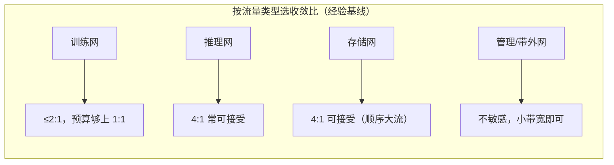

# 收敛比设计与成本权衡

> 中文简称：收敛比设计与成本权衡

> **一句话理解**: 收敛比回答一个问题——为了省钱，允许每张 GPU 的跨机带宽打几折，2:1 就是打五折。

---

## 一、收敛比的定义与计算

收敛比（oversubscription ratio）定义为下行总带宽比上行总带宽，写作「下行:上行」，例如 2:1 表示上行只有下行的一半。工程上先按单台 leaf 计算，再按全网聚合复核。

```text
# leaf：64×400G 交换机（400G 为端口速率，全双工）
D = 48（下行口数）   U = 16（上行口数）
收敛比 = D : U = 48 : 16 = 3:1
# 每 GPU 稳态跨机带宽 = 400G ÷ 3 ≈ 133G
```

- 逐台口径：单台 leaf 的 D:U，决定这台 leaf 下所有卡的跨机体验；
- 全网口径：Σ上行带宽 = Σ下行带宽 才是整网 1:1，逐台达标则全网达标；
- 两个口径都要写进设计文档，缺一个都会在评审时被挑战。

收敛比是「稳态平均」视角：瞬时突发可以靠队列缓冲超过去，但 AllReduce 这种持续数秒的大流会稳定落在平均值上——长时间平均意义下没有侥幸。另外注意收敛比讨论的带宽指稳态可用带宽，与「单向/双向」口径无关：NIC 的 400G 是全双工端口速率，AllReduce 双向对称时上下行同时吃满。

---

## 二、1:1 / 2:1 / 4:1 成本与性能对比

| **方案** | **每卡稳态跨机带宽** | **性能表现** | **成本量级（同卡数下）** |
| --- | --- | --- | --- |
| **1:1 无阻塞** | 400G | 任意通信对可打满，长尾最小 | spine 台数与上行光模块最多 |
| **2:1** | 200G | 带宽受限的集合通信时间约翻倍 | spine 与上行光模块大幅减少 |
| **4:1** | 100G | 大模型训练 MFU 明显下滑 | 约为 1:1 方案的零头 |
| **8:1 及以上** | ≤50G | 只适合存储/管理类流量 | 最低 |

从 1:1 放宽到 2:1 不是线性省钱：省的主要是 spine 台数与上行光模块。光模块经常占网络 CAPEX 一半以上，所以这是最大的一根省钱杠杆。性能端则是等比损失：稳态带宽砍半，带宽受限的集合通信时间就翻倍。

---

## 三、训练要求低收敛比、推理可以放宽

训练的 DP AllReduce 是双向大流量：每 step 对全部梯度做一次 AllReduce，ring 算法下每卡发送与接收约等于 2×梯度体积/N（N 为卡数）的数据，持续数秒、双向对称、完成时间由最慢链路决定。稳态带宽直接进入 step 时间公式，收敛比每恶化一档，通信时间按比例上升——训练网普遍要求 ≤2:1，稠密大模型预训练尽量 1:1。

推理的流量特征不同：prefill/decode 期间是间歇性的 KV Cache 搬运与少量跨机集合通信，且可以用 PD 分离、缓存和本地化调度消化，对持续带宽没那么饥渴，4:1 常可接受。

以 70B 参数、fp32 梯度约 280GB 为例：1024 卡 ring AllReduce 每卡收发约 2×280GB÷1024 ≈ 550MB；400G 口径（有效 busbw 约 45GB/s）下通信约 12ms/step，收敛比 2:1 时翻倍到约 24ms。step 时间 500ms 的作业，仅此一项 MFU 就掉约 2.4 个百分点，千卡规模下这是实打实的损失。

一句话对比：训练网买的是「稳态带宽」，推理网买的是「突发吞吐 + 低延迟」。

---

## 四、算例：从 1:1 放宽到 2:1 省多少

前提：384 卡集群 = 48 台 8 卡服务器，每卡 1×400G NIC（全双工），leaf 用 64×400G 交换机，spine 同机型。

| **项目** | **1:1 方案** | **2:1 方案** |
| --- | --- | --- |
| **leaf 切法** | 32 下行 + 32 上行 | 48 下行 + 16 上行 |
| **每 leaf 挂服务器** | 2 台（16 卡） | 6 台（48 卡） |
| **leaf 台数** | 24 | 8 |
| **spine 台数** | 32 | 16 |
| **上行 400G 光模块（两端计）** | 24×32×2 = 1536 只 | 8×16×2 = 256 只 |
| **交换机总台数** | 56 | 24 |

链路数自检：1:1 方案 24×32 = 768 = 32 台 spine × 24 口；2:1 方案 8×16 = 128 = 16 台 spine × 8 口，两端都闭合。

结论：放宽到 2:1 后，交换机从 56 台降到 24 台，上行光模块降到约 1/6——数量级的节省；代价是每卡稳态跨机带宽 400G→200G，带宽受限的 AllReduce 时间翻倍。这就是收敛比设计的本质：拿性能换 spine 和光模块。

光模块统计口径提醒：上表按两端计（leaf 侧 + spine 侧各一只）；只报单端数字会让成本对比严重失真。

---

## 五、经验值基线



先问流量类型，再定收敛比；四类网在同一个机房里往往并存，各自独立设计、互不迁就。

基线不是铁律：小模型微调对收敛比宽容，千卡级稠密大模型几乎必须 1:1 或 2:1。正确顺序是先估通信占比，再反推收敛比，最后用成本模型验证。

---

## 六、非对称收敛与逐作业放置

非对称收敛指不同层用不同收敛比：例如 leaf→spine 维持 2:1、spine→super-spine 放宽到 4:1，把预算优先花在离 GPU 最近的一层——越靠近端点，带宽被「打折」的感知越强。

另一条思路是空间上的非对称：同一集群里划出低收敛区与高收敛区，调度器把通信最重的训练作业放进低收敛区，把存储、管理、小作业放进高收敛区。全网平均成本下降，而重作业的体验不塌——收敛比设计与作业放置是同一个问题的两面，需要 affinity 调度配合。

| **收敛策略** | **做法** | **适用场景** |
| --- | --- | --- |
| 层间非对称 | 近端 1:1/2:1、远端 4:1 | 预算有限的大集群 |
| 空间分区 | 低收敛区放重训练、高收敛区放杂流 | 多作业混部集群 |
| 全网统一 | 一个收敛比铺满 | 小集群，简单优先 |

---

## 交叉引用

- [[12_架构基建/08_网络/07_GPU_高网设计/03_拓扑设计/01_Fat_Tree_CLOS|Fat-Tree 与 CLOS 无阻塞]]
- [[12_架构基建/08_网络/07_GPU_高网设计/03_拓扑设计/04_CLOS_Two_Three_Layer_Scaling|二层与三层 CLOS 规模推演]]
- [[12_架构基建/08_网络/07_GPU_高网设计/08_容量成本/02_Network_CAPEX_Model|网络 CAPEX 模型]]
- [[12_架构基建/08_网络/07_GPU_高网设计/06_推理网络/01_Training_vs_Inference_Traffic|训练与推理流量画像]]
- [[12_架构基建/08_网络/07_GPU_高网设计/06_推理网络/06_Affinity_Topology_Scheduling|亲和性与拓扑调度]]

---

*Last updated: 2026-10-27*
