# Rail-Optimized 八轨拓扑

> 中文简称：Rail-Optimized 八轨拓扑

> **一句话理解**: 让所有机器的同编号网卡插在同一台交换机上，跨机通信就永远只拐一个弯。

---

## 一、八轨拓扑设计详图

rail-optimized 的接线规则一句话：每台 8 卡服务器的 GPU i（经网卡 i）固定接 rail i 的 leaf，全网所有节点的同号网卡汇聚在同一台（或同一组）交换机上。spine 不是必需品——理想的 rank 对齐下跨 rail 流量几乎不存在，最多留少量兜底链路给存储与带外。

```mermaid
flowchart TB
    subgraph rails["8 台 leaf = 8 条 rail（同号 NIC 全部汇到同一台）"]
        R0["rail0-leaf"]
        R1["rail1-leaf"]
        R2["rail2-leaf"]
        R3["rail3-leaf"]
        R4["rail4-leaf"]
        R5["rail5-leaf"]
        R6["rail6-leaf"]
        R7["rail7-leaf"]
    end
    subgraph nodeA["服务器 A（8 卡，8×400G NIC）"]
        A0["GPU0/NIC0"]
        A1["GPU1/NIC1"]
        A2["GPU2/NIC2"]
        A3["GPU3/NIC3"]
        A4["GPU4/NIC4"]
        A5["GPU5/NIC5"]
        A6["GPU6/NIC6"]
        A7["GPU7/NIC7"]
    end
    subgraph nodeB["服务器 B（8 卡，8×400G NIC）"]
        B0["GPU0/NIC0"]
        B1["GPU1/NIC1"]
        B2["GPU2/NIC2"]
        B3["GPU3/NIC3"]
        B4["GPU4/NIC4"]
        B5["GPU5/NIC5"]
        B6["GPU6/NIC6"]
        B7["GPU7/NIC7"]
    end
    A0 ---|400G| R0
    B0 --- R0
    A1 --- R1
    B1 --- R1
    A2 --- R2
    B2 --- R2
    A3 --- R3
    B3 --- R3
    A4 --- R4
    B4 --- R4
    A5 --- R5
    B5 --- R5
    A6 --- R6
    B6 --- R6
    A7 --- R7
    B7 --- R7
```



图中只画两台服务器示意；一个典型训练组是 8-16 台服务器，全部按同一规则接线。同号 NIC 之间的流量永远只经过所属 rail 的交换机一跳。

---

## 二、为什么同号 GPU 通信只走 leaf 一跳

通信侧原因：NCCL 把集合通信拆成多条 channel，每条 channel 的跨机跳固定绑定一张网卡。rank 排布对齐时（第 j 台机器的第 i 号卡在同一条 channel 里处于相同位置，即 ring 内同 rank 位置对齐），跨机通信的收发两端都是「第 i 号卡」——各自用 NIC i，两个端口都接在 rail i 的同一台 leaf 上，一跳直达，不经 spine、不跨 ECMP、没有哈希分流的概率问题。

硬件侧前提：标准 HGX 主板布局中 GPU i 与 NIC i 挂在同一个 PCIe switch 下，NCCL 拓扑探测会自然选中这种配对。PCIe5 x16 合计 128GB/s（双向口径），400G NIC 线速约 50GB/s，GPU 从本地 NIC 直取带宽不打折。

带宽侧收益：8 条 rail 同时并行，各自独立转发同号流量；一个 8 机 ring 的跨机流量被摊到 8 台 leaf 上，每台只承担 1/8，单台交换机不会成为瓶颈。

---

## 三、rank 排布与拓扑对齐

四个编号必须链式对齐：hostfile 顺序决定 rank 排布；CUDA_VISIBLE_DEVICES 决定机内 GPU 序号；PCIe 亲和决定 GPU i 绑定 NIC i；物理接线决定 NIC i 进入 rail i。任何一环错位（网卡改名、主板更换、跳线插错口）都会把同号流量打散到别的 rail，而且不报错，只表现为 busbw 掉一截。

```bash
# 1) 检查 GPU i 与 NIC i 的 PCIe 亲和（期望同属一个 PCIe switch）
nvidia-smi topo -m
# 2) 打印 NCCL 实际生成的通信通道与网卡绑定
NCCL_DEBUG=INFO NCCL_DEBUG_SUBSYS=INIT,GRAPH \
  torchrun --nproc_per_node=8 train.py
# 3) 固定拓扑文件，避免各机探测结果漂移
export NCCL_TOPO_FILE=/opt/nccl/topology-rail.xml
```

接线级排查：从每台机器向对端逐号发 iperf，结合交换机端口计数器确认同号流量确实落在预期 leaf；NCCL 通道层面的调优细节另见集合通信章节。

---

## 四、非 rail 化的代价

rank 与接线错位后，同号流量不再落在同一台 leaf，全部退化为普通 fat-tree 跨轨流：

| **通信场景** | **路径** | **交换跳数** | **风险点** |
| --- | --- | --- | --- |
| **同号 GPU 跨机（rail 对齐）** | NIC i → rail i → NIC i | 1 跳 | 无哈希分流，单流可打满线速 |
| **跨号 GPU 跨机** | leaf → spine → leaf | 3 跳 | ECMP 哈希碰撞，可用带宽受收敛比约束（常等效减半） |
| **跨 rail 的 All-to-All（EP 未摊开）** | 大量绕 spine 的高扇出流 | 3 跳 × 高扇出 | 热点链路 + 长尾抖动，最慢流拖死整个集合通信 |

AllReduce/All-to-All 的完成时间由最慢 rank 决定：哈希碰撞让某条上行先满，其余 rail 空转，step 时间出现毛刺。这类长尾抖动比平均带宽下降更伤训练吞吐，也是 rail 设计被反复强调的原因。

---

## 五、故障域特性

单台 rail leaf 故障只损失 1/8 的跨机带宽：该 rail 上的节点仍有其余 7 条 rail 可用，NCCL 重构 channel 后降速运行。对比 fat-tree 中一台 spine 故障影响所有节点各 1/N 条路径——两种故障模型不同：rail 的故障域是「一个编号的全部流量」，spine 的故障域是「所有编号的一部分流量」。

运维粒度友好：每条 rail 的交换机下行口数等于节点台数，全网交换机台数为 8（rail 内级联时为 8 的倍数），型号统一、配置一致，可按 rail 为单位批量巡检与备件替换；坏卡、坏口可先按 rail 归组缩小定位范围。长尾与 straggler 的定位方法见运维故障章节。

---

## 六、与超节点的关系

scale-up 域越大，机内能消化的通信越多，跨机 rail 的条数与带宽压力越小。8 卡服务器的时代必须 8 条 rail 精确对齐；到了 NVL72 这类一机架 72 卡的超节点（NVLink5 每卡 1.8TB/s，双向口径），TP 等大带宽通信锁进机架，跨机只剩 DP/EP/PP 流量，rail 条数可以减少，甚至退化为「每个超节点一组上联」的简化 CLOS。

反向提醒：rail 设计的收益前提是「同号通信占主导」。当 MoE 模型的 All-to-All 占比升高时，跨 rail 流量上升，需要并行策略与放置配合，否则 rail 白排。

---

## 交叉引用

- [[12_架构基建/08_网络/07_GPU_高网设计/03_拓扑设计/05_Topology_Parallel_Matching|拓扑与并行策略匹配]]
- [[12_架构基建/08_网络/07_GPU_高网设计/03_拓扑设计/06_Supernode_MegaPod_MultiPlane|超节点与多平面组网]]
- [[12_架构基建/08_网络/07_GPU_高网设计/03_拓扑设计/02_Oversubscription_Design|收敛比设计与成本权衡]]
- [[12_架构基建/08_网络/07_GPU_高网设计/05_集合通信/02_Ring_vs_Tree_AllReduce|Ring 与 Tree AllReduce]]
- [[12_架构基建/08_网络/07_GPU_高网设计/05_集合通信/03_NCCL_Tuning|NCCL 调优]]
- [[概念/GPU/nccl|NCCL]]

---

*Last updated: 2026-10-27*
