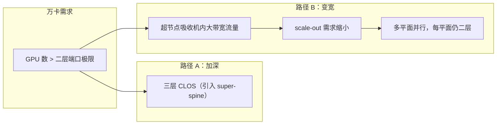

# 二层与三层 CLOS 规模推演

> 中文简称：二层与三层 CLOS 规模推演

> **一句话理解**: 用乘除法算清楚一层交换机能挂多少卡、卡数超过端口极限时怎么办。

---

## 一、二层 CLOS 容量公式

全部推演只用乘除，但有两个容易漏掉的约束：spine 单机端口数上限，以及「每台 leaf 到每台 spine 至少一条链路」的可达性要求。

```text
# 记：每卡 1×400G NIC；leaf 为 P 口 400G 交换机（D 下行 + U 上行，D+U=P）
GPU 数 ≈ leaf 台数 × D × 每下行口接卡数（每口 1 卡时即 leaf 台数 × D）
leaf 台数上限 = spine 端口数 ÷ 每 leaf-spine 并行链路数
spine 台数 = U ÷ 每 leaf-spine 并行链路数（取整后回代校验端口）
自检式：leaf 台数 × U = spine 台数 × spine 实占端口数
```

并行链路数是关键变量：它与 leaf-spine 之间绑几条 400G 对应。并行链路越多，spine 台数越少，但每台 spine 被占掉的端口也越多，能挂的 leaf 反而变少——规模与冗余在这里交换。

---

## 二、算例一：64 口 400G leaf 撑 1024 卡

前提：leaf 用 64×400G 交换机，切法 48 下行 + 16 上行（收敛 3:1）；每台服务器 8 卡、每卡 1×400G。

| **项目** | **数值** | **推导** |
| --- | --- | --- |
| **GPU 规模** | 1024 卡 | 128 台 8 卡服务器 |
| **leaf 台数** | 22 台 | 21 台满配 48 口 + 1 台半载，共 1008+16 口 ≥ 1024 口需求 |
| **每 leaf 上行** | 16×400G | 48:16 = 3:1 |
| **spine 台数** | 8 台 | 每 leaf-spine 对 2×400G 并行，8×2 = 16 条上行 |
| **spine 实占端口** | 44/64 | 22 台 leaf × 2 链路 = 44 |
| **上行 400G 光模块（两端计）** | 352×2 = 704 只 | leaf 台数 × U × 2 |

自检：22×16 = 352 条上行链路 = 8 台 spine × 44 口，闭合。最后一台半载 leaf 的空闲下行口留给存储或管理节点，是常见做法。

---

## 三、算例二：512 口交换机撑万卡

前提：51.2T 芯片（如 Tomahawk 5）512×100G 逻辑口，拆成 128×400G 使用；leaf 与 spine 同机型。

| **项目** | **数值** | **推导** |
| --- | --- | --- |
| **GPU 规模** | 10080 卡（万卡级） | 105 台 leaf × 96 卡 |
| **服务器** | 1260 台 | 每 leaf 12 台 8 卡服务器 |
| **leaf 切法** | 96 下行 + 32 上行 | 128×400G 端口拆分，收敛 3:1 |
| **spine 台数** | 32 台 | 每 leaf 与每 spine 1×400G，32 = 每 leaf 上行数 |
| **spine 实占端口** | 105/128 | 每 spine 接全部 105 台 leaf |
| **上行 400G 光模块（两端计）** | 3360×2 = 6720 只 | 105×32×2 |

自检：105×32 = 3360 = 32×105，闭合。万卡集群仅上行光模块就要近 7000 只，光模块为什么是 CAPEX 大头在这里看得最清楚。

---

## 四、什么时候必须上三层

二层规模的硬上限由 spine 端口数决定：

```text
# 二层容量极限（每 leaf-spine 单链路口径）
GPU 上限 = spine 单机端口数 × 每 leaf 下行卡数
例：128×400G spine、96 卡/leaf（3:1 切法）
    → leaf 台数上限 128，GPU 上限 128×96 = 12288 卡
```

需求超过上限时只有三条路，各有利弊：

- 加并行链路：spine 更少更满，但可挂 leaf 数下降，等于用规模换冗余；
- 上三层 super-spine：规模无上限，但代价见下节；
- 拆多个二层平面并行：每平面仍二层，跨平面靠作业放置规避。

另一个变量是芯片代际：51.2T 到更高速率代际端口数翻倍，二层极限跟着翻倍，三层的门槛一直在被往后推——设计方案要按交付时点的芯片算，不要按立项时点的。

---

## 五、三层的代价

| **代价项** | **量级** | **影响** |
| --- | --- | --- |
| **额外一跳延迟** | 约 0.3-0.5 µs/跳 | 交换芯片转发再加一跳，PP 小包与同步敏感作业可感知 |
| **光模块** | 接近翻倍 | spine-super-spine 是全新一层，模块量与二层全网同量级 |
| **ECMP 极化概率** | 上升 | 哈希级数更多，必须逐层设计种子 |
| **运维排障** | 明显变难 | 路径组合爆炸，断链定位要跨三层设备 |

延迟一跳看起来小，但叠加在每一次跨 super-spine 的集合通信上；光模块翻倍则是实打实的钱。所以「能二层就别三层」是默认原则。

---

## 六、替代路径：超节点与多平面

与其向下加深，不如向上变宽：



两条路径分别对应「加深」与「变宽」：路径 B 是当前主流趋势——scale-up 域变大让 scale-out 不必加深，多平面让每张平面保持二层低延迟，跨平面流量交给作业放置规避。代价是跨平面流量要调度配合，详见超节点与多平面一页。

---

## 交叉引用

- [[12_架构基建/08_网络/07_GPU_高网设计/03_拓扑设计/01_Fat_Tree_CLOS|Fat-Tree 与 CLOS 无阻塞]]
- [[12_架构基建/08_网络/07_GPU_高网设计/03_拓扑设计/02_Oversubscription_Design|收敛比设计与成本权衡]]
- [[12_架构基建/08_网络/07_GPU_高网设计/03_拓扑设计/06_Supernode_MegaPod_MultiPlane|超节点与多平面组网]]
- [[12_架构基建/08_网络/07_GPU_高网设计/08_容量成本/01_Topology_Sizing_Walkthrough|拓扑规模推演走查]]
- [[12_架构基建/08_网络/07_GPU_高网设计/02_物理层硬件/01_Switch_Generations|交换机代际]]

---

*Last updated: 2026-10-27*
