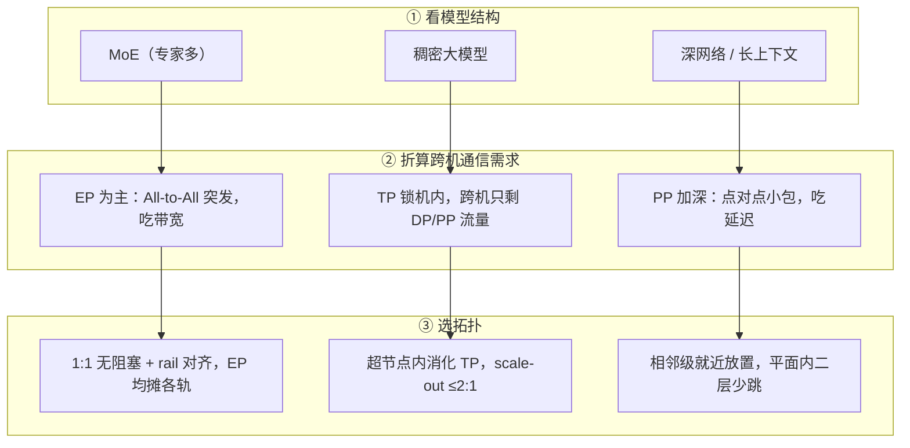

# 拓扑与并行策略匹配

> 中文简称：拓扑与并行策略匹配

> **一句话理解**: 并行怎么切决定流量长什么样，流量长什么样决定网络该怎么搭——切法与拓扑错位，再贵的网也白搭。

---

## 一、并行策略 × 网络需求矩阵

| **并行策略** | **主要通信原语** | **流量特征** | **对拓扑的核心要求** |
| --- | --- | --- | --- |
| **TP 张量并行** | AllGather / ReduceScatter（每层前向 + 反向） | 特大带宽脉冲，逐层高频 | 挤进机内/超节点 NVLink 域，禁止跨机 |
| **DP 数据并行** | AllReduce（每 step 梯度同步） | 跨机大包、周期性、双向对称 | ≤2:1 无阻塞 + rail 对齐 |
| **PP 流水并行** | 点对点 send/recv（activation） | 小到中流量，延迟敏感 | 相邻 stage 物理就近，少跳数 |
| **EP 专家并行** | All-to-All（token 分发/回收） | 大扇出、突发、最不均匀 | 均匀摊到各 rail/leaf，带宽兜底最大 |
| **ZeRO-1/2/3** | AllGather + ReduceScatter 混合 | 持续大流，ZeRO-3 最重 | 同 DP；offload 时机影响突发度 |

读法：先看作业用的切法，再查这行流量特征，最后落到拓扑要求。EP/MoE 的 All-to-All 大扇出突发对拓扑最敏感——它是「任意点到任意点」，没有可以躲的局部性。

---

## 二、placement 三原则

- **TP 挤机内**：TP 大小 ≤ 单机或超节点 GPU 数（8 或 72），保证逐层的 AllGather/ReduceScatter 只走 NVLink。NVLink4 900GB/s、NVLink5 1.8TB/s（均为双向官方口径），远高于任何 400G/800G NIC，TP 出机内等于把最快的互联换成最慢的。
- **EP 均匀摊到各 rail**：专家按 rail 均分，让 All-to-All 的对端均匀落在各台 leaf 上；专家集中在少数 leaf 是最常见的热点来源。
- **PP 相邻级放近**：stage i 与 stage i+1 放同一 leaf 下或相邻机架，点对点小包不吃跨 spine 的跳数与排队。

```bash
# 伪配置：切分顺序 = TP 锁机内 → PP 相邻放置 → DP 外层铺满
mega_launch \
  --tp 8 \                 # TP=8：等于单机 NVLink 域
  --pp 4 --pp-adjacent \   # PP：相邻 stage 放相邻机架
  --dp 4                   # DP：外层铺满剩余节点
```

三原则冲突时按「TP > EP > PP > DP」排序保前面的：TP 错配是数量级损失，EP 错配是热点，PP 错配是延迟，DP 最宽容。

---

## 三、决策树：从模型结构到拓扑选择



决策链是「模型结构 → 并行切法 → 带宽/延迟需求 → 拓扑选择」四步，每一步都依赖上一步的结论；跳过中间两步直接「买最贵的网」是常见的浪费。

---

## 四、常见错配案例

| **错配** | **典型症状** | **根因** |
| --- | --- | --- |
| **TP 跨机** | step 时间 3-5 倍、MFU 腰斩 | AllGather 掉出 NVLink 域，走 400G NIC |
| **EP 挤在少数 rail** | 个别 leaf 上行打满、全网长尾抖动 | 专家未按 rail 均摊，All-to-All 扇出集中 |
| **PP 相邻级放远** | pipeline bubble 增大、小包 RTT 高 | stage 未就近放置，跨 spine 转发 |
| **ZeRO-3 配高收敛比** | 通信占比超 40% | 参数 AllGather 撞上带宽墙 |

展开两个最疼的案例。TP 跨机：TP=16 切到两台机器，每层前向反向的 AllGather 都要走 NIC，带宽从 NVLink 域的数百 GB/s 掉到单卡几十 GB/s，差一个数量级以上——这不是调参能救的，只能改切法或换超节点。

EP 集中：专家放置没有按 rail 摊开，八成的 All-to-All 打在两条 rail 上，这两台 leaf 上行打满、PFC 反压扩散到邻居，表现为「网络没问题但作业就是慢」——交换机侧看少数端口持续高位是最明显的信号。

---

## 五、验证方法

```bash
# 1) 集合通信带宽体检：busbw 越接近 NIC 线速越健康（400G 有效约 45GB/s+）
./build/all_reduce_perf -b 512M -e 8G -f 2 -g 8
# 2) 确认 NCCL 通道是否用满全部 rail
NCCL_DEBUG=INFO NCCL_DEBUG_SUBSYS=GRAPH 2>&1 | grep -i channel
# 3) 放置审计：导出 rank-节点映射，核对 TP/EP/PP 分组与机架/rail 的对应
```

| **信号** | **健康基线** | **异常时先查什么** |
| --- | --- | --- |
| all_reduce busbw | ≥45GB/s（400G 口径） | rank 排布与 rail 接线是否对齐 |
| 交换机端口利用率 | 各 leaf 均衡，无持续 90%+ 端口 | 专家/分片放置是否集中 |
| step 时间分布 | 平稳无周期毛刺 | 跨机 TP、ECMP 哈希碰撞 |

nccl-tests 的详细读数方法与常见误读见集合通信章节。

---

## 交叉引用

- [[12_架构基建/08_网络/07_GPU_高网设计/03_拓扑设计/03_Rail_Optimized_Topology|Rail-Optimized 八轨拓扑]]
- [[12_架构基建/08_网络/07_GPU_高网设计/03_拓扑设计/06_Supernode_MegaPod_MultiPlane|超节点与多平面组网]]
- [[12_架构基建/08_网络/07_GPU_高网设计/05_集合通信/01_Collectives_Parallel_Mapping|集合通信与并行映射]]
- [[12_架构基建/08_网络/07_GPU_高网设计/05_集合通信/06_NCCL_Tests_Reading|nccl-tests 读数]]
- [[概念/GPU/expert-parallelism|专家并行]]
- [[10_部署推理/03_推理优化/18_Parallel_策略_深入分析|Parallel 策略深入分析]]

---

*Last updated: 2026-10-27*
