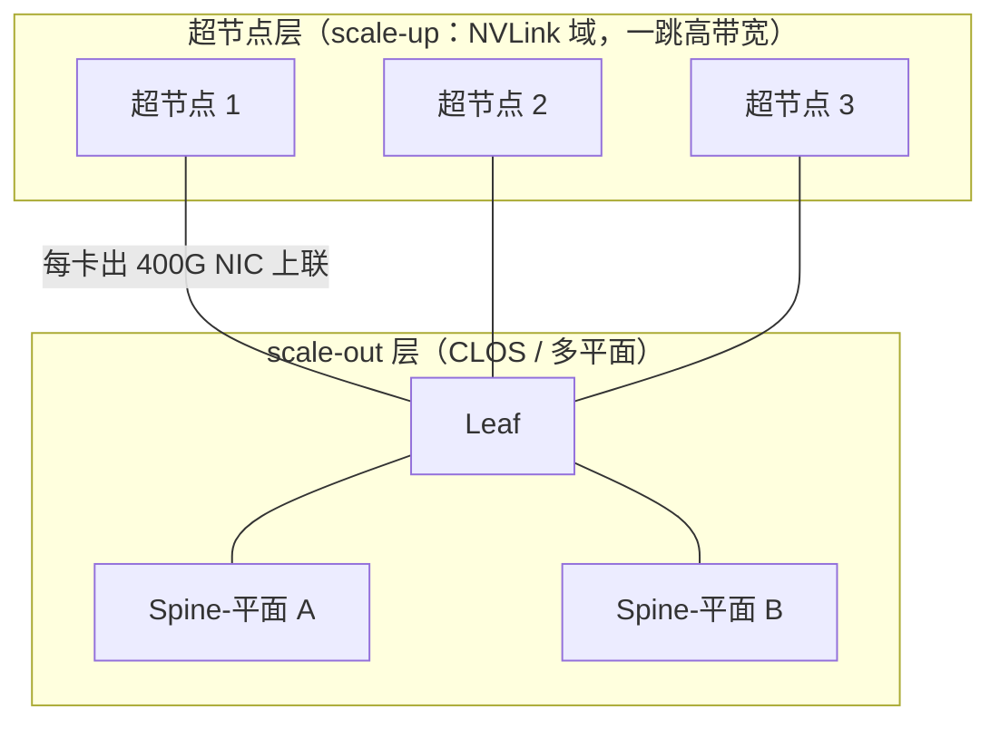

# 超节点与多平面组网

> 中文简称：超节点与多平面组网

> **一句话理解**: 先用 NVLink 把一小撮 GPU 捆成一台「大机器」，再用 CLOS 把这些大机器连起来。

---

## 一、超节点定义

超节点（supernode）把 scale-up 域从「一台服务器」放大到「一个机架甚至多个机架」的 GPU 池：域内一跳（或等效一跳）高带宽互联，域间再走 scale-out CLOS。域内互联用 NVLink、NVLink Fusion 或 UALink 类协议，三个网络特征：

- 带宽比 NIC 高一个数量级以上（数百 GB/s 对数十 GB/s）；
- 延迟亚微秒级，且确定性强、无 ECMP 概率问题；
- 域内天然无阻塞，不需要收敛比设计。

分层的完整框架见分层体系章节；本页聚焦「超节点怎么当积木，scale-out 怎么拼」。

---

## 二、GB200 NVL72 案例

GB200 NVL72 是超节点的标杆案例：一个机架 72 张 Blackwell GPU + 36 颗 Grace CPU，NVLink5 全互联，每卡 1.8TB/s（双向官方口径），整机架 NVLink 聚合带宽官方口径约 130TB/s；机架内以铜互联为主，成本与功耗都优于等带宽的光模块方案。

网络视角的本质变化：原来 72 卡之间的 TP 流量要出网卡进 fat-tree，现在锁死在机架内；scale-out 只承载跨机架的 DP/EP/PP 流量。等于把「最贵、最抖」的那部分东西向流量从 CLOS 里抽走，CLOS 的收敛比与规模压力同时下降——这就是「scale-up 越大、rail 与 CLOS 越简单」的底层逻辑。

---

## 三、阿里 HPN：双平面与 segment

阿里 HPN（论文《Alibaba HPN: A Data Center Network Architecture for Large Language Model Training》，NSDI 2024）是万卡级 scale-out 的代表设计，面向 15000 卡：

- 双平面（dual-plane）架构：整个集群拆成两个物理独立的平面，一个训练作业整体放进单平面，跨平面不出训练流量；
- 每 64 卡一个 segment，segment 内双 ToR 上联，消除单点故障；
- 两个平面在 L2 层各自独立、互不连通，只到 L1 层才存在互通路径，用于容错兜底与调度灵活性；
- 设计动机：万卡规模下 ECMP 哈希的不确定性被放大成不可控长尾，与其在概率上搏命，不如用物理隔离换确定性。

HPN 的启示是「用架构换确定性」：平面内路径少而稳，故障域按 segment 切小，这比单纯堆三层 fat-tree 的可预测性好得多。

---

## 四、字节 MegaPod：模块化思路

字节 MegaPod（定性描述）走模块化路线：以「POD」为建设单位，每个 MegaPod 是一组预制的机架级模块——计算、网络、供电制冷一体化交付；POD 内高带宽互联，POD 之间用标准 CLOS 互联；扩容按 POD 粒度堆叠。

这条路线的价值不在单一技术点，而在工程组织：交付周期从「逐台上架调测」变成「逐 POD 复制」，故障域被 POD 边界天然限定，容量规划可以按 POD 粒度滚动——超大规模集群从此有了「标准件」。

---

## 五、多平面 vs 三层 CLOS

| **维度** | **多平面（每平面二层 + 超节点组合）** | **三层 CLOS（加深）** |
| --- | --- | --- |
| **域内延迟** | 平面内固定 1-2 跳，低且稳 | 域间路径 +1 跳（约 0.3-0.5 µs） |
| **跨域流量** | 依赖作业放置避免跨平面 | 天然可达，无需放置配合 |
| **哈希不确定性** | 平面内路径少，ECMP 简单可控 | 路径多，极化与长尾管理难 |
| **扩展方式** | 加平面 / 加 POD | 加 super-spine 层 |
| **故障域** | 一个平面或一个 POD，边界清晰 | 一条路径组，边界模糊 |
| **适合场景** | 作业大、调度可控的自建训练集群 | 多租户、流量不可预测的通用集群 |

取舍的核心问题：「流量能不能被预测并放进一个平面」。能，多平面赢在确定性与低延迟；不能，三层 CLOS 赢在不需要任何放置配合。

---

## 六、故障域与运维

超节点与多平面把故障域切成了清晰的层级：segment/POD 整体巡检（健康度按域聚合，不逐卡大海捞针）；坏卡热隔离——把坏卡从 scale-up 域标记隔离，作业重排到余下好卡继续跑，不必整域停机；双 ToR 无损切换，segment 级故障不放大。

运维侧的代价是「域」变多：平面间配置必须严格一致（版本、ACL、QoS 策略），跨平面的兜底路径平时不承载流量、容易藏配置漂移，巡检要专门覆盖。运维视角的完整展开见视角章节。

---

## 七、趋势判断

图中 TP 等大带宽通信锁在超节点内，跨超节点的 DP/EP/PP 流量进 scale-out 的 CLOS 或多平面——这就是「万卡集群 = 超节点 × CLOS」的组合形态。

两个趋势判断：其一，scale-up 域继续变大（8 卡 → 72 卡 → 数百卡），scale-out 需求随之缩小、设计随之简化；其二，超大集群不会走向巨型三层 fat-tree，而是「超节点做积木、多平面/二层 CLOS 做拼装」，用确定性换规模。

---

## 交叉引用

- [[12_架构基建/08_网络/07_GPU_高网设计/03_拓扑设计/03_Rail_Optimized_Topology|Rail-Optimized 八轨拓扑]]
- [[12_架构基建/08_网络/07_GPU_高网设计/03_拓扑设计/04_CLOS_Two_Three_Layer_Scaling|二层与三层 CLOS 规模推演]]
- [[12_架构基建/08_网络/07_GPU_高网设计/01_分层体系/01_Scale_Up_NVLink_NVSwitch|Scale-Up：NVLink/NVSwitch]]
- [[12_架构基建/08_网络/07_GPU_高网设计/01_分层体系/04_NVLink_Fusion|NVLink Fusion]]
- [[12_架构基建/08_网络/07_GPU_高网设计/10_视角/03_Ops_Angle|运维视角]]
- [[12_架构基建/02_架构概览/02_AI_基础设施_2026|AI 基础设施 2026]]

---

*Last updated: 2026-10-27*
