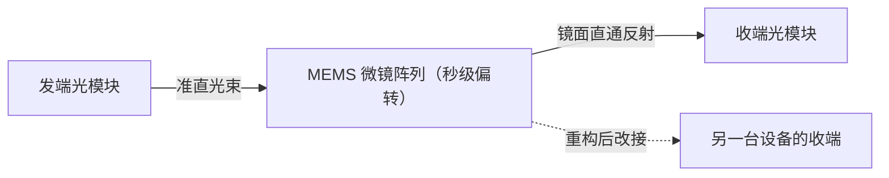

# Google OCS 光交换

> 中文简称：Google OCS 光交换

> **一句话理解**: 用可转动的微镜直接接通光路，交换的不是数据包，而是「谁和谁相连」这件事本身。

---

## 一、OCS 原理：MEMS 微镜阵列

OCS（Optical Circuit Switch，光交换机）的核心是 MEMS（微机电系统）微镜阵列：输入光经过准直器变成平行光束，打在可二维偏转的微镜上；微镜把光束反射到任意一个输出准直器，两点之间的物理光路就此接通。全程光域直通，不经过任何电域。

它与传统交换机的本质区别在于「交换的对象」：

- 交换机逐包转发：解析包头、查表、从出端口发出，微秒级响应每一个包；
- OCS 逐「拓扑」交换：一次镜面调整等于改接一条物理链路，重构在秒级完成；
- OCS 没有任何 per-packet 智能——不解析、不缓存、不感知协议，也因此没有转发芯片的延迟与功耗；
- 端口规模：MEMS 阵列可做上百端口级的交叉矩阵，且端口数增加基本不推高单跳延迟——这是「大端口、低延迟」的独门优势。

光束打到哪个准直器由微镜姿态决定，虚线表示一次重构后的新连接——「换镜面」就是「换拓扑」。

---

## 二、Jupiter/Palomar 与 TPU pod 的应用

Google 自研 OCS（项目代号 Palomar）在其 Jupiter 数据中心网络规模部署（见论文《Jupiter Rising: A Decade of Clos Topologies and Centralized Control in Google's Datacenter Network》，SIGCOMM 2022），在 spine 层用 OCS 做动态拓扑重构，是光交换在数据中心东西向最著名的大规模落地。

TPU v4（论文见 ISCA 2023）把 OCS 用进了 pod 内部：4096 个 TPU 芯片组成的 pod 通过 OCS 重构互联拓扑，收益包括三点：

- 故障芯片可被重构绕开，不必等维修恢复算力；
- 拓扑可按作业切片，把碎片算力重组给形状匹配的作业；
- OCS 上下电不中断光路（镜面保持姿态），运维窗口友好。

| **时间点** | **事件** | **意义** |
| --- | --- | --- |
| 2015 年前后 | Jupiter 引入 OCS 规模部署 | 光交换首次数据中心级验证 |
| 2022 年 | Jupiter Rising 论文公开 | 十年 CLOS + 集中控制的完整复盘 |
| 2023 年 | TPU v4 论文公开 pod 内 OCS | 光交换进入 AI 加速器域内互联 |

数字细节（端口数、切换时间、插入损耗）各代产品差异较大，引用时以官方口径为准，不在此处展开精确规格。

---

## 三、OCS vs 电交换对比

| **维度** | **OCS（光交换）** | **电交换机（包交换）** |
| --- | --- | --- |
| **转发机制** | 光路直通，无包解析 | SERDES + 转发芯片，线速逐包 |
| **单跳延迟** | 纳秒级光路传播 | 约 0.3-0.5 µs 芯片转发 |
| **功耗** | 微镜驱动为主，显著更低 | 高速 SERDES 与转发芯片功耗大 |
| **重构速度** | 拓扑级，秒级 | 包级纳秒级，但拓扑静态（只有 ECMP） |
| **智能性** | 无 per-packet 能力 | 完整转发表、ECMP、拥塞反馈 |
| **协议相关性** | 波长即通，速率与协议无关 | 需匹配具体以太网/IB 速率代际 |
| **运维特性** | 无源光路为主、上下电不断路 | 软件升级需重启、影响转发表 |

什么时候选谁：流量模式稳定、可以按分钟/小时粒度调度的东西向骨干，OCS 的低延迟低功耗有优势；流量不可预测、需要逐包智能的接入与汇聚，电交换不可替代。现实中的正确姿势是分层混用：电交换做包级智能，OCS 做拓扑级重构。

两个容易低估的对比点：

- 电交换每跳约 0.3-0.5 µs 里包含 SERDES 重定时、查表与排队三段，其中排队延迟随拥塞上升；
- OCS 的光路延迟近似纯光传播，与端口规模基本无关，矩阵越大这个优势越明显。

---

## 四、为什么 Google 能用

OCS 的「慢」（秒级重构、无逐包智能）是硬伤，Google 用三个条件把它补成了优点：

- **自研全栈**：TPU、光交换、调度系统一体设计，OCS 缺的智能由上层调度预判补偿，而不是指望交换机自己；
- **流量可预测**：训练与内部批处理的通信模式稳定，拓扑按小时/天粒度重构完全够用，包级动态性需求本来就低；
- **放置算法配合**：集中式控制器知道每个作业的通信矩阵，把「拓扑」当调度变量一起算——作业还没起，它未来几小时的流量形状已经进了拓扑规划。

三个条件缺一，OCS 的秒级重构就会从特性变成缺陷。

---

## 五、商用 GPU 集群为什么未普及

- **生态不匹配**：商用集群以以太网/IB 商用交换机为主，NCCL 与上层框架假设静态拓扑、固定路径数；动态拓扑需要框架层感知并重新探测，改动成本高；
- **运维体系**：光交换引入准直、灰尘、机械可靠性等全新故障模式，现有 DC 运维流程与备件体系要重建；
- **供应商稀缺**：量产 OCS 厂商极少，Google 自用为主，商用采购议价与备件保障都困难；
- **规模未到拐点**：多数 GPU 集群的规模与流量稳定性，还没到「拓扑重构收益 > 复杂度代价」的临界点，静态 fat-tree + 好的放置策略已经够用。

所以现状是「Google 能用、别人用不起也用不好」，而不是 OCS 本身不好。

---

## 六、启示：拓扑即调度

- **拓扑是调度变量**：把拓扑从静态资产变成调度系统的输入之一，是突破 fat-tree 物理上限的一条路——Google 用十年证明了可行；
- **光交换在东西向的角色会随规模上升**：数据中心东西向带宽每代翻倍，电交换的功耗墙越来越近，光路直通的低功耗价值随之放大；
- **零成本版本人人可用**：即使不上 OCS，「作业放置 × 拓扑」联合优化（affinity 调度、rail 对齐、平面放置）也是 OCS 思想的零成本落地，商用集群今天就能做；
- **跟踪信号**：商用 OCS 供应商数量、UEC/超以太生态是否引入光交换层、超节点代际规模——三者任一变化都可能把适用拐点提前。

判断题外的话：当 scale-up 域大到把机内流量全部吸走、scale-out 只剩可预测的训练流量时，商用集群离 OCS 的适用区间其实在变近——这是值得持续跟踪的变量。

---

## 交叉引用

- [[12_架构基建/08_网络/07_GPU_高网设计/03_拓扑设计/06_Supernode_MegaPod_MultiPlane|超节点与多平面组网]]
- [[12_架构基建/08_网络/07_GPU_高网设计/01_分层体系/03_Multi_Plane_Network_Segmentation|多平面网络分割]]
- [[12_架构基建/08_网络/07_GPU_高网设计/03_拓扑设计/01_Fat_Tree_CLOS|Fat-Tree 与 CLOS 无阻塞]]
- [[12_架构基建/08_网络/07_GPU_高网设计/06_推理网络/06_Affinity_Topology_Scheduling|亲和性与拓扑调度]]
- [[12_架构基建/08_网络/02_AI_网络|AI 网络]]

---

*Last updated: 2026-10-27*
