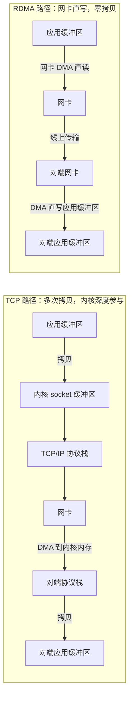

# RDMA 语义与 Verbs：单边零拷贝如何绕开内核

> 中文简称：RDMA 语义与 verbs

> **一句话理解**: RDMA 让网卡自己搬数据、完全不惊动操作系统内核，远端 CPU 甚至可以不知道发生过这次通信。

---

## 一、为什么需要 RDMA：TCP 栈的拷贝税

一次传统 TCP 发送要走的完整路径：

1. 应用调用 `send()`，数据从用户缓冲区**拷贝**到内核 socket 缓冲区（第一次拷贝）；
2. 内核 TCP/IP 协议栈逐层封包，再送入网卡发送队列（第二次拷贝 + 协议栈处理开销）；
3. 接收侧对称走一遍：网卡 DMA 到内核内存，协议栈处理，再**拷贝**到用户缓冲区；
4. 全程伴随系统调用陷入、上下文切换与中断，CPU 深度参与。

带宽上去之后，这些拷贝与 CPU 开销成为瓶颈：单核用 TCP 只能打出几十 Gbps 量级吞吐，而 GPU 集群里一张 ConnectX-7 400G 网卡就能轻松超过这个数。RDMA（Remote DMA，远程直接内存访问）用两个关键词解决：

- **kernel bypass（内核旁路）**：应用通过用户态队列直接给网卡下命令，不走 socket、不陷入内核；
- **zero-copy（零拷贝）**：数据从本方应用缓冲区直接进网卡，再被对端网卡直接 DMA 写进对方应用缓冲区，全程零次 CPU 拷贝。

两条路径的本质差别不在带宽而在拷贝次数与 CPU 参与：RDMA 把中间人（内核、协议栈、额外缓冲区）全部请出数据路径。

---

## 二、两大动词族：双边 send/recv 与单边 read/write

RDMA 的编程接口统称 verbs（动词），核心分两族：

**双边动词（send/recv）**

- 通信双方都要参与：发送方投递 send，接收方必须**提前**投递 recv 留好缓冲区；
- 语义像邮箱：消息一定送达，但落在哪个缓冲区由接收方预留的队列决定；
- 接收方 CPU 有前置开销（挂 recv buffer），不如单边省心。

**单边动词（RDMA read / RDMA write）**

- 只有发起方参与：发起方网卡直接读写**对端**内存指定地址，对端 CPU 完全不感知，可以同时在跑 GPU kernel；
- 前提是对端事先注册好内存，并把地址与远程密钥（rkey）交给发起方；
- 这是零拷贝与低 CPU 占用的极致形态，也是 NCCL 等 GPU 通信库数据面的主力。

| **动词族** | **参与方** | **谁决定数据落点** | **对端 CPU 开销** | **典型用途** |
|---|---|---|---|---|
| send/recv（双边） | 双方都要投递队列 | 接收方（预留缓冲） | 需预先挂 recv buffer | 控制消息、RPC、握手协商 |
| RDMA write（单边） | 仅发起方 | 发起方（指定对端地址） | 近零 | 批量数据下发、参数同步 |
| RDMA read（单边） | 仅发起方 | 发起方（指定对端地址） | 近零 | 拉取远端数据、KV 惰性加载 |
| write + immediate | 发起方 + 通知 | 发起方写入、对端收通知 | 仅收通知 | 写完通知对方消费 |

---

## 三、MR 内存注册：锁页、lkey 与 rkey

网卡要直接 DMA 一段内存，前提是这段内存的物理地址**固定不变**。`ibv_reg_mr()` 做三件事：

1. **pin pages（锁页）**：把这段虚拟内存对应的物理页锁定，禁止换出，保证 DMA 地址稳定；
2. 生成本地密钥 **lkey**：本方网卡访问这段内存时携带，硬件据此校验权限；
3. 生成远程密钥 **rkey**：交给对端；对端发起单边操作时带上 rkey 与目标虚拟地址，即可直写这段内存。

两个工程注意点：

- 注册有开销（大块内存注册在毫秒量级），因此 NCCL 内部维护注册缓存、复用已注册 buffer，避免每次通信重复注册；
- 未注册的内存不能被单边操作触碰——rkey 同时是权限凭证，这是 RDMA 的安全边界。

---

## 四、QP 队列对：verbs 的执行模型（简版）

- **QP（Queue Pair）** 是一对队列：发送队列（SQ）加接收队列（RQ）。应用往队列投递工作请求（WQE），网卡硬件直接消费执行；
- **CQ（Completion Queue）**：操作完成后产生完成事件（CQE），应用轮询（`ibv_poll_cq`）或事件驱动地收割结果；
- QP 有状态机（RESET → INIT → RTR → RTS …），“建连接”本质是双方交换 QPN、地址、rkey 后把 QP 拉到就绪态；
- RoCE 上使用 RC（Reliable Connection）传输：可靠、保序、带重传——代价是对丢包极度敏感，这正是无损以太存在的理由。

记忆钩子：QP 是网卡的“任务收件箱”，CQ 是“完成回执箱”，MR 是“可被直写的门牌与钥匙”。

---

## 五、RoCEv1 与 RoCEv2：可路由性决定生死

| **维度** | **RoCEv1** | **RoCEv2** |
|---|---|---|
| 封装 | 直接用以太帧（EtherType 0x8915） | UDP/IP 封装，目的端口 4791 |
| 可路由性 | 仅二层（L2），不能跨子网 | 三层（L3）可路由，可跨叶子与脊柱 |
| 适用拓扑 | 单个二层域、小集群 | 胖树/CLOS 多级组网的事实标准 |
| 现状 | 基本淘汰 | 当前 GPU 集群 RoCE 的默认形态 |

一句话：RoCEv1 是“局域网内的 RDMA”，RoCEv2 才是“组网级的 RDMA”。CLOS 拓扑里流量必须跨三层路由，UDP 封装让 RoCE 报文能像普通 IP 包一样被交换机转发。代价是继承了以太“尽力而为、可能丢包”的天性，于是引出 PFC/ECN/DCQCN 整套无损以太体系。

---

## 六、GPU RDMA：网卡直写显存与量化收益

GPU 集群把 RDMA 又推进一层：通信缓冲区不在主机内存，而在 **GPU 显存**。

- NCCL 对通信用的显存 buffer 直接调用 `ibv_reg_mr` 注册；
- `nvidia_peermem` 内核模块让注册显存成为可能：它教 RDMA 驱动如何 pin GPU 页，网卡 DMA 跨 PCIe 直达显存，不再经主机内存中转（细节见 GPUDirect 家族页）；
- 效果：跨机 AllReduce/AllGather 的数据面全程不进 CPU、不进系统内存。

量化对比（数量级口径，具体取决于网卡与 CPU 代次）：

| **指标** | **TCP socket** | **RDMA（RoCE/IB）** |
|---|---|---|
| 单向小消息延迟 | ~30µs 起步 | ~1-3µs |
| 数据路径拷贝次数 | ≥2 次 | 0 次（网卡直写） |
| CPU 占用 | 满带宽需多个核搬运 | 接近零，CPU 让给业务 |
| 直达显存 | 不行，必须经系统内存 | 可以（GPUDirect RDMA） |

对训练的意义：梯度同步的延迟与 CPU 占用同时下降，通信更容易被计算重叠掩盖。

---

## 交叉引用

- [[12_架构基建/08_网络/07_GPU_高网设计/04_协议传输/02_Lossless_Ethernet_PFC_ECN_DCQCN|无损以太 PFC ECN DCQCN]]
- [[12_架构基建/08_网络/07_GPU_高网设计/04_协议传输/06_GPUDirect_Family|GPUDirect 家族]]
- [[12_架构基建/08_网络/06_RDMA_and_RoCE_for_AI|RDMA and RoCE for AI]]
- [[概念/GPU/infiniband-roce-2|InfiniBand 与 RoCE]]

---

*Last updated: 2026-10-27*
