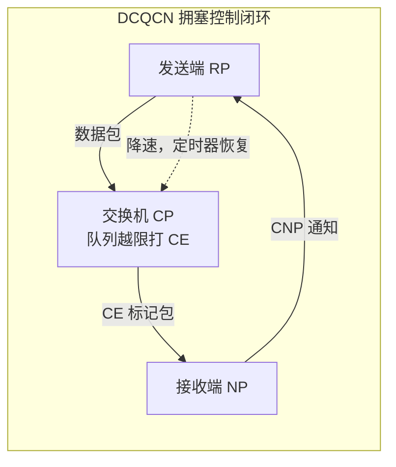

# 无损以太：PFC、ECN 与 DCQCN

> 中文简称：无损以太 PFC ECN DCQCN

> **一句话理解**: 以太天生会丢包而 RoCE 一丢包性能就崩，无损以太就是给以太打三层补丁——先反压别丢（PFC）、再提前报警（ECN）、最后让发送方自觉降速（DCQCN）。

---

## 一、RoCE 为什么怕丢包：go-back-N 与吞吐悬崖

- RoCEv2 的 RC 传输采用 go-back-N 类重传：接收端只按序接收，丢一个包后，失序到达的后续包全部被拒收，发送端从丢失点开始**整段重发**；
- 一个丢包触发整段重传，链路流量被放大，更容易拥塞，进而更多丢包，形成正反馈；
- 结果是吞吐悬崖：丢包率到十万分之一（1e-5）量级，RoCE 吞吐就可能从线速跌到零头，而不是线性下降；
- 对比 TCP：TCP 重传单位是报文段，配合累计确认损失可控；RoCE 的 go-back-N 把重传单位放大成整段，惩罚被成倍放大；
- 典型触发场景是 incast：多打一时队列瞬间膨胀，buffer 不够就丢包——GPU 同步集合通信天天制造这种流量形态；
- 不要指望靠堆 buffer 解决：incast 的队列增长速度远超反压传播速度，buffer 只能买时间，买不来无损；
- 结论：承载 RoCE 的以太必须被改造成“近似无损”，这就是 PFC、ECN、DCQCN 三件套存在的原因。工程口诀：RoCE 的性能公式里，丢包率是乘法项不是加法项。

---

## 二、PFC：按优先级反压，以及它的副作用

**原理（IEEE 802.1Qbb）**

- 以太帧按 802.1p 优先级分成 8 类；交换机某个优先级的入口队列将满时，向上游发送 **per-priority PAUSE** 帧，上游暂停发送该优先级，其他优先级不受影响；
- 与古老的全口 PAUSE（802.3x）不同，PFC 可以只停 RoCE 那一类，避免殃及同网的其他业务；
- 反压生效有传播时延，期间对端还在继续发，所以入口必须预留 **headroom 缓冲**接住 in-flight 包；
- PFC 只在直连链路起作用，必须路径上每一跳、每一台交换机都配置，一台漏配则整条路径漏。

**副作用**

- **head-of-line 阻塞（HOL）**：同一优先级里一条流被堵，排在后面的无关流一起陪等；
- **PFC 风暴**：反压沿链路逐级向上游传染，极端时压死整条路径，甚至波及管理流量；
- **死锁**：环形路径上互为上下游的端口互相 pause，形成环等待，谁也动不了；必须开 **PFC watchdog** 周期性检测并强制丢包打断死锁。

---

## 三、ECN 打标：在丢包发生之前报警

- 交换机持续监测队列长度，越过 **ECN 阈值**就把包 IP 头的 ECN 域改成 **CE（Congestion Experienced）** 标记——包照常转发，只是捎带上“我经历过拥塞”的信息；
- 目标是让端系统在**丢包发生前**感知拥塞并主动降速，从而尽量不触发 PFC，更不要走到丢包；
- 阈值链条必须错开：ECN 打标阈值 < PFC 触发阈值（xoff）< headroom 上限；buffer 越深，这些阈值的安全余量越好安排；
- ECN 只对配置启用的队列生效；GPU 流量通常单独划进“无损优先级”，打标与反压策略只作用于这一类，不干扰普通业务；
- ECN 是逐队列、逐端口的配置，交换机型号与固件不同，可调粒度也不同，跨厂商组网时最容易在这里翻车。

---

## 四、DCQCN：三角色闭环

DCQCN（Data Center Quantized Congestion Notification）把 ECN 信号变成发送端的降速动作，三个角色分工：

- **CP（Congestion Point，拥塞点）**＝交换机：检测队列拥塞，给包打 ECN-CE 标；
- **NP（Notification Point，通知点）**＝接收端网卡：发现收到 CE 包，回送 **CNP（拥塞通知报文）** 给发送端；
- **RP（Reaction Point，反应点）**＝发送端：收到 CNP 后按 DCTCP 风格计算降速系数 alpha 并降速，之后靠字节计数与定时器逐步试探恢复。



时序要点：ECN 是在数据包上捎带、CNP 是独立小包，两者速率差很大，所以 DCQCN 的反应速度天然慢于交换机本地打标。闭环里任何一个角色失灵（CE 没打、CNP 被丢、RP 参数不敏感），拥塞就会穿透到 PFC 甚至丢包。

---

## 五、调参要点与诊断命令

| **参数** | **含义** | **调不好的后果** |
|---|---|---|
| PFC 使能门槛（xoff） | 入口队列多深时触发反压 | 太浅则频繁 pause 吞吐抖动；太深则来不及反压先丢包 |
| headroom 深度 | 反压传播期间接住 in-flight 包 | 不足则 PFC 形同虚设，照样丢包 |
| ECN 阈值 | 队列多深时开始打 CE | 过低则频繁降速吞吐抖动；过高则来不及预警直接压到 PFC |
| ECN 标记策略 | 按队列长度还是排队时延触发 | 相邻设备触发口径不一致，会造成行为失衡 |
| CNP 速率与优先级 | CNP 回送是否及时、会不会被丢 | CNP 丢失则闭环失灵，退化为纯 PFC 硬扛 |
| RP 降速/恢复参数 | 收到 CNP 后降多少、多快恢复 | 过激则带宽利用率低，过缓则压不住拥塞 |

诊断命令：

```bash
mlnx_qos -i eth0                    # 查看/设置 PFC 优先级、buffer 划分与 ECN 配置
ethtool -S eth0 | grep -i pause    # 各优先级 pause 帧收发计数
ethtool -S eth0 | grep -i ecn      # ECN 标记相关计数
```

解读与审计习惯：

- **PFC pause 计数持续增长是拥塞前兆**：偶发 xoff 属正常，速率持续上涨说明带宽供需不匹配，或 ECN/降速闭环没有兜住；
- 给 pause 与 ECN 计数建立基线，带宽扩容或拓扑变更后必须回归对比（详见无损配置审计页）；
- 每台交换机的 PFC/ECN 配置纳入版本管理，配置漂移是“排查半天才发现”的常见剧本。

---

## 六、典型事故模式

| **现象** | **根因** | **处置** |
|---|---|---|
| 交换机没开 PFC | RoCE 丢包走 go-back-N 重传，吞吐直接掉一半甚至更多 | 按厂商指南对 RoCE 优先级使能 PFC，并全链路审计 |
| ECN 阈值过低 | 发送端频繁降速又恢复，吞吐反复抖动 | 抬高 ECN 阈值，拉开与 PFC 门槛的距离 |
| headroom 配小了 | 反压生效前 in-flight 包被丢，PFC 等于没开 | 按线速乘传播时延重算 headroom |
| 只在单跳配了 PFC | 路径中某台交换机漏配，反压链条断在中间 | 用配置审计工具全链路对账，不只查接入层 |
| watchdog 未开启 | 一次死锁导致整片队列 hang 住 | 开启 PFC watchdog 并接入告警 |
| CNP 被限速丢弃 | 闭环退化为纯 PFC，拥塞响应迟钝 | CNP 走独立队列/优先级并确保不丢 |
| 跨厂商配置不一致 | 两边阈值口径不同，反压时序错位 | 统一用同一份配置基线逐台下发 |

排障顺序建议：

1. 先看丢包计数定位丢点，再查该跳的 PFC/ECN 配置；
2. 再看 pause 计数增速，判断拥塞是偶发还是常态化；
3. 最后回到业务层，用 nccl-tests 复测确认修复效果。

共同教训：无损以太不是“开了就无损”，而是三件套参数互相咬合的动态系统，任何一次固件升级、拓扑变更都要重新审计。

---

## 交叉引用

- [[12_架构基建/08_网络/07_GPU_高网设计/04_协议传输/01_RDMA_Semantics|RDMA 语义与 verbs]]
- [[12_架构基建/08_网络/07_GPU_高网设计/04_协议传输/03_IB_Flow_Control_Adaptive_Routing|IB 流控与自适应路由]]
- [[12_架构基建/08_网络/07_GPU_高网设计/07_运维故障/04_Lossless_Config_Audit|无损配置审计]]
- [[12_架构基建/08_网络/05_网络_Diagnostics_命令|网络 Diagnostics 命令]]

---

*Last updated: 2026-10-27*
