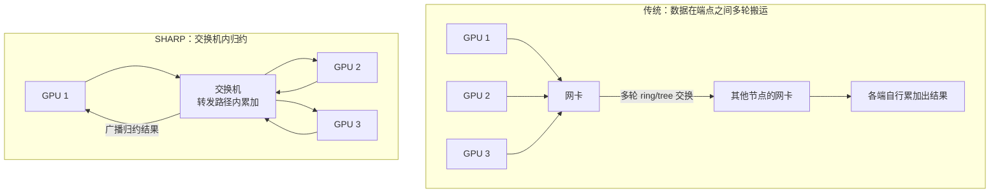

# SHARP 在网计算：把 AllReduce 搬进交换机

> 中文简称：SHARP 在网计算

> **一句话理解**: 与其让几百张卡互相传梯度再各自相加，不如让交换机在转发的路上顺手把加法做了——网里少跑一半流量，结果还更快到。

---

## 一、原理：归约在转发路径内完成

AllReduce（如梯度求和）的传统做法：数据在**端点之间**搬运多轮（ring/tree），每张卡收到别人的数据、算完再往下转发。SHARP（Scalable Hierarchical Aggregation and Reduction Protocol）把归约下沉到**交换机数据面**：

- **上行**：多路贡献包进入交换机，边转发边累加——加法在交换机转发管线里直接完成；
- **下行**：最终归约结果从聚合树根交换机广播回所有参与者。

两个结构性收益：

- **网内流量约减半**：N 份贡献在网内被折叠成一份归约结果，不再全网搬运；
- **跳数与串行化次数减少**：集合完成路径变短，尾延迟更稳。

为什么恰好是“约减半”：上行方向 N 份贡献在交换机内折叠，下行只需要广播一份结果，总搬运量近似砍半；与 ring 对比，ring 的总线带宽受单链路限制，SHARP 的树形聚合把多条链路并行用满，中小消息的时延优势最明显。

适用的集合类型以归约类为主（AllReduce、Reduce 及聚合类形态）；本质是把 ring/tree 里的树形聚合环节硬件化，GPU 侧照常发起集合与收取结果。



上图要点：SHARP 没有消灭计算，只是把“求和”挪到数据必经之路上，省掉的是搬运轮次本身。

---

## 二、性能量级：中小消息约 2 倍

| **消息规模** | **传统 ring/tree AllReduce** | **CollNet/SHARP 参考量级** |
|---|---|---|
| 小消息（KB 级） | 时延主导 | 时延明显下降，加速约 2 倍量级 |
| 中消息（百 KB 至 MB 级） | 时延与带宽混合 | 加速约 2 倍量级，官方演示与多方复测的常见区间 |
| 大消息（几十 MB 级） | 带宽主导 | 收益收窄，最终受链路带宽上限约束 |

- 延迟收益来自更少的跳数与更少的串行化次数，且集合完成时间的方差更小（尾延迟改善）；
- 口径提醒：加速倍数依赖消息大小、组规模与拓扑；工程上先用 nccl-tests 在自己集群实测，不要直接引用宣传页数字；
- 实测口径注意：nccl-tests 的 busbw 指标在 CollNet 下与 ring 的解读方式相同，不要拿 algbw 跨算法直接比较；
- 对整步训练时间的影响取决于通信占比：跨机 AllReduce 越密集，SHARP 折算成端到端 Step 时间的节省越明显。

---

## 三、版本演进：SHARPv2 → SHARPv3

| **版本** | **时代** | **关键提升** |
|---|---|---|
| SHARPv2 | DGX-2 一代系统 | 交换机内聚合进入大规模商用，验证在网归约路线 |
| SHARPv3 | Quantum 世代交换机 | 聚合组规模上限大幅提升，并发组数量增加 |
| 后续代际 | 持续演进 | 更大的组、更多的组、更少的互斥限制 |

演进主线始终是三件事：更大的单树组规模、更多的并发聚合组、与更多拓扑/路由特性的兼容。判断代际不要只看名字要看规格：同一世代不同 SKU 的交换机，聚合组上限可能差一个量级，采购以规格表为准。

---

## 四、NCCL 集成：CollNet

- NCCL 通过 CollNet 机制把归约操作卸载到 SHARP 交换机；fabric 支持、参数合法时自动启用，不满足则自动回落 ring/tree：

```bash
export NCCL_COLLNET_ENABLE=1   # 允许 NCCL 使用 CollNet/SHARP
export NCCL_ALGO=CollNet       # 强制指定 CollNet 算法（默认由 NCCL 自动评估）
```

- 验证方式：`NCCL_DEBUG=INFO` 的日志里观察算法选择是否落到 CollNet；个别集合类型不满足条件而回落属正常行为；
- 环境变量只是“允许”：fabric 或拓扑不满足时 NCCL 仍会静默回落，以日志确认为准，不要设完就当生效；
- CollNet 与 ring/tree 并存：NCCL 会按消息大小与拓扑在不同算法间切换，不是全有或全无；
- 调参入口见 NCCL 调优页，SHARP 相关开关只是其中一个维度。

---

## 五、限制条件

- **硬件绑定**：需要 Quantum 系 IB 交换机参与聚合，以太交换机不参与 SHARP 数据面（以太侧的对应能力要看 UEC 可选在网聚合如何落地）；
- **组规模受限**：聚合是树形结构，单树大小受交换机代次上限约束，超大规模要拆成多棵树再在端侧合并；
- **拓扑/路由互斥**：与某些路由特性（特定自适应路由配置等）互斥，需按厂商兼容矩阵部署；
- **首末跳不卸载**：GPU 到网卡这一段仍是普通数据面，小集群收益不明显；
- **资源占用可见**：聚合组数量是交换机的稀缺资源，大集群要监控组分配，避免多个作业互相挤占；
- 软件版本耦合：NCCL 版本、交换机固件、CollNet 插件三者要对齐，升级任一都要回归测试。

---

## 六、适用场景判断

| **场景** | **SHARP 收益判断** |
|---|---|
| 大规模数据并行训练（跨机 AllReduce 密集） | 收益最大：网内流量与完成时间双降 |
| 中小规模训练（单机多卡为主、跨机占比低） | 收益有限，不值得为它溢价 |
| 推理（TP/EP 小消息、KV 传输为主） | 收益有限，推理更该关心时延与成本 |
| HPC 类模拟（归约密集型科学计算） | 与训练同口径评估 |

判断流程：先用集合通信画像确认跨机 AllReduce 占比，再用 nccl-tests 对比开/关 CollNet 的差值，最后把收益折算成整集群的 Step 时间节省，对比为此付出的交换机与许可成本做决策。一个反例：如果跨机集合主要是 AllGather/AllToAll（MoE 训练与推理常见），归约卸载帮不上忙，预算应该花在带宽与拓扑上。

---

## 交叉引用

- [[12_架构基建/08_网络/07_GPU_高网设计/04_协议传输/03_IB_Flow_Control_Adaptive_Routing|IB 流控与自适应路由]]
- [[12_架构基建/08_网络/07_GPU_高网设计/04_协议传输/05_IB_vs_Ethernet_SpectrumX_UEC|IB 与以太路线之争]]
- [[12_架构基建/08_网络/07_GPU_高网设计/05_集合通信/02_Ring_vs_Tree_AllReduce|Ring 与 Tree AllReduce]]
- [[12_架构基建/08_网络/07_GPU_高网设计/05_集合通信/03_NCCL_Tuning|NCCL 调优]]
- [[概念/GPU/nccl|NCCL 概念页]]

---

*Last updated: 2026-10-27*
