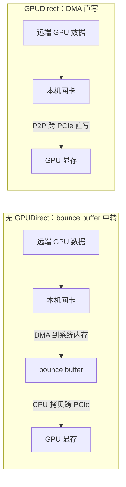

# GPUDirect 家族：网卡直写显存的全家桶

> 中文简称：GPUDirect 家族

> **一句话理解**: 没有它，远端来的数据要先落地主机内存再由 CPU 搬进显卡；有了它，网卡一步跨过 PCIe 直接写显存，CPU 彻底下班。

---

## 一、没有 GPUDirect 时的路径：bounce buffer 中转

默认情况下，远端数据到达本机网卡后，网卡只能 DMA 到**系统内存**里的一块 bounce buffer（中转缓冲）：

1. 网卡收到数据，DMA 写入主机内存；
2. CPU（或驱动）再发起一次拷贝，把数据从系统内存跨 PCIe 搬进 GPU 显存；
3. GPU 才能开始消费这份数据。

代价清单：

- **多两次数据搬运**（网到内存、内存到显存），每次都要挤占 PCIe 5 x16 128GB/s（双向口径）这样的互连带宽；
- **CPU 被迫参与**，占用本该跑业务与推理框架的核；
- **主机内存带宽被吃掉**，与其他进程争抢；
- **延迟叠加**，每个来回多出微秒级的搬运时间。

什么时候最痛：PD 分离的 KV 块搬运、EP 的跨机 all-to-all——都是高频、大批量、时延敏感路径，中转税被成倍放大。

---

## 二、GPUDirect：网卡 DMA 直写显存



上图要点：GPUDirect 依赖 PCIe P2P（peer-to-peer）让网卡与 GPU 两个设备直接互访，数据面绕开系统内存与 CPU；前提是两者 PCIe 拓扑可达，且中间没有 ACS 这类强制流量回根复合体的开关。RDMA 语义层面则靠注册显存 MR 实现（见 RDMA 语义页）。

---

## 三、家族成员一览

| **成员** | **走什么传输** | **数据去向** | **典型用途** |
|---|---|---|---|
| GPUDirect RDMA | IB/RoCE | 对端 GPU 显存直写 | NCCL 跨机集合通信（训练主力） |
| GPUDirect TCPX | TCP（内核旁路实现） | GPU 显存 | 推理引擎跨机通信（TensorRT-LLM 生态） |
| GPUDirect TCPX-B | RoCE | GPU 显存 | 推理跨机通信、KV 传输 |
| GPUDirect Storage | NVMe/NFS 等存储协议 | 显存或近显存（bar1 映射） | 训练数据直读、checkpoint 加载与保存 |
| GPUDirect P2P | 单机 PCIe | 同机另一块 GPU | 单机内卡间零拷贝（基础能力） |

记忆口径：**RDMA 管跨机集合，TCPX/TCPX-B 管推理跨机，Storage 管数据进出，P2P 管单机内**。选型口径：跨机训练先确认 GPUDirect RDMA 生效；推理引擎选 TCPX 还是 TCPX-B，由其网络栈与部署环境决定。

---

## 四、启用条件

- NVIDIA 驱动安装到位（版本与内核匹配），加载 `nvidia-peermem` 内核模块，让 RDMA 驱动具备 pin GPU 页的能力：

```bash
sudo modprobe nvidia-peermem     # 模块名 nvidia_peermem
```

- **NCCL 自动检测**：启动时自动探测 NIC 与 GPU 的 P2P 能力、注册通信缓冲，可用则默认走 GPUDirect，无需手工配置；
- TCPX/TCPX-B 不走 NCCL，由推理引擎（如 TensorRT-LLM）按其部署文档启用；
- GPUDirect Storage 走单独的 nvidia-fs 栈，与 CUDA 应用通过 cuFile 对接；
- 容器场景必须把 RDMA 设备映射进容器（见第六节的坑）。

---

## 五、验证方法

```bash
lsmod | grep peermem                    # 应看到 nvidia_peermem 已加载
ibv_devinfo                             # 网卡 RDMA 设备与端口状态
nvidia-smi topo -m                      # NIC 与 GPU 的 PCIe 亲和（PIX/PHB/NODE/SYS）
NCCL_DEBUG=INFO ./all_reduce_perf ...   # 日志确认走 NIC→GPU direct 路径
```

判读要点：

- `nvidia-smi topo -m` 里 NIC 与 GPU 同 PCIe switch（PIX）最理想；跨 socket（SYS）性能明显打折；
- NCCL DEBUG 日志中应出现 IB 设备通道与 GPU Direct 直达路径的描述；若日志显示数据经由共享缓冲中转，说明直通没有生效；
- `ibv_devinfo` 正常但 NCCL 看不到设备，多半是容器设备映射问题而非驱动问题；
- 进阶佐证：对比开/关 peermem 的 all_reduce_perf 总线带宽与 CPU 占用，差异明显即直通生效；
- nvidia-smi 的设备树输出可与 topo 交叉确认 NIC 与 GPU 的物理位置关系。

---

## 六、常见坑

| **症状** | **根因** | **处置** |
|---|---|---|
| NCCL 找不到 IB 设备 | 容器没映射 `/dev/infiniband/*` | 运行时加设备映射或改 CDI/containerd 配置 |
| P2P 降级或被禁用 | BIOS 里 IOMMU/ACS 强制流量过根复合体 | 检查 dmesg 的 P2P 提示，按厂商指南关 ACS |
| peermem 加载失败 | 驱动与内核版本不匹配，或 secure boot 拒绝未签名模块 | 对齐版本、走签名/MOK 流程 |
| 性能时好时坏 | NIC 与 GPU 跨 socket，亲和差 | 进程与网卡按 NUMA 绑定，参照拓扑页调度 |
| 推理没吃到 TCPX | 引擎未按文档启用对应 backend | 按引擎文档检查环境变量与版本要求 |
| GDS 装了没生效 | nvidia-fs 版本与存储后端不匹配 | 按存储类型核对 cuFile 配置 |
| 升级后掉速 | 内核/驱动升级后 peermem 未自动重载 | 把 modprobe 纳入节点启动脚本与巡检项 |

共同教训：GPUDirect 的收益建立在“驱动 + 内核模块 + PCIe 拓扑 + 容器权限”四层同时正确之上，任何一层退化都是静默降级——不会报错只会变慢，必须靠基线测试兜底。

---

## 交叉引用

- [[12_架构基建/08_网络/07_GPU_高网设计/04_协议传输/01_RDMA_Semantics|RDMA 语义与 verbs]]
- [[12_架构基建/08_网络/07_GPU_高网设计/06_推理网络/03_PD_Disaggregation_KV_Transfer|PD 分离与 KV 传输]]
- [[12_架构基建/08_网络/07_GPU_高网设计/06_推理网络/01_Training_vs_Inference_Traffic|训练与推理流量画像]]
- [[概念/GPU/gpu-direct|GPUDirect 概念页]]
- [[概念/GPU/nccl|NCCL 概念页]]
- [[13_运维/02_SRE与可靠性/10_GPU_集群_Operations_2026|GPU 集群 Operations 2026]]

---

*Last updated: 2026-10-27*
