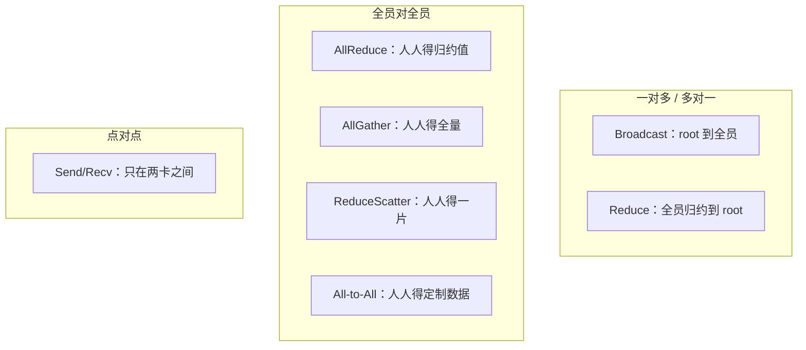

# 集合通信原语与并行映射

> 中文简称：集合通信原语与并行映射

> **一句话理解**: 先弄清楚每种并行训练到底在网上发了什么、每次发多大的消息，才知道网络该按什么规格去设计——这一页就是那张对照表。

---

## 一、七个集合通信原语

集合通信（Collective Communication）是一组多卡协同操作。框架层（Megatron、DeepSpeed、FSDP、vLLM）不直接操纵网线，而是调用 NCCL/HCCL 等库提供的这组原语；理解原语语义是理解一切上层通信流量的前提。

| **原语** | **语义** | **结果在谁手里** | **典型用途** |
|---------|---------|----------------|-------------|
| **Broadcast** | root 卡的数据发给所有卡 | 所有卡持有 root 的完整数据 | 参数初始化同步、配置下发 |
| **Reduce** | 所有卡的数据归约（求和/取大）后送到 root | 只有 root 拿到结果 | 旧式参数服务器梯度汇总 |
| **AllReduce** | Reduce + Broadcast 的组合 | 所有卡都拿到归约结果 | 数据并行梯度同步 |
| **AllGather** | 每卡出一片，拼成全量发给大家 | 所有卡都拿到拼接后的完整数据 | ZeRO-3/FSDP 参数收集 |
| **ReduceScatter** | 归约后按 rank 切片分发 | 每卡只拿到属于自己的那一片 | ZeRO-2/3 梯度分片归约 |
| **All-to-All** | 每卡发给每个对端的数据都不同 | 每卡收到来自所有人的定制数据 | MoE token 分发与回收 |
| **Send/Recv** | 点对点收发（严格说不是集合原语） | 只有对端 | 流水线并行的激活/梯度传递 |



图示七个原语按「参与方关系」的三分类。两个高频组合值得单独记住：AllReduce 等价于 ReduceScatter + AllGather 的串联，这个分解正是 Ring 算法的基础（见 [[12_架构基建/08_网络/07_GPU_高网设计/05_集合通信/02_Ring_vs_Tree_AllReduce|Ring 与 Tree AllReduce]]）；All-to-All 是唯一「每对卡之间传的数据互不相同」的原语，对网络的对分带宽与均衡性要求最苛刻。

---

## 二、每卡流量公式表

设通信组内共 n 张卡，每卡参与操作的 buffer 大小为 S 字节，每卡可用链路带宽为 B。下表是带宽最优算法下的每卡收发量，也是一切流量估算的出发点：

| **原语** | **每卡发送量** | **每卡接收量** | **备注** |
|---------|--------------|--------------|---------|
| **AllReduce** | 2(n-1)/n · S | 2(n-1)/n · S | 等于 RS + AG 两段之和；n 趋近无穷时逼近 2S |
| **AllGather** | (n-1)/n · S | (n-1)/n · S | S 为全量大小，每卡初始只持有 S/n |
| **ReduceScatter** | (n-1)/n · S | (n-1)/n · S | 结果每卡只有 S/n |
| **All-to-All** | (n-1) · s | (n-1) · s | s 为每卡发往单个对端的数据量 |
| **Broadcast / Reduce** | 约 S（树形路径上的中间节点有转发） | S | 流量集中在树路径，链路利用率不如环 |

代入两个例子建立量级感：

- 64 卡数据并行，梯度总量 S = 256MB，每步 AllReduce 每卡收发约 2 × 63/64 × 256MB ≈ 504MB，每步一次；
- 8 卡张量并行，单层 AllReduce S = 64MB 激活值，每个 transformer 层前向 + 反向触发多次，频次比数据并行高一个数量级以上。

注意 AllReduce 每卡收发量随 n 增长只从 1.5S（n=4）缓慢逼近 2S：卡数翻倍不会让每卡流量翻倍，但会让链路总数与对分带宽压力翻倍——这是容量规划的关键直觉，展开见 [[12_架构基建/08_网络/07_GPU_高网设计/08_容量成本/04_Traffic_Modeling|流量建模]]。

---

## 三、原语 × 并行策略矩阵

不同并行策略调用不同原语，消息大小与频次特征完全不同，直接决定它应该跑在哪一层网络：

| **并行策略** | **调用的原语** | **发生时机** | **消息特征** |
|------------|--------------|-------------|-------------|
| **数据并行 DP** | AllReduce（梯度） | 反向传播结束后 | 大消息、低频、可分桶重叠 |
| **ZeRO-1** | AllReduce | 同 DP（优化器分片不改变梯度同步方式） | 大消息、低频 |
| **ZeRO-2** | ReduceScatter（梯度）+ AllGather（更新后参数） | 反向结束 / 优化器步之后 | 大消息、频率同 DP |
| **ZeRO-3 / FSDP** | AllGather（参数）+ ReduceScatter（梯度） | 前向、反向逐层触发 | 中消息、高频、可 prefetch 重叠 |
| **张量并行 TP** | 每层 AllReduce（或 AllGather + RS 变体） | 每个 transformer 层前向 + 反向 | 中小消息、极高频、硬同步点 |
| **流水线并行 PP** | Send/Recv（激活、梯度） | 微批次边界 | 变长消息、点对点、可流水 |
| **专家并行 EP/MoE** | All-to-All（dispatch / combine） | 每个 MoE 层 | 中消息、高频、延迟敏感 |

对应到 PyTorch 接口层，就是三行代码的差别：

```python
import torch.distributed as dist
dist.all_reduce(bucket.grad)                  # DP：梯度同步
dist.all_gather(flat_shards, param_flat)      # FSDP：参数收集
dist.all_to_all(recv_tokens, send_tokens)     # MoE：token 分发
```

两个直接推论：

1. TP 的通信频次最高且不可隐藏，几乎总是被放进单机 8 卡，用 NVLink4 900GB/s（双向）或 NVLink5 1.8TB/s（双向）这样的机内高带宽域扛住；
2. DP/ZeRO 的消息最大但可与反向传播重叠，适合走跨机网络，带宽要求可以靠重叠摊薄（见 [[12_架构基建/08_网络/07_GPU_高网设计/05_集合通信/04_Compute_Comm_Overlap|通信计算重叠]]）。

---

## 四、Megatron 5D 并行的通信分解

Megatron 风格的大模型训练同时开五个维度：DP（数据）、TP（张量）、PP（流水线）、CP（上下文/序列）、EP（专家）。每个维度独立建通信组，各用各的原语：

| **维度** | **原语** | **典型通信组规模** | **落点网络** |
|---------|---------|------------------|-------------|
| **DP / ZeRO** | AllReduce 或 RS + AG | 全局（几十到上千卡） | 跨机为主，走 rail 优化拓扑 |
| **TP** | 每层 AllReduce，前向 + 反向各一轮 | 单机 8 卡为主 | 机内 NVLink / NVSwitch |
| **PP** | Send/Recv | 相邻 stage 两两一组 | 机内或相邻机，点对点 |
| **CP（上下文并行）** | AllGather + ReduceScatter（沿序列切分） | 序列组，常与 TP 同域 | 机内为主 |
| **EP（专家并行）** | All-to-All（token dispatch / combine） | 全局专家组 | 跨机，对分带宽敏感 |

排布原则一句话：**高频同步维度（TP/CP）压进机内 NVLink 域，可重叠的大消息维度（DP/EP）放跨机，PP 靠微批次流水把点对点流量藏进计算**。这个「并行维度 ↔ 网络层级」的对应，正是 [[12_架构基建/08_网络/07_GPU_高网设计/03_拓扑设计/05_Topology_Parallel_Matching|拓扑与并行匹配]] 的核心议题；并行策略本身的取舍细节见 [[10_部署推理/03_推理优化/18_Parallel_策略_深入分析|Parallel 策略深入分析]]。

---

## 五、为什么这张表是网络需求分析的输入

网络设计的反推链条，第一环就是这张矩阵，它直接回答四个问题：

1. **流量多大**：每卡收发公式 × 通信频率 × 并发度 = 每卡跨机带宽需求，再结合容忍度反推网卡数与收敛比（见 [[12_架构基建/08_网络/07_GPU_高网设计/03_拓扑设计/02_Oversubscription_Design|收敛比设计]]）；
2. **消息多大**：大消息走带宽最优算法、小消息走延迟最优算法，决定 Ring/Tree 选择与 NCCL 协议调优方向（见 [[12_架构基建/08_网络/07_GPU_高网设计/05_集合通信/03_NCCL_Tuning|NCCL 调优实战]]）；
3. **通信组跨不跨机**：TP 留机内，机内带宽决定 TP 上限；EP/DP 跨机，rail 优化拓扑的对分带宽决定扩展性；
4. **能否重叠**：可重叠的通信（DP 梯度、FSDP prefetch）允许实际带宽适度欠配，硬同步通信（TP 每层 AllReduce）必须足配。

因此并行策略参数（TP 尺寸、EP 度、微批数）不是纯算法问题，而是网络规格的上游输入；反过来，网络拓扑也会限制可行的并行度组合——设计与验证时两边要对着这张表反复对齐。

---

## 交叉引用

- [[12_架构基建/08_网络/07_GPU_高网设计/05_集合通信/02_Ring_vs_Tree_AllReduce|Ring 与 Tree AllReduce]]
- [[12_架构基建/08_网络/07_GPU_高网设计/05_集合通信/04_Compute_Comm_Overlap|通信计算重叠]]
- [[12_架构基建/08_网络/07_GPU_高网设计/03_拓扑设计/05_Topology_Parallel_Matching|拓扑与并行匹配]]
- [[12_架构基建/08_网络/07_GPU_高网设计/08_容量成本/04_Traffic_Modeling|流量建模]]
- [[10_部署推理/03_推理优化/18_Parallel_策略_深入分析|Parallel 策略深入分析]]

---

*Last updated: 2026-10-27*
