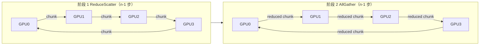

# Ring 与 Tree AllReduce

> 中文简称：Ring 与 Tree AllReduce

> **一句话理解**: 大文件搬家用环形接力（人人都在搬、链路全跑满），小纸条传话用树形转达（跳数最少、到得快）——NCCL 会按消息大小自动帮你选。

---

## 一、Ring 两阶段：ReduceScatter + AllGather

Ring AllReduce 把 n 张卡排成一个环，每卡 buffer 切成 n 段，分两个阶段完成：



图分两段：第一段每步沿环传「累加中的 chunk」，n-1 步后每张卡恰好持有一个段的完整归约值；第二段把「已归约的 chunk」沿环再转 n-1 步，人人拿到全量结果。以 n=4、每卡 S 字节为例看阶段 1：

| **步数** | **每卡动作** | **每卡发送量** |
|--------|-------------|--------------|
| **第 1 步** | 把自己某段的副本发给下家；收到上家的段并累加 | S/4 |
| **第 2 步** | 把累加后的段继续发给下家；收到再累加 | S/4 |
| **第 3 步** | 同上；3 步（n-1）结束时每卡持有 1 段完整归约值 | S/4 |

阶段 2 与之对称。两阶段合计 2(n-1) 步，每卡总发送量 = 2(n-1)/n · S——这正是 [[12_架构基建/08_网络/07_GPU_高网设计/05_集合通信/01_Collectives_Parallel_Mapping|集合通信原语与并行映射]] 里 AllReduce 流量公式的来源。

---

## 二、带宽最优的直觉

Ring 的核心优点：**任意时刻每张卡的发送链路与接收链路都在满载**，没有一条链路空闲，也没有「等别人」的串行浪费。因此它的带宽利用率是拓扑上限，时间公式：

T_ring ≈ 2(n-1)/n · S / B + 2(n-1) · α

其中 B 为每卡可用链路带宽（环上单方向），α 为每步的启动延迟。注意两个特性：

1. **带宽项几乎与 n 无关**：系数 2(n-1)/n 从 1.5（n=4）缓慢逼近 2，64 卡时为 1.97——卡再多，每卡搬运量也就 2S；
2. **延迟项线性增长**：共 2(n-1) 步，n=1024 时是 2046 次 α 的累积，小消息下这笔账很致命。

量级对照：单机 8 卡 NVLink4 每卡 900GB/s（双向，即单向聚合 450GB/s），Ring 跑大消息 allreduce 的 busbw 能接近单向聚合带宽上限——机内规格详见 [[12_架构基建/08_网络/07_GPU_高网设计/01_分层体系/01_Scale_Up_NVLink_NVSwitch|Scale-Up 互联 NVLink 与 NVSwitch]]。

---

## 三、Tree 算法：用跳数换延迟

Tree（NCCL 内部为 halving-doubling 风格实现）把通信组织成二叉树/蝴蝶网络：

- **ReduceScatter 用递归减半（recursive halving）**：每步只与距离减半的对端交换一半数据，log2(n) 步完成；
- **AllGather 用倍增（doubling）**：每步与距离翻倍的对端交换，再 log2(n) 步。

T_tree ≈ 2·log2(n) · α + 带宽项

| **规模 n** | **Ring 跳数 2(n-1)** | **Tree 跳数 2·log2(n)** |
|----------|---------------------|------------------------|
| **8** | 14 | 6 |
| **64** | 126 | 12 |
| **1024** | 2046 | 20 |

Tree 的代价是：同一时刻只有部分链路在干活，靠近树根的链路要承载聚合流量，带宽利用率不如 Ring；收益是跳数从线性降到对数。小消息（α 主导）下 Tree 完胜，大消息（带宽主导）下 Ring 完胜。

---

## 四、切换判据：NCCL 怎么选

判据本质是比较延迟项与带宽项谁主导：

| **条件** | **优选算法** | **原因** |
|---------|------------|---------|
| **消息大（MB 级以上）** | Ring | 带宽项主导，链路满载利用率最高 |
| **消息小（KB 级）** | Tree | 2·log2(n) 跳的延迟远小于 2(n-1) 跳 |
| **n 很大** | Tree 倾向增强 | Ring 延迟项 2(n-1)·α 线性恶化 |
| **单机 NVLink 域** | Ring 常见 | α 极小，延迟劣势不明显，带宽优势保留 |

NCCL 运行时按消息大小、rank 数与拓扑自动选择；用 NCCL_ALGO 可以强制指定并实测切换点：

```bash
NCCL_ALGO=Ring mpirun -np 8 ./build/all_reduce_perf -b 8 -e 1G -f 2
NCCL_ALGO=Tree mpirun -np 8 ./build/all_reduce_perf -b 8 -e 1G -f 2
```

对比两条输出曲线的交叉处，就是当前拓扑下的实际 Ring/Tree 分界。环境变量细节见 [[12_架构基建/08_网络/07_GPU_高网设计/05_集合通信/03_NCCL_Tuning|NCCL 调优实战]]。

---

## 五、algbw 与 busbw：把算法带宽折算成链路压力

nccl-tests 输出两个带宽，口径必须分清：

- **algbw**（algorithm bandwidth）= 消息大小 ÷ 完成时间，回答「这个集合操作整体跑多快」；
- **busbw**（bus bandwidth）= algbw × 算法搬运系数，AllReduce 的系数为 2(n-1)/n，即 busbw ≈ algbw × 2(n-1)/n（AllGather/ReduceScatter 系数为 (n-1)/n）。

busbw 的直觉：**它把算法的实际搬运量折算成对单条物理链路的压力**，因此「busbw 接近链路（或单卡聚合）额定带宽」就是算法把硬件跑满的标志。举例：400G 网卡（单向线速 50GB/s）跨机 allreduce，busbw 测得 45GB/s 即链路利用率 90%，集合通信层已无明显可挖，剩余瓶颈要去链路层找。

反过来，algbw 天然比 busbw 低一个系数。拿 algbw 直接和网卡规格对比会误判「网络很慢」——这是读 nccl-tests 输出最常见的错误，输出判读详见 [[12_架构基建/08_网络/07_GPU_高网设计/05_集合通信/06_NCCL_Tests_Reading|nccl-tests 判读]]。

---

## 交叉引用

- [[12_架构基建/08_网络/07_GPU_高网设计/05_集合通信/01_Collectives_Parallel_Mapping|集合通信原语与并行映射]]
- [[12_架构基建/08_网络/07_GPU_高网设计/05_集合通信/03_NCCL_Tuning|NCCL 调优实战]]
- [[12_架构基建/08_网络/07_GPU_高网设计/05_集合通信/06_NCCL_Tests_Reading|nccl-tests 判读]]
- [[12_架构基建/08_网络/07_GPU_高网设计/01_分层体系/01_Scale_Up_NVLink_NVSwitch|Scale-Up 互联 NVLink 与 NVSwitch]]
- [[概念/GPU/nccl|NCCL 概念页]]

---

*Last updated: 2026-10-27*
