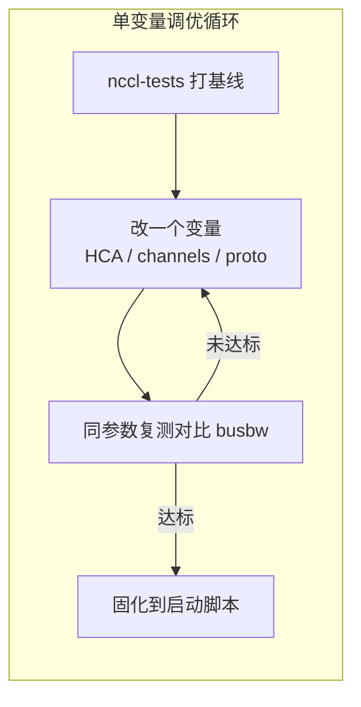

# NCCL 调优实战

> 中文简称：NCCL 调优实战

> **一句话理解**: NCCL 默认已经很强，调优就是让它「认对网卡、开够通道、别掉回 socket」，再用日志和打流确认每一步。

---

## 一、初始化流程：从建 ring 到选协议

每个 communicator 建立时，NCCL 走一遍固定流程，调优前必须知道每一步在做什么：

1. **枚举硬件**：扫描 GPU、IB/RoCE 网卡（HCA）与 PCIe 拓扑；
2. **探测互连**：两两判断 GPU 之间走 NVLink 直连（P2P）还是绕 PCIe/主机内存（PHB/SYS），GPU 到网卡是否具备 GPUDirect RDMA 能力；
3. **生成拓扑 XML**：把上述关系写成机器可读的拓扑图；
4. **编排通信结构**：按拓扑把 rank 编成 Ring/Tree 路径，优先把 NVLink 域放前段、跨机网卡放后段（与 [[12_架构基建/08_网络/07_GPU_高网设计/05_集合通信/02_Ring_vs_Tree_AllReduce|Ring 与 Tree AllReduce]] 的两阶段分解对应）；
5. **选择算法与协议**：按消息大小在 Ring/Tree/CollNet 与 Simple/LL/LL128 之间组合选择；
6. **建立 channel**：把并行通道绑定到网卡队列；此后集合通信 kernel 直接走 RDMA 数据面，不再经过控制面。

初始化只发生一次，但拓扑探测在大集群上可能耗时数秒到数十秒——这解释了为什么训练第一个 step 总是显著偏慢。

---

## 二、拓扑探测与 NCCL_TOPO_FILE

NCCL 支持把探测结果固化复用：

```bash
# 首次：把探测到的拓扑导出成文件
NCCL_TOPO_DUMP_FILE=/tmp/topo.xml mpirun -np 8 ./build/all_reduce_perf -b 1G -e 1G

# 之后：跳过探测，直接使用固化拓扑
NCCL_TOPO_FILE=/tmp/topo.xml mpirun -np 8 ./build/all_reduce_perf -b 1G -e 1G
```

适用与风险：

| **场景** | **是否固化** | **原因** |
|---------|------------|---------|
| **硬件固定的批量同构节点** | 建议 | 消除每次启动的探测时间与抖动 |
| **更换/新增网卡、改 NVSwitch 配置后** | 必须重新生成 | 旧 XML 与实际拓扑不符会直接选错路 |
| **排查问题阶段** | 不建议 | 需要看真实探测结果定位异常 |
| **云上虚拟化/异构节点** | 谨慎 | 探测结果可能随宿主机分配变化 |

---

## 三、关键环境变量速查

| **变量** | **作用** | **示例与注意** |
|---------|---------|--------------|
| **NCCL_DEBUG** | 日志级别 | `INFO`（调优必开）/ `WARN`（生产默认） |
| **NCCL_IB_HCA** | 指定使用的 IB 网卡 | `=mlx5_0,1,2,3`；用错口会绕远路或跑不满 |
| **NCCL_SOCKET_IFNAME** | 带外 socket 走的网卡 | `=eth0`；多网卡环境不指定常 connect 失败 |
| **NCCL_ALGO** | 强制算法 | `=Ring` / `=Tree` / `=CollNet`；用于验证切换点 |
| **NCCL_PROTO** | 强制协议 | `=Simple` / `=LL` / `=LL128`；小消息延迟敏感时实验 |
| **NCCL_MIN_NCHANNELS / NCCL_MAX_NCHANNELS** | 通道数下限/上限 | 常成对设成同值以固定通道数 |
| **NCCL_IB_GID_INDEX** | IB/RoCE GID 索引 | RoCE 下选错索引会落到错误网段 |
| **NCCL_PXN_DISABLE** | 关闭 PXN 跨 NVSwitch 转发 | `=1` 用于排查 PXN 路径问题 |

生产环境建议把选定组合写进集群统一的启动脚本，避免各节点环境漂移。

---

## 四、channel 数与网卡、队列对齐

NCCL 把一次集合操作拆成多个 channel 并行搬运，每个 channel 绑定一对收发路径。通道数是「网卡跑不满」的第一嫌疑：

- **通道太少**：8 张 400G 网卡只开 2 个 channel，等于 6 张网卡在围观，大消息 busbw 上不去；
- **通道太多**：每个 channel 的拷贝 kernel 占用 SM，通信与计算抢 GPU 资源——在重叠场景反而伤吞吐（见 [[12_架构基建/08_网络/07_GPU_高网设计/05_集合通信/04_Compute_Comm_Overlap|通信计算重叠]]）；
- **经验起点**：通道数与每卡跨机网卡数对齐（如每卡 1 张 400G 网卡配 8-16 通道起步），再实测扫消息大小验证。

```bash
# 固定通道数做对照实验
NCCL_MIN_NCHANNELS=8  NCCL_MAX_NCHANNELS=8  mpirun -np 64 ./build/all_reduce_perf -b 1M -e 1G -f 4
NCCL_MIN_NCHANNELS=16 NCCL_MAX_NCHANNELS=16 mpirun -np 64 ./build/all_reduce_perf -b 1M -e 1G -f 4
```

---

## 五、怎么读 NCCL DEBUG 日志

```bash
NCCL_DEBUG=INFO NCCL_DEBUG_SUBSYS=INIT,TOPO,TUNING torchrun --nproc_per_node=8 train.py
```

拿到日志后按清单看五个位置：

| **日志位置** | **看什么** | **异常信号** |
|------------|-----------|-------------|
| **硬件枚举段** | GPU 与 HCA 是否全部识别 | 少网卡、少 GPU |
| **拓扑树段（via=...）** | GPU-GPU 走 P2P 还是 PHB/SYS | 本应 NVLink 直连却绕 PCIe |
| **init 段 nChannels** | 实际建立的通道数 | 通道数远小于网卡数 |
| **算法/协议选择行** | 大小消息各用什么组合 | 与预期切换点不符 |
| **NET/IB 或 NET/Socket 行** | 跨机传输走什么 Provider | 出现 Socket 即已静默退回 TCP |

`connect` 类报错（Connection refused、no route）绝大多数指向 `NCCL_SOCKET_IFNAME` 选错网卡或多网卡环境未显式指定，而不是集合通信本身的问题。

---

## 六、容器化部署的常见坑

最常见的「性能腰斩」根因：容器里 IB 没用上，NCCL 静默退回 socket 传输。触发条件有两个——没挂 IB 设备文件、没装 ibverbs 用户态库。NCCL 对此默认只给 WARN 级提示，任务照常跑，只是带宽掉一个数量级。

```bash
docker run --gpus all \
  --device /dev/infiniband/ \
  --cap-add=IPC_LOCK \
  --ulimit memlock=-1 \
  nccl-test-image:latest
```

排查三步：

1. 容器内 `ls /dev/infiniband/`，确认设备可见；
2. 容器内 `ldconfig -p | grep ibverbs`，确认用户态库存在（通常随镜像内 rdma-core 安装）；
3. `NCCL_DEBUG=INFO` 日志里确认出现 `NET/IB` 而不是 `NET/Socket`。

`IPC_LOCK` 与 `memlock` 影响 RDMA 内存锁定，缺失时大 buffer 注册失败同样会降级或报错。

---

## 七、调优流程



图示循环的纪律是「一次只改一个变量」：同时改 HCA 和通道数，出问题无法归因。基线与验收的判读标准见 [[12_架构基建/08_网络/07_GPU_高网设计/05_集合通信/06_NCCL_Tests_Reading|nccl-tests 判读]]；日志之外的网络层定位工具链见 [[12_架构基建/08_网络/07_GPU_高网设计/07_运维故障/02_Network_Diagnostics_Command_Chain|网络诊断命令链]]。

---

## 交叉引用

- [[12_架构基建/08_网络/07_GPU_高网设计/05_集合通信/02_Ring_vs_Tree_AllReduce|Ring 与 Tree AllReduce]]
- [[12_架构基建/08_网络/07_GPU_高网设计/05_集合通信/06_NCCL_Tests_Reading|nccl-tests 判读]]
- [[12_架构基建/08_网络/07_GPU_高网设计/05_集合通信/04_Compute_Comm_Overlap|通信计算重叠]]
- [[12_架构基建/08_网络/07_GPU_高网设计/07_运维故障/02_Network_Diagnostics_Command_Chain|网络诊断命令链]]
- [[概念/GPU/nccl|NCCL 概念页]]

---

*Last updated: 2026-10-27*
