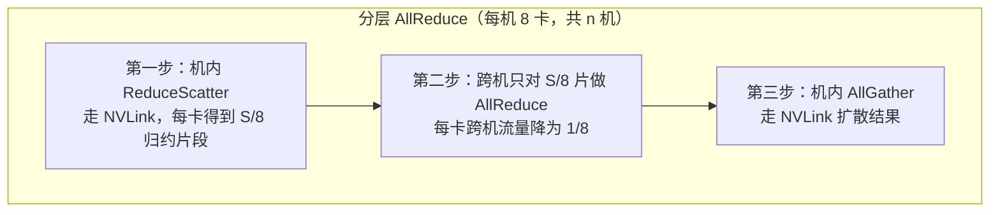

# 通信计算重叠

> 中文简称：通信计算重叠

> **一句话理解**: 让网卡搬数据与 GPU 算数同时进行，通信就不再白等——真正吃掉 MFU 的只是藏不住的那部分通信。

---

## 一、通信占比与 MFU 的关系

MFU（Model FLOPs Utilization）≈ 计算时间 /（计算时间 + 串行通信时间）。只有**暴露在外**（exposed，无法与计算重叠）的通信才计入分母；能藏进计算的通信近似免费。粗算一笔账：

| **通信占 step 比例** | **完全串行时 MFU** | **完全重叠时 MFU** |
|-------------------|------------------|------------------|
| **20%** | 约 83% | 近似不受影响 |
| **35%** | 约 74% | 近似不受影响 |
| **50%** | 约 67% | 近似不受影响 |

因此网络设计的目标不是「消灭通信流量」，而是「让暴露通信趋近零」：能重叠的大消息可以容忍带宽适度欠配，硬同步的通信必须足配。哪些通信能重叠、哪些不能，取决于并行策略——分层逻辑见 [[12_架构基建/08_网络/07_GPU_高网设计/05_集合通信/01_Collectives_Parallel_Mapping|集合通信原语与并行映射]]。

---

## 二、各并行策略的重叠手段

| **框架/策略** | **重叠手段** | **与什么计算重叠** | **效果** |
|-------------|-------------|------------------|---------|
| **DDP（数据并行）** | 梯度分桶（bucket，默认 25MB 量级），反向传播中先算完的桶先异步 AllReduce | 尚未算完的后续层反向传播 | 经典手段，能藏掉大部分梯度同步 |
| **FSDP / ZeRO-3** | 参数 prefetch：提前 AllGather 后续层参数 | 当前层的前向/反向计算 | 参数通信几乎全隐藏 |
| **PP（流水线）** | 1F1B 调度、交织微批次（interleaved 1F1B） | 相邻微批次的前向/反向 | 点对点 Send/Recv 藏进流水 |
| **TP（张量并行）** | 双流拆分 AllReduce、与 GEMM 局部重叠 | 同层其他分片的计算 | 难度大：每层是硬同步点，收益有限 |
| **EP/MoE** | dispatch → expert 计算 → combine 流水化 | 其他 expert 的计算 | token 搬运大部分可藏 |

规律：越靠近「每层必须同步」的维度（TP），越难重叠；越「整段一次性通信」的维度（DP 梯度、FSDP prefetch），越容易用流水藏住。

验证手段很直接：同一负载开/关重叠各跑一次（如调整 DDP 分桶策略、FSDP 的 prefetch 数量），两次 step 时间之差就是重叠真正省下的时间——这比任何估算都有说服力。

---

## 三、分层 AllReduce：把跨机流量除以 8

纯跨机 Ring AllReduce 每卡收发 2(n-1)/n · S，全部压在网卡上。分层（hierarchical）方案在机内 NVLink 与跨机网络之间做分工：



图示三步中，只有第二步占用宝贵的跨机带宽：跨机每卡流量从 2(n-1)/n · S 降到其 1/8；机内两步由 NVLink4 900GB/s（双向）这类高带宽域承担（机内规格见 [[12_架构基建/08_网络/07_GPU_高网设计/01_分层体系/01_Scale_Up_NVLink_NVSwitch|Scale-Up 互联 NVLink 与 NVSwitch]]）。代价是两阶段串行化带来额外延迟，因此分层方案适合大消息，小消息反而不如直接跑。

---

## 四、气泡：藏不住的等待

即使通信全部重叠，仍有两类结构性浪费：

**1. 流水线气泡**。PP 的 stage 在等相邻 stage 的输出，气泡占比 ≈ (p-1)/m（p 个 stage、m 个微批次）：

| **p / m 组合** | **气泡占比** |
|--------------|-------------|
| **8 / 64** | 约 10.9% |
| **8 / 16** | 约 43.8% |
| **16 / 64** | 约 23.4% |

微批次开得越多气泡越小；交织微批次进一步把有效 stage 数除以每 GPU 承载的 chunk 数，气泡再降一档。

**2. TP 的每层同步**。前向、反向每层各一次 AllReduce，前后层计算无法越过它——TP 的通信不是「藏不藏」的问题，而是同步点本身，只能靠机内带宽硬扛。这也是 TP 尺寸一般不超过单机 8 卡的主因，跨机代价见 [[12_架构基建/08_网络/07_GPU_高网设计/06_推理网络/02_TP_Cross_Node_Latency|TP 跨机延迟]]。

---

## 五、重叠什么时候失效

- **同步密集小消息**：每步通信只有几微秒，kernel 启动与同步开销吃掉重叠收益，此时该优化延迟而不是带宽（回到 [[12_架构基建/08_网络/07_GPU_高网设计/05_集合通信/02_Ring_vs_Tree_AllReduce|Ring 与 Tree AllReduce]] 的切换判据）；
- **网络抖动打断流水**：一次重传或 PFC 暂停让某步 AllGather 晚到，prefetch 流水断档，暴露通信突然增大——慢者效应的识别见 [[12_架构基建/08_网络/07_GPU_高网设计/07_运维故障/03_Straggler_Identification|慢者识别]]；
- **通信 kernel 抢占计算资源**：NCCL 通道的拷贝 kernel 占用 SM，通道开太多时通信与计算互相拖累（通道权衡见 [[12_架构基建/08_网络/07_GPU_高网设计/05_集合通信/03_NCCL_Tuning|NCCL 调优实战]]）；
- **计算太薄**：小 batch、短序列时层内计算量不足以覆盖一次通信，流水填不满，重叠窗口形同虚设。

---

## 六、诊断：从 profiler 看通信空转

```python
import torch
from torch.profiler import profile, ProfilerActivity

with profile(activities=[ProfilerActivity.CPU, ProfilerActivity.CUDA]) as prof:
    model.train_step()
print(prof.key_averages().table(sort_by="cuda_time_total"))
```

看三个信号：

| **信号** | **含义** | **指向** |
|---------|---------|---------|
| **comm stream 长段空闲** | 通信在等计算（桶没攒够、prefetch 没发出） | 桶大小/调度参数问题 |
| **compute stream 成段空隙** | 计算在等通信（AllGather 晚到） | 带宽欠配或延迟过高 |
| **AllReduce kernel 自身耗时长** | 通信本身慢 | 用 [[12_架构基建/08_网络/07_GPU_高网设计/05_集合通信/06_NCCL_Tests_Reading|nccl-tests 判读]] 查网络层 |

暴露通信时间的量化口径（torch profiler / nsys 中通信 kernel 时间减去与计算真正并行的部分）是衡量重叠效果的核心指标，也是训练侧 SRE 基线的一部分（见 [[07_模型训练/04_分布式训练/03_分布式训练_2026|分布式训练]]）。

---

## 交叉引用

- [[12_架构基建/08_网络/07_GPU_高网设计/05_集合通信/01_Collectives_Parallel_Mapping|集合通信原语与并行映射]]
- [[12_架构基建/08_网络/07_GPU_高网设计/05_集合通信/02_Ring_vs_Tree_AllReduce|Ring 与 Tree AllReduce]]
- [[12_架构基建/08_网络/07_GPU_高网设计/05_集合通信/03_NCCL_Tuning|NCCL 调优实战]]
- [[12_架构基建/08_网络/07_GPU_高网设计/06_推理网络/02_TP_Cross_Node_Latency|TP 跨机延迟]]
- [[12_架构基建/08_网络/07_GPU_高网设计/07_运维故障/03_Straggler_Identification|慢者识别]]

---

*Last updated: 2026-10-27*
