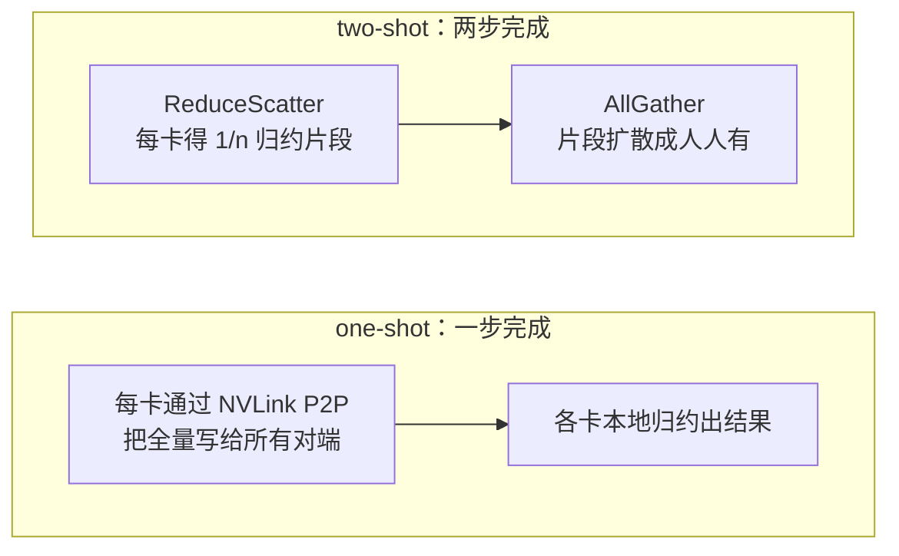

# 集合通信库对比

> 中文简称：集合通信库对比

> **一句话理解**: NCCL 是通用瑞士军刀，但推理机内小消息有更快的小刀——知道每个库在哪个场景更快，才知道为什么有人要绕开 NCCL。

---

## 一、库全景对比

| **库** | **硬件阵营** | **定位与特点** |
|-------|-------------|--------------|
| **NCCL** | NVIDIA GPU | 通用性最强：覆盖 PCIe/NVLink/IB/RoCE/Socket 全路径，训练推理默认选择，拓扑自适应与大消息带宽优化见长 |
| **HCCL** | 华为昇腾 NPU | 昇腾集群配套（CANN 栈内），接口风格对齐 NCCL，跨机走 CloudEngine 系网络 |
| **RCCL** | AMD GPU（ROCm） | NCCL 的 ROCm 分支，接口高度同源，训练框架迁移成本低 |
| **oneCCL** | Intel（oneAPI 栈） | 面向 CPU 与 Intel GPU 的异构体系，配合自家加速器生态 |
| **MSCCL++** | 学术/微软系 | 可编程集合通信：用脚本编排 ReduceScatter/AllGather 等流程，人工合成低延迟算法 |
| **custom allreduce（vLLM、TRT-LLM 内置）** | NVIDIA 机内 | 推理小消息专用：one-shot/two-shot 直连归约，绕开 NCCL 通用路径 |

接口层高度同源：HCCL/RCCL 的 API 命名与 NCCL 一一对应（ncclAllReduce 对应 hcclAllReduce / rcclAllReduce），PyTorch 侧多数时候只是换一个分布式后端名。这带来两层影响：

- 框架代码近乎零改动就能跨阵营迁移，但性能特征不会自动等价——通道数、算法切换点这些调优参数要按阵营重做；
- 语义兼容不等于行为兼容：拓扑探测、自适应路由等底层能力的成熟度差异，最终都体现为 busbw 与小消息延迟的差距；
- 版本节奏跟随各自栈：NCCL 随 CUDA、HCCL 随 CANN、RCCL 随 ROCm 迭代——升级驱动/固件时，通信库要一并纳入回归验证清单。

选型的第一分叉是硬件阵营（NVIDIA/昇腾/AMD/Intel），第二分叉才是同阵营内的「通用 vs 特化」。原语与流量公式是共同语言，与用哪个库无关（见 [[12_架构基建/08_网络/07_GPU_高网设计/05_集合通信/01_Collectives_Parallel_Mapping|集合通信原语与并行映射]]）。

---

## 二、推理机内小消息：为什么绕开 NCCL

推理的 TP 前向每层都要 AllReduce，但消息常只有几百 KB 到几 MB，且卡着毫秒级延迟预算。NCCL 的通用性在这个场景反而成为负担：

1. **通用拓扑逻辑的固定开销**：NCCL 要适配任意拓扑、任意 rank 数，初始化与调度路径长，小消息下这些固定开销占比极高；
2. **多协议与代理机制**：kernel 启动、通道管理、CPU 侧代理线程的延迟，在微秒级消息面前无法忽略；
3. **优化目标不同**：NCCL 为大消息带宽优化，推理机内要的是单次操作的最低延迟。

vLLM/TRT-LLM 的 custom allreduce 用**预建的对端 P2P 映射 + 单个 kernel 完成归约**砍掉这些开销，机内小消息延迟显著低于走 NCCL。切换通常按消息大小三级进行：极小消息 one-shot，中等消息 two-shot，超过阈值（MB 量级，随卡数与代际变化）回落 NCCL；当前消息落在哪一级，看推理引擎日志里的 allreduce 路径选择即可。跨机做 TP 的延迟问题另见 [[12_架构基建/08_网络/07_GPU_高网设计/06_推理网络/02_TP_Cross_Node_Latency|TP 跨机延迟]]。

```bash
# vLLM 中控制 custom allreduce 的开关（默认开启，小消息自动走 custom 路径）
python -m vllm.entrypoints.openai.api_server --disable-custom-all-reduce
```

---

## 三、one-shot 与 two-shot



图示两种实现的差别落在步数与每卡数据量上：

| **实现** | **步数** | **每卡数据量** | **适用** |
|---------|---------|--------------|---------|
| **one-shot** | 1 | (n-1) · S（全量写给每个对端） | 极小消息，延迟最低 |
| **two-shot** | 2 | 2(n-1)/n · S | 稍大消息，带宽友好 |
| **NCCL Ring（回落）** | 2(n-1) 步 | 2(n-1)/n · S | 大消息，带宽最优 |

two-shot 本质就是把分层 ReduceScatter + AllGather 特化成机内专用流水；one-shot 的带宽代价（每卡发 n-1 份全量）之所以可接受，是因为机内 NVLink 带宽充裕且消息极小——这也是它只用于机内、不用于跨机的原因。消息再大则交回 NCCL 的 Ring（见 [[12_架构基建/08_网络/07_GPU_高网设计/05_集合通信/02_Ring_vs_Tree_AllReduce|Ring 与 Tree AllReduce]]）。

---

## 四、SHARP / CollNet 与本页的关系

SHARP 在 IB 交换机网元内做归约：GPU 端把数据发进网络，交换机算完送回；NCCL 通过 CollNet 算法接入。它与 custom allreduce 是同一方向的两种做法——**都绕开「GPU 端通用集合路径」来降延迟或降载**：区别在于一个把计算卸载到交换机（跨机场景），一个把路径特化到机内 NVLink。

与 custom allreduce 的关系是互补而非竞争：SHARP 降的是跨机带宽占用与 GPU 端负载，custom allreduce 降的是机内延迟；同一套推理集群可以机内走 custom、跨机走 CollNet 或普通 Ring。机制详见 [[12_架构基建/08_网络/07_GPU_高网设计/04_协议传输/04_SHARP_In_Network_Computing|SHARP 在网计算]]。

---

## 五、选型建议

| **场景** | **首选** | **理由** |
|---------|---------|---------|
| **训练跨机（DP/ZeRO/FSDP）** | NCCL | 拓扑自适应、大消息带宽最优、生态最全（调优见 [[12_架构基建/08_网络/07_GPU_高网设计/05_集合通信/03_NCCL_Tuning|NCCL 调优实战]]） |
| **推理机内 TP 小消息** | vLLM/TRT-LLM custom allreduce | 固定开销低、延迟最低 |
| **推理大 EP 跨机** | NCCL，可试 MSCCL++ | All-to-All 带宽与可编程优化 |
| **昇腾集群** | HCCL | 生态绑定，与 Atlas/CloudEngine 成套交付 |
| **AMD ROCm 集群** | RCCL | 接口同源，训练框架近乎零改动 |
| **极致低延迟定制场景** | MSCCL++ | 算法可编排、可人工合成 |

各库的实测差异量化方法与 [[12_架构基建/08_网络/07_GPU_高网设计/05_集合通信/06_NCCL_Tests_Reading|nccl-tests 判读]] 相同：大消息看 busbw 是否贴近链路上限，小消息看延迟量级是否达标。

混合部署提醒：同一集群「训练走 NCCL、推理机内走 custom」是常态而非例外；监控基线要把两条路径分开建，避免拿训练侧的 busbw 经验去判推理侧的延迟指标。

---

## 交叉引用

- [[12_架构基建/08_网络/07_GPU_高网设计/05_集合通信/01_Collectives_Parallel_Mapping|集合通信原语与并行映射]]
- [[12_架构基建/08_网络/07_GPU_高网设计/05_集合通信/03_NCCL_Tuning|NCCL 调优实战]]
- [[12_架构基建/08_网络/07_GPU_高网设计/06_推理网络/02_TP_Cross_Node_Latency|TP 跨机延迟]]
- [[12_架构基建/08_网络/07_GPU_高网设计/04_协议传输/04_SHARP_In_Network_Computing|SHARP 在网计算]]
- [[概念/GPU/nccl|NCCL 概念页]]

---

*Last updated: 2026-10-27*
