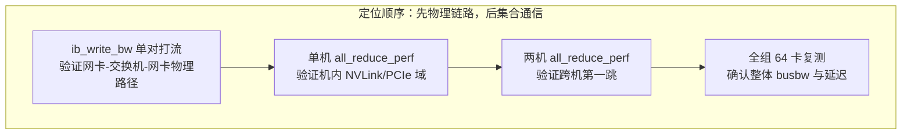

# nccl-tests 判读

> 中文简称：nccl-tests 判读

> **一句话理解**: 用 nccl-tests 把一组卡到一组卡的通信能力测成一行 busbw 数字，再对照达标线判断网络健不健康、坏在哪里。

---

## 一、工具矩阵

nccl-tests 是一组微基准工具，先选对工具再谈判读：

| **工具** | **测的原语** | **对应真实负载** |
|---------|------------|----------------|
| **all_reduce_perf** | AllReduce | DP/ZeRO 梯度同步，最常用的体检项 |
| **all_gather_perf** | AllGather | ZeRO-3/FSDP 参数收集路径 |
| **alltoall_perf** | All-to-All | MoE/EP 的 token 分发 |
| **sendrecv_perf** | Send/Recv | PP 激活传递、点对点链路质量 |
| **reduce/broadcast_perf** | Reduce、Broadcast | 按需补充的覆盖面 |

原语与并行策略的对应关系见 [[12_架构基建/08_网络/07_GPU_高网设计/05_集合通信/01_Collectives_Parallel_Mapping|集合通信原语与并行映射]]。

---

## 二、常用参数与标准命令

| **参数** | **含义** |
|---------|---------|
| **-b** | 起始消息大小（字节，可带 K/M/G 后缀） |
| **-e** | 终止消息大小 |
| **-f** | 增长因子 |
| **-g** | 每进程使用的 GPU 数 |
| **-w** | warmup 次数（预热不计成绩） |
| **-n** | 正式迭代次数 |

8 机 64 卡（每机 8 卡、每进程绑 1 卡）的标准扫法：

```bash
mpirun -np 64 --hostfile hosts \
    ./build/all_reduce_perf -b 8 -e 8G -f 2 -g 1 -w 4
```

从 8 字节扫到 8GB、每次翻倍：小消息段反映延迟（Tree/LL 路径），大消息段反映带宽（Ring/Simple 路径），一条命令把两条曲线都拿到（算法选择逻辑见 [[12_架构基建/08_网络/07_GPU_高网设计/05_集合通信/02_Ring_vs_Tree_AllReduce|Ring 与 Tree AllReduce]]）。

---

## 三、读懂输出

典型输出（节选）：

```
#       size    count   type  redop    root     time   algbw   busbw #wrong
#                               (B)  (elements)          (us)  (GB/s)  (GB/s)
           8        2  float    sum      -1    35.2    0.00    0.00      0
      65536    16384  float    sum      -1    43.7    1.50    3.00      0
 1073741824 268435456 float   sum      -1  11821.5   90.9  180.3      0
```

三个口径必须分清：

- **time**：单次操作耗时（微秒）。小消息段看这列，64 卡跨机 8B 消息几十微秒属正常量级；
- **algbw** = size ÷ time：算法带宽，回答「这个操作整体多快」，天然偏低；
- **busbw** = algbw × 2(n-1)/n（AllReduce 口径）：折算成对物理链路的压力，**这才是和网卡规格比的列**（推导见 [[12_架构基建/08_网络/07_GPU_高网设计/05_集合通信/02_Ring_vs_Tree_AllReduce|Ring 与 Tree AllReduce]]）。

「out of bus bandwidth」百分比即 busbw ÷ 理论链路带宽：例如 400G 网卡（单向线速 50GB/s）测得 busbw 45GB/s，即 90%。加 `-c` 可顺带校验正确性：`#wrong` 非零说明数据被写坏，优先怀疑链路或内存问题，而不是带宽。

---

## 四、达标线

| **busbw / 理论值** | **判定** | **动作** |
|------------------|---------|---------|
| **≥ 85-90%** | 良好 | 记录为基线，纳入监控 |
| **70-85%** | 可疑 | 查拓扑探测、通道数、网卡绑定（见 [[12_架构基建/08_网络/07_GPU_高网设计/05_集合通信/03_NCCL_Tuning|NCCL 调优实战]]） |
| **< 70%** | 异常 | 按下一节模式表排查 |

判定要分消息段：大消息段看 busbw 达标率，小消息段（KB 级）看 time 是否在正常延迟量级——两者坏因不同，混在一起看会误诊。

---

## 五、异常模式速查

| **现象** | **最可能原因** | **下一步** |
|---------|--------------|-----------|
| **单机 8 卡正常、多机直接腰斩** | 跨机链路问题：HCA 没用满、rail 接错、退回 socket | 查 NCCL_IB_HCA 与日志中 NET/IB 行 |
| **特定两台机参与就慢** | 网卡代际混插、光模块劣化、PCIe 带宽不足 | ib_write_bw 对这两台定点打流对比 |
| **小消息延迟超标数倍** | 协议/算法选择不当、CPU 亲和性差、NUMA 远端访问 | NCCL_ALGO/PROTO 对照实验、绑核 |
| **偶发抖动或卡死** | 丢包重传、PFC 风暴、链路翻动 | 转网络层诊断 |

---

## 六、与 ib_write_bw 配合：先链路后集合



图示自底向上的顺序是定位纪律：ib_write_bw 正常而 all_reduce_perf 异常，问题在 NCCL 配置或拓扑编排；ib_write_bw 本身就差，先修链路再谈集合层。链路层工具的完整命令链见 [[12_架构基建/08_网络/07_GPU_高网设计/07_运维故障/02_Network_Diagnostics_Command_Chain|网络诊断命令链]]，周期性基线对比见 [[12_架构基建/08_网络/07_GPU_高网设计/07_运维故障/06_Telemetry_Baseline_Monitoring|遥测基线监控]]。

---

## 交叉引用

- [[12_架构基建/08_网络/07_GPU_高网设计/05_集合通信/02_Ring_vs_Tree_AllReduce|Ring 与 Tree AllReduce]]
- [[12_架构基建/08_网络/07_GPU_高网设计/05_集合通信/03_NCCL_Tuning|NCCL 调优实战]]
- [[12_架构基建/08_网络/07_GPU_高网设计/07_运维故障/02_Network_Diagnostics_Command_Chain|网络诊断命令链]]
- [[12_架构基建/08_网络/07_GPU_高网设计/07_运维故障/06_Telemetry_Baseline_Monitoring|遥测基线监控]]
- [[12_架构基建/08_网络/05_网络_Diagnostics_命令|网络 Diagnostics 命令]]

---

*Last updated: 2026-10-27*
