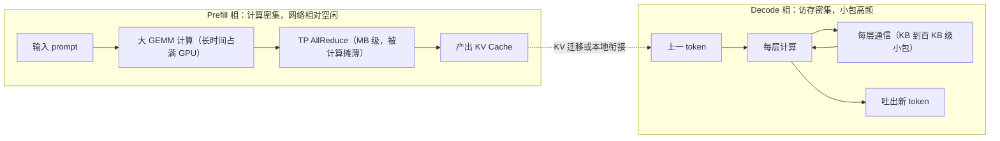

# 训练与推理流量模型对比

> 中文简称：训练与推理流量模型对比

> **一句话理解**: 训练每 step 发一次 GB 级大包、拼带宽；推理 decode 每层每 token 发 KB 级小包、拼延迟——同一张网伺候两类流量，必须分开设计。

---

## 一、总对比：一张 AI 网，两种流量物种

训练与推理都在跑集合通信，但流量模型几乎相反：只按训练的「大带宽无阻塞」思路建网，推理会在小包延迟与抖动上翻车；只按低延迟思路建网，又喂不饱训练的大象流。

| **对比维度** | **训练流量** | **推理 decode 流量** |
| --- | --- | --- |
| 典型消息大小 | GB 级梯度张量（bucket 切分后单次仍为数十至数百 MB） | 每层 KB 到百 KB 级激活分片（batch 大时涨到 MB 级） |
| 触发频率 | 每 step 每个参数桶一次，周期性 | 每层每 token 一次，持续高频 |
| 性能敏感性 | 带宽敏感：通信时间 ≈ 数据量 ÷ 有效带宽 | 延迟敏感：小包耗时由排队、跳数与协议栈决定，堆带宽几乎无效 |
| 主要流向 | 对称 AllReduce（梯度求和），环形双向流动 | All-to-All（EP 的 dispatch/combine）、AllReduce（TP）、KV 单向搬运（PD 分离） |
| 拥塞特征 | 大象流长时间打满链路，step 末尾 incast 突发 | 微突发密集，对交换机队列深度极其敏感 |
| 抖动容忍 | 中等：可与计算 overlap 掩盖一部分 | 极低：每层通信是串行硬依赖，尾延迟原样进 P99 TPOT |

归纳成一句话：训练流量问「单位时间搬多少」，decode 流量问「这一跳多久能过去」。

---

## 二、推理内部两相：Prefill 相与 Decode 相

推理自身也不是一种流量，而是两种性质相反的相在交替：

| **维度** | **Prefill 相** | **Decode 相** |
| --- | --- | --- |
| 计算特征 | 大 GEMM、计算密集，算力吃得满 | 小 GEMM、访存密集，算力大量闲置 |
| 网络负载 | 相对空闲：只有 TP AllReduce，且被长计算时间摊薄 | 小包高频：每层每 token 都有 TP AllReduce 或 EP All-to-All |
| 消息量级 | tokens × hidden × dtype，输入长度乘上去后为 MB 级 | batch 小时仅 KB 到百 KB 级，接近甚至低于 MTU |
| 对应指标 | 主要决定 TTFT | 主要决定 TPOT |

prefill 网络压力小，不是因为没有通信，而是消息虽大、计算时间更长，通信占比低；decode 恰好相反——单包极小、次数极多、且每次都躺在关键路径上。把两相在调度上解耦（PD 分离）会引入一条新的 KV 传输链路，见 [[12_架构基建/08_网络/07_GPU_高网设计/06_推理网络/03_PD_Disaggregation_KV_Transfer|PD 分离 KV 传输链路]]。

---

## 三、TTFT 与 TPOT 的网络项拆解

把两个服务指标按组成项拆开，才能看清网络各管哪一段：

| **指标** | **组成项** | **网络可控项** |
| --- | --- | --- |
| TTFT | 排队等待 + prefill 计算 + KV 迁移（PD 分离时）+ 首 token 回包传输 | KV 传输带宽与并发度、调度排队策略、回包路径 |
| TPOT | 每层（计算 + 通信）× 层数，逐 token 重复 | 跨机每层通信时延、队列调度、与业务流的隔离程度 |

量化感受 decode 的放大效应：80 层模型、每层 2 次 AllReduce，跨机后每次多 3µs，单个 token 就多约 0.5ms；基线 TPOT 20ms 时 P50 抬高约 2.5%，拥塞抖动会把 P99 抬得更多。完整推导见 [[12_架构基建/08_网络/07_GPU_高网设计/06_推理网络/02_TP_Cross_Node_Latency|TP 跨机的时延账]]。

---

## 四、对网络设计的不同要求

流量模型的差异落到网络设计上，是两套优先级：

| **设计项** | **训练优先** | **推理优先** |
| --- | --- | --- |
| 收敛比 | 无阻塞（1:1），超购直接掉 MFU | 可适度收敛，延迟与抖动优先于极限带宽 |
| 交换机 buffer | 大 buffer 吸收 step 末尾 incast | 大 buffer 吸收 All-to-All 微突发，且更怕排队抖动 |
| 拥塞控制 | DCQCN/PFC 面向大流吞吐调参 | 面向小包低排队：推理流量走高优先级队列 |
| 流量隔离 | 与存储/业务网分平面即可 | 要与一切业务流（存储、监控、API 回包）隔离 |
| 核心指标 | 均值带宽、MFU | P99 TTFT/TPOT，抖动即事故 |

两类失败模式也完全不同：训练网络的失败是「吞吐不足、step 时间拉长」，损失的是算力成本；推理网络的失败是「P99 飙升、流式输出卡顿」，直接损失用户体验。

---

## 五、训推混部：冲突点与隔离手段

训推混部（同一集群同时跑训练与在线推理）的冲突集中在三处：

1. 训练大象流打满共享链路，推理小包在同队列排队，延迟从 µs 级恶化到 ms 级；
2. 训练 step 末尾的 incast 触发 PFC 暂停帧扩散，推理端口被连坐暂停；
3. 训练周期性全网格打流，推理的 P99 变成「跟着训练 step 节奏抖」，难复现也难归因。

隔离手段按彻底程度排序：

| **手段** | **做法** | **效果与代价** |
| --- | --- | --- |
| 物理分平面 | 训推各用独立 NIC 与独立交换机 | 最彻底，硬件与机房端口成本翻倍 |
| 逻辑隔离 | 按流量类型分队列，推理小包走高优先级，配差异化 ECN/PFC | 硬件复用，调参门槛高，故障域仍共享 |
| 错峰与限速 | 训练通信限速、推理保障带宽下限、大任务错峰 | 零硬件成本，牺牲训练吞吐，适合过渡期 |

平面划分的总体设计见 [[12_架构基建/08_网络/07_GPU_高网设计/01_分层体系/03_Multi_Plane_Network_Segmentation|多平面网络分割]]；混部下的租户隔离细则见 [[12_架构基建/08_网络/07_GPU_高网设计/07_运维故障/05_Multi_Tenant_Isolation|多租户隔离]]。

---

## 六、两相流量示意

prefill 相里网络近乎旁观者；decode 相每生成一个 token，模型每一层都要过一次小包集合通信，通信次数等于「层数 × token 数」，这就是推理网络延迟敏感的根源。

两类流量各自怎么估容见 [[12_架构基建/08_网络/07_GPU_高网设计/08_容量成本/04_Traffic_Modeling|流量建模]]；推理侧的完整视角见 [[12_架构基建/08_网络/07_GPU_高网设计/10_视角/02_Inference_Angle|推理视角]]。

---

## 交叉引用

- [[12_架构基建/08_网络/07_GPU_高网设计/06_推理网络/02_TP_Cross_Node_Latency|TP 跨机的时延账]]
- [[12_架构基建/08_网络/07_GPU_高网设计/06_推理网络/03_PD_Disaggregation_KV_Transfer|PD 分离 KV 传输链路]]
- [[12_架构基建/08_网络/07_GPU_高网设计/06_推理网络/05_EP_Multi_Node_Network|EP 多机推理网络]]
- [[12_架构基建/08_网络/07_GPU_高网设计/08_容量成本/04_Traffic_Modeling|流量建模]]
- [[12_架构基建/08_网络/07_GPU_高网设计/10_视角/02_Inference_Angle|推理视角]]

---

*Last updated: 2026-10-27*
