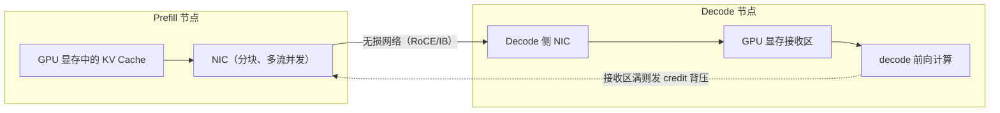

# PD 分离 KV 传输链路

> 中文简称：PD 分离 KV 传输链路

> **一句话理解**: PD 分离后，prefill 算好的 KV Cache 要从预填充节点的显存「搬家」到解码节点的显存，这条搬家链路的带宽、流控与调度联动直接决定 TTFT。

---

## 一、为什么要把 Prefill 与 Decode 分开

- **资源画像相反**：prefill 是大 GEMM 的计算密集型，decode 是读权重与 KV 的访存密集型，同一组 GPU 混跑时互相拖累；
- **独立弹性**：分离后 prefill 组按 TTFT SLO 扩容、decode 组按并发与 TPOT 扩容，P/D 配比随流量曲线调整；
- **SLO 解耦**：TTFT 与 TPOT 两个指标分别归 prefill 组与 decode 组负责，长尾互不传染。

代价是新增一条必经链路：prefill 的结果 KV 必须送到 decode 侧才能开算，传输慢则 TTFT 直接膨胀。架构层面的完整讨论见 [[10_部署推理/03_推理优化/13_Prefill_Decode_Disaggregation|Prefill/Decode 分离]] 与 [[12_架构基建/08_网络/07_GPU_高网设计/06_推理网络/01_Training_vs_Inference_Traffic|训练与推理流量模型对比]]。

---

## 二、KV 迁移链路与实现路径

链路本体：prefill 节点 GPU 显存 →（GPUDirect RDMA 直取，或经 host 内存中转）→ prefill 侧 NIC → 无损网络 → decode 侧 NIC → decode 节点 GPU 显存接收区。



链路方向是单向为主（prefill → decode），但控制面双向：decode 侧用 credit/确认帧反向控制发送速率，避免接收区被冲爆。

实现路径目前有三类，不互斥、常组合使用：

| **实现路径** | **典型代表** | **特点** |
| --- | --- | --- |
| 集合通信搬运 | NCCL broadcast / isend-irecv | 复用 NCCL 拓扑与 RDMA 能力，搭建最快；但面向大张量吞吐设计，小传输的启动开销与额外显存拷贝不占优 |
| 引擎级 KVConnector | vLLM KVConnector 生态（NIXL、Mooncake adapter 等） | 与引擎调度器集成：按 chunk 传输，传输期间实例可继续处理其他请求 |
| 专用 KV 传输/缓存组件 | LMCache、Mooncake transfer engine | 面向 KV 分块、零拷贝与前缀复用优化，可挂分级存储 |

GPUDirect RDMA 让 NIC 直写对端显存、跳过 host 中转，是低开销路径的基础，见 [[12_架构基建/08_网络/07_GPU_高网设计/04_协议传输/06_GPUDirect_Family|GPUDirect 家族]]。

---

## 三、传输层选择

| **传输层** | **适用场景** | **优点** | **局限** |
| --- | --- | --- | --- |
| NCCL 点对点/broadcast | 已有 NCCL 环境，快速搭原型 | 拓扑自适应、开发量小 | comm group 建立开销、额外 buffer 拷贝、流控粗 |
| RDMA zero-copy 分块 | 生产主力 | 显存直写、多流并发打满 NIC、chunk 级流控 | 依赖无损网络与内存注册管理 |
| TCP 兜底 | 无 RDMA 环境、跨可用区降级 | 到处能跑 | 带宽与延迟差数倍，仅保命 |

生产上主流是 RDMA zero-copy 分块：把整段 KV 切成固定大小的 chunk，多队列对并发发送，既打满带宽又留出流控粒度。无损网络（RoCE 的 PFC/ECN 或 IB）是前提，调优见 [[12_架构基建/08_网络/07_GPU_高网设计/04_协议传输/02_Lossless_Ethernet_PFC_ECN_DCQCN|无损以太网 PFC/ECN/DCQCN]] 与 [[12_架构基建/08_网络/06_RDMA_and_RoCE_for_AI|RDMA 与 RoCE for AI]]。

---

## 四、带宽估算公式与算例

```text
KV 字节数（单请求）
  = 2 × 层数 × KV 头数 × head_dim × dtype 字节数 × 序列长度
  其中 2 = K 与 V 两份；MHA 时 KV 头数 = 注意力头数，GQA 时为 KV 组头数

跨网带宽需求 ≈ 并发请求数 × 单请求 KV 字节数 ÷ 传输时间预算
```

| **模型口径** | **KV 结构** | **每 token KV 体量** | **8K 上下文单请求** |
| --- | --- | --- | --- |
| 70B 级 GQA、fp16 KV | 80 层、8 KV 头、head_dim 128 | 2×80×8×128×2 = 320KB | 约 2.6GB |
| 同结构、fp8 KV | 同上、dtype 减半 | 160KB | 约 1.3GB |
| KV 头更少的 GQA 变体 | 视 KV 头数等比缩小 | 数十到百余 KB | 1GB 以内 |

把算例代进公式：100 并发 × 8K 上下文 × 320KB/token（fp16）≈ 260GB，要在 decode 接管前 2s 内搬完，需要约 130GB/s，即 1Tbps 量级；若 KV 用 fp8、KV 头更少、或前缀复用命中一部分，需求回落到数百 Gbps 级。

这就是 PD 分离集群在计算网之外，还要为 KV 传输单独准备多张 400G 网卡聚合（或独立平面）的原因。带宽口径速查见 [[12_架构基建/08_网络/07_GPU_高网设计/01_分层体系/06_Bandwidth_Latency_Cheat_Sheet|带宽与时延速查表]]，整体容量推演见 [[12_架构基建/08_网络/07_GPU_高网设计/08_容量成本/04_Traffic_Modeling|流量建模]]。

---

## 五、流控与背压

- **接收区有限**：decode 侧接收区（预注册显存或 pinned 内存）容量有限，KV 涌入快于 decode 消耗时必须背压；
- **chunk + 信用窗口**：decode 侧按空闲块发放 credit，prefill 侧拿到 credit 才发下一块，速率自动匹配消费速度；
- **背压失效的两个后果**：其一，decode 显存被 KV 挤爆，请求被抢占重算，prefill 白算一遍；其二，KV 大流挤占同网卡的 TP/EP 小包，TPOT 恶化。

KV 大流与延迟敏感小包共网时必须做队列隔离或独立网卡，否则一条 KV 搬迁就能把整组 decode 的 P99 拖垮，隔离思路回到 [[12_架构基建/08_网络/07_GPU_高网设计/06_推理网络/01_Training_vs_Inference_Traffic|训练与推理流量模型对比]] 的第四节。

---

## 六、调度联动：配比、复用与路由

- **P/D 配比**：prefill 与 decode 组数按到达率与 SLO 动态配，失衡时排队与传输距离同时恶化；
- **前缀复用**：系统提示词、多轮历史这类公共前缀命中则既不重算也不重传，传输量按命中率等比削减——复用命中率就是带宽放大器；
- **缓存亲和路由**：调度器把请求路由到已持有其前缀 KV 的 decode 节点或缓存节点，避免无谓搬移；
- **KV 齐备再开算**：decode 实例应等 KV 传输完成才开始前向，传输完成度本身是调度信号。

PD 配比与 KV 生命的业务侧推演见 [[10_部署推理/03_推理优化/28_办公Agent_PD分离_链路推演|办公 Agent PD 分离链路推演]]。下一步形态是把 KV 从「一次性搬家物」升级为「全局可复用的池」，见 [[12_架构基建/08_网络/07_GPU_高网设计/06_推理网络/04_Mooncake_KV_Pool|Mooncake KV 池化架构]]。

---

## 交叉引用

- [[12_架构基建/08_网络/07_GPU_高网设计/06_推理网络/04_Mooncake_KV_Pool|Mooncake KV 池化架构]]
- [[12_架构基建/08_网络/07_GPU_高网设计/06_推理网络/01_Training_vs_Inference_Traffic|训练与推理流量模型对比]]
- [[10_部署推理/03_推理优化/13_Prefill_Decode_Disaggregation|Prefill/Decode 分离]]
- [[10_部署推理/03_推理优化/05_KV_Cache_深入分析|KV Cache 深入分析]]
- [[12_架构基建/08_网络/06_RDMA_and_RoCE_for_AI|RDMA 与 RoCE for AI]]
- [[10_部署推理/03_推理优化/28_办公Agent_PD分离_链路推演|办公 Agent PD 分离链路推演]]

---

*Last updated: 2026-10-27*
