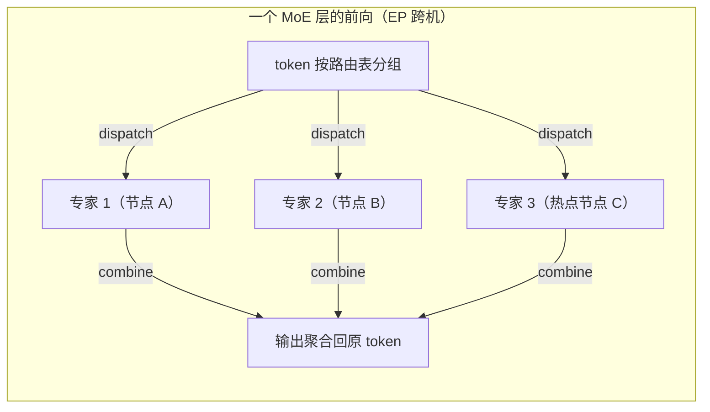

# EP 多机推理网络

> 中文简称：EP 多机推理网络

> **一句话理解**: MoE 大模型推理把专家撒到几十上百张卡上，token 每层都要「寄快递」给专家再收回来——这张网的核心是双向 All-to-All 的突发吞吐与抗热点能力。

---

## 一、为什么 MoE 推理走向多机 EP

推力来自三个方向：

- **单机放不下**：DeepSeek-V3/R1 一类 671B 稠密专家模型，全量专家权重达数百 GB 到 TB 级（取决于精度），单机 8 卡装下全部专家后还要给 KV 与激活留显存，几乎不可能；
- **要负载均衡**：专家路由是动态的，单机部署必然出现热点卡与闲置卡；EP 把专家均匀撒到更多卡上，用全局路由摊平负载；
- **有公开先例**：DeepSeek 官方披露的推理系统采用大规模跨节点专家并行（数百卡规模的预部署 EP），是多机 EP 的标志性实践。

概念底座见 [[概念/GPU/expert-parallelism|专家并行]] 与 [[05_大模型/04_LLM架构/14_MoE_推理优化_2026|MoE 推理优化 2026]]。与 TP 跨机的矛盾不同：TP 跨机死于每层同步小包延迟（见 [[12_架构基建/08_网络/07_GPU_高网设计/06_推理网络/02_TP_Cross_Node_Latency|TP 跨机的时延账]]），EP 跨机则是被业务规模推着走、用网络工程把它伺候好。

---

## 二、All-to-All 流量特征

每个 MoE 层产生 dispatch 与 combine 两次双向 All-to-All：token 先按路由表发往各专家所在卡，专家算完再回传聚合。流量形状有三个要点：

- **burst 突发**：同一层的所有 token 在同一时刻发起 dispatch，全网同步突发，交换机瞬时承受远超均值的入向速率；
- **expert 热度不均**：路由是学出来的分布，天然倾斜，热门专家所在节点与链路的流量远超均值——A2A 的瓶颈不是均值带宽，而是最热的那条链路；
- **消息大小随相变化**：prefill 时 token 多、消息大，属吞吐型；decode 时每卡每层只发 batch 数量级的小消息，属延迟型。两相都要伺候好，网络得同时具备大 buffer 吞吐与低排队延迟。

这三点决定了 EP 网络的选型逻辑与训练网不同——训练网调均值带宽，EP 网调的是尾部那条最热路径。

---

## 三、DeepEP 类库的路由优化

DeepEP 是面向 MoE 推理/训练的通信库，其设计浓缩了 EP 网络的工程经验：

| **机制** | **做法** | **解决的问题** |
| --- | --- | --- |
| 机内 NVLink + 跨机 RDMA 两级转发 | 先在机内经 NVLink 汇聚/分发，跨机只走必要的 RDMA 链路 | 减少跨机网卡数与交换机负载，摊薄 per-GPU 流量 |
| normal 模式（高吞吐） | 面向 prefill/训练，经两级转发、追求带宽利用率 | 大消息 burst 的吞吐 |
| low-latency 模式 | 面向 decode，纯 RDMA 直写、为 µs 级小消息优化 | 每层 A2A 的延迟 |
| hook 重叠机制 | dispatch/combine 与 attention、共享专家计算重叠 | 用计算掩盖部分通信时间 |

同类思路也在其他集合通信库里出现，横向对比见 [[12_架构基建/08_网络/07_GPU_高网设计/05_集合通信/05_Collective_Libraries_Alternatives|集合通信库替代方案]]；NVIDIA 侧的对应栈见 [[12_架构基建/08_网络/07_GPU_高网设计/09_厂家/01_NVIDIA_Networking_Stack|NVIDIA 网络栈]]。

两级转发的本质是跨机流量的汇聚复用：机内 NVLink 带宽充裕，先把发往同一远端的 token 在机内拼成大消息，跨机链路数与协议开销同步下降——这也是 EP 跨机没有像 TP 跨机那样被延迟账判死刑的重要原因。

---

## 四、网络要求表

EP 推理对网络的要求可以列成一张表：

| **要求** | **原因** | **典型做法** |
| --- | --- | --- |
| 少一跳（单层 CLOS 优先） | decode A2A 小消息延迟主导，每多一跳加百 ns 级转发加一次排队机会 | 单 spine 无核心层、或把 EP 收进超节点内 |
| 大 buffer 交换机 | dispatch 同步突发，浅 buffer 直接丢包或触发 PFC 风暴 | 51.2T 一代（Tomahawk 5 级别）数据中心交换机的深共享 buffer |
| 自适应路由/负载均衡 | expert 热度不均造成少数链路热点，静态哈希无法避开 | IB 自适应路由、以太动态负载均衡，A2A 天然多路径 |
| 低抖动 | 一层 A2A 的完成时间取决于最慢的收发方，尾延迟决定层时间 | 严格队列、与业务流隔离、无损网络调优 |

拓扑选型上，单层 CLOS（或超节点内组 EP）比多层 CLOS 每次通信少一跳排队，EP 场景收益比训练更明显，见 [[12_架构基建/08_网络/07_GPU_高网设计/03_拓扑设计/01_Fat_Tree_CLOS|Fat-Tree CLOS]] 与 [[12_架构基建/08_网络/07_GPU_高网设计/03_拓扑设计/06_Supernode_MegaPod_MultiPlane|超节点与 MegaPod]]；自适应路由细节见 [[12_架构基建/08_网络/07_GPU_高网设计/04_协议传输/03_IB_Flow_Control_Adaptive_Routing|IB 流控与自适应路由]]。

---

## 五、监控要点

EP 集群要盯三个信号：

- **per-expert 流量分布**：top-k 专家的流量占比是热点链路的先行指标，倾斜度上升就该预警（考虑专家重均衡或副本）；
- **A2A 时间占比**：dispatch/combine 耗时 ÷ MoE 层总耗时，超过阈值说明网络或路由倾斜在吃性能；
- **热点链路告警**：per-port 利用率的不均衡度、PFC 暂停帧速率、重传率，配合同组 NIC 的 p99 完成时间离散度做 straggler 判定，见 [[12_架构基建/08_网络/07_GPU_高网设计/07_运维故障/03_Straggler_Identification|Straggler 识别]]。

A2A 时间占比是最有性价比的一个指标：它不依赖逐包遥测，从引擎侧打点就能算，又能同时反映网络拥塞与 expert 热度两个问题。

---

## 六、与训练 AllReduce 流量差异对选型的影响

把两类流量对交换机的要求摆在一起看差异：

| **维度** | **训练 AllReduce** | **推理 A2A（EP）** |
| --- | --- | --- |
| 流量形状 | 持续大流、对称 | 双向突发、不对称（受 expert 热度影响） |
| 瓶颈 | 有效带宽（收敛比） | 最热链路与尾延迟 |
| 网内计算（SHARP） | AllReduce 语义可卸载，收益直接 | A2A 非 reduce 语义，不直接适用 |
| 选型侧重 | 无阻塞带宽、聚合/卸载能力 | buffer 深度、自适应路由、低时延转发 |

同一代交换机同时承载两类负载时，EP 推理对「深 buffer + 自适应路由」的权重要显著高于训练场景；训推混部时更要按 [[12_架构基建/08_网络/07_GPU_高网设计/06_推理网络/01_Training_vs_Inference_Traffic|训练与推理流量模型对比]] 的隔离手段分平面或分队列，SHARP 的适用边界见 [[12_架构基建/08_网络/07_GPU_高网设计/04_协议传输/04_SHARP_In_Network_Computing|SHARP 网内计算]]。

---

## 交叉引用

- [[12_架构基建/08_网络/07_GPU_高网设计/06_推理网络/02_TP_Cross_Node_Latency|TP 跨机的时延账]]
- [[12_架构基建/08_网络/07_GPU_高网设计/06_推理网络/01_Training_vs_Inference_Traffic|训练与推理流量模型对比]]
- [[05_大模型/04_LLM架构/14_MoE_推理优化_2026|MoE 推理优化 2026]]
- [[12_架构基建/08_网络/07_GPU_高网设计/03_拓扑设计/01_Fat_Tree_CLOS|Fat-Tree CLOS]]
- [[12_架构基建/08_网络/07_GPU_高网设计/04_协议传输/03_IB_Flow_Control_Adaptive_Routing|IB 流控与自适应路由]]
- [[12_架构基建/08_网络/07_GPU_高网设计/05_集合通信/05_Collective_Libraries_Alternatives|集合通信库替代方案]]

---

*Last updated: 2026-10-27*
