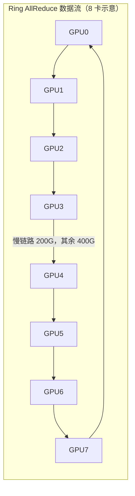

# 网络故障分布与模式

> 中文简称：网络故障分布与模式

> **一句话理解**: 网络坏了先怀疑光模块和线缆，其次网卡，最后才是交换机——前者的数量多好几倍、接头裸露怕灰、还怕热。

---

## 一、故障率排序：数量基数决定分布

故障率 ≈ 单体故障率 × 部件数量。一台 8 卡 GPU 服务器通常配 8 张 400G 网卡，每张网卡至少一个光模块，交换机侧还有等量端口模块——光模块与线缆的数量基数可达 GPU 的 3-5 倍。放到几千卡的集群上，光模块数量轻松破万，交换机却只有几十到几百台，因此集群级故障分布高度稳定，不随厂家明显改变：

| **排序** | **部件** | **相对故障率** | **主导原因** |
|---|---|---|---|
| 1 | 光模块 / 线缆（AOC、DAC、跳纤） | 最高 | 数量基数 3-5 倍于 GPU；接头污染（灰尘、指纹油膜）；温度敏感，光功率随结温漂移 |
| 2 | 网卡（NIC/DPU） | 中 | 固件缺陷、PCIe 接触不良、散热不足引起的降速或复位 |
| 3 | 交换机 | 较低 | 单体可靠性高但单点影响面大；电源、风扇通常先于转发芯片失效 |
| 4 | 光纤链路整体（含配线架与跳纤段） | 低但隐蔽 | 弯折半径超标、跳纤松脱导致光衰渐进劣化，平时不坏、高负载掉速 |

光模块怕热的机理：激光器输出功率与接收灵敏度都随温度漂移，机房热点上的模块会先出现误码率抬升，再发展成 CRC 与 flapping——「同一排机柜顶部的模块先坏」并不玄学，是气流组织问题。

两个推论直接影响运维资源分配：

- 一线工单的大头（经验上过半）落在光模块与线缆上，值班排班与备件池按此倾斜；
- 交换机故障频率低但爆炸半径大——一台 spine 失效影响的训练任务最多，预案要按「低频高危」单独演练，不能只按工单量排优先级。

注意排序的前提是数量基数：它回答的是「集群级故障从哪来」，不代表单体质量排序。单体角度看，交换机的可靠性远高于光模块。

---

## 二、典型故障模式速查

| **故障模式** | **表现** | **第一诊断动作** |
|---|---|---|
| link flapping | 端口反复 up/down，NCCL 频繁重连，任务 hang 后自愈又复发 | `ibstat` 看 Physical state 抖动；读光功率是否接近模块灵敏度下限 |
| CRC 错包 | 吞吐下降、重传增多，pcrc/rcrc 计数增长 | `ethtool -S` 与交换机 counter 定位增长在哪一段；清洁接头复测，仍增长则更换该段模块/线缆 |
| 端口 lane 降速（宽口裂开 400G→200G） | 链路仍 Active 但速率掉档，涉及链路的打流带宽腰斩 | `ibstat` 核对 Rate 是否掉到 200G；重插拔，无效则与对端交叉换模块定位 |
| 静默丢包 / bitflip | 无告警无重传，但 loss 偶发不收敛、数值结果偶发出错 | 与基线两两打流对比；查 CRC 与 FEC counter 交叉验证；锁定链路后换硬件验证 |
| PFC 风暴 | 交换机 buffer 打满、pause 大面积扩散，吞吐断崖 | 先看交换机 pfc counters 与 watchdog 状态止损，再查拥塞源或配置根因 |
| 交换机缓冲异常 | 特定流量模型下时延尖刺，集合通信长尾拉大 | show interface counters 看 drop 与暂存计数；核对 buffer 水位与队列配置 |
| 网卡固件异常 | 链路状态全部正常但吞吐异常、偶发 hang | 比对网卡固件版本与集群批准版本；升级到统一版本后复测 |

模式之间有演进关系：光衰 → CRC 间歇增长 → 链路反复重训练（表现为 flapping）→ 彻底 down。在 CRC 阶段拦住它，代价只是换一个模块；拖到 down 阶段，就是一次生产事故加全组排查。

速查表的用法：先按表现匹配模式，执行第一诊断动作，再决定换件。不要跳过诊断直接换件——换件会引入新变量（接触状态、固件版本、批次差异），把一次性故障变成间歇性故障。

---

## 三、备件与 RMA 策略

光模块按消耗品管理，备件比例为总量的 1-3%：规模越大统计越平稳，比例可取低值，但备件下限必须覆盖 RMA 往返周期内的预期故障量：

```
备件下限 = 光模块总数 × 月故障率 × RMA 往返周期（月） × 安全系数
```

RMA 按固定闭环执行，防止坏件回流备件池：

1. 换下的坏模块当场贴工单号与故障现象标签，禁止复用、禁止插回备件池；
2. 24 小时内在备件台账登记：序列号、所在链路、故障 counter 截图、光功率读数；
3. 攒批发起 RMA，取得厂商 Return 授权后寄出；
4. 返修/换新回货先过一致性检验（协商速率、光功率范围、打流达标），合格才入池。

固件齐平是隐性要求。同型号光模块与网卡存在多个固件版本时，链路重训练策略与 FEC 兼容性会有差异，表现为「换完更怪」。集群维护一份当前批准版本清单，入网与换新一律刷到该版本再上线。

---

## 四、上电前后的预防工艺

故障大头在物理层，预防也主要在物理层，且大部分动作在首次上电前完成：

- 布线工艺（上电前）：跳纤弯曲半径不超标、不扎带过紧；所有光纤接头插拔前用一次性清洁笔清洁；未插的端口与模块必须戴防尘帽；
- 标签：线缆两端标签（机柜-U 位-端口号）一一对应；标签缺失的线不允许上线——排查 flapping 时，找线时间经常超过修线本身；
- 上电验收：点亮即读 RX/TX 光功率并存档，连同首装打流值一起构成该链路的「出厂带宽数」基线；
- 周期巡检：每月抽读光功率与首装值对比，漂移超过 2dB 的链路安排计划内更换，不等它断。

防尘帽的价值常被低估：机房气流带来的灰尘会在未使用的光模块端口内沉积，首次插纤时被顶入接触面，成为「新开局就 CRC」的经典来源。同理，机柜搬动、服务器抽插后的链路劣化，第一怀疑对象永远是接头状态而不是交换机。

---

## 五、「一慢俱慢」：单条慢链路拖垮整组 AllReduce

ring allreduce 是同步流水线：数据沿环逐跳流动，每个 GPU 的下一步发送依赖上一跳的到达。任何一条链路慢——降速、CRC 引发的低效重传、光衰导致的链路层重训练——整环每一步都要等它走完。



图中 G3→G4 一段降速后，每个数据块经过该段的耗时最长，环上所有 GPU 的步调都被它锁定。

- 机制：环上每个数据块都要流经该慢链路，慢链路成为全环的串行瓶颈；
- 量化直觉：n 卡 ring 的 allreduce 吞吐近似等于最慢链路的可用带宽，而不是各链路带宽的平均值；
- 放大效应：512 卡集群里 1 条 400G 降为 200G 的链路，足以把整组总线带宽（busbw）拖到接近腰斩——症状是「全组都慢」，根因只有一处。

这也是慢节点定位方法成立的物理基础：全组掉速不需要怀疑 512 个节点，只需要找到那条最慢的链路，具体方法见慢节点定位与隔离。

---

## 交叉引用

- [[12_架构基建/08_网络/07_GPU_高网设计/07_运维故障/02_Network_Diagnostics_Command_Chain|网络诊断命令链]]
- [[12_架构基建/08_网络/07_GPU_高网设计/07_运维故障/03_Straggler_Identification|慢节点定位与隔离]]
- [[12_架构基建/08_网络/07_GPU_高网设计/07_运维故障/06_Telemetry_Baseline_Monitoring|网络遥测与监控基线]]
- [[12_架构基建/08_网络/07_GPU_高网设计/02_物理层硬件/03_Optical_Modules|光模块]]

---

*Last updated: 2026-10-27*
