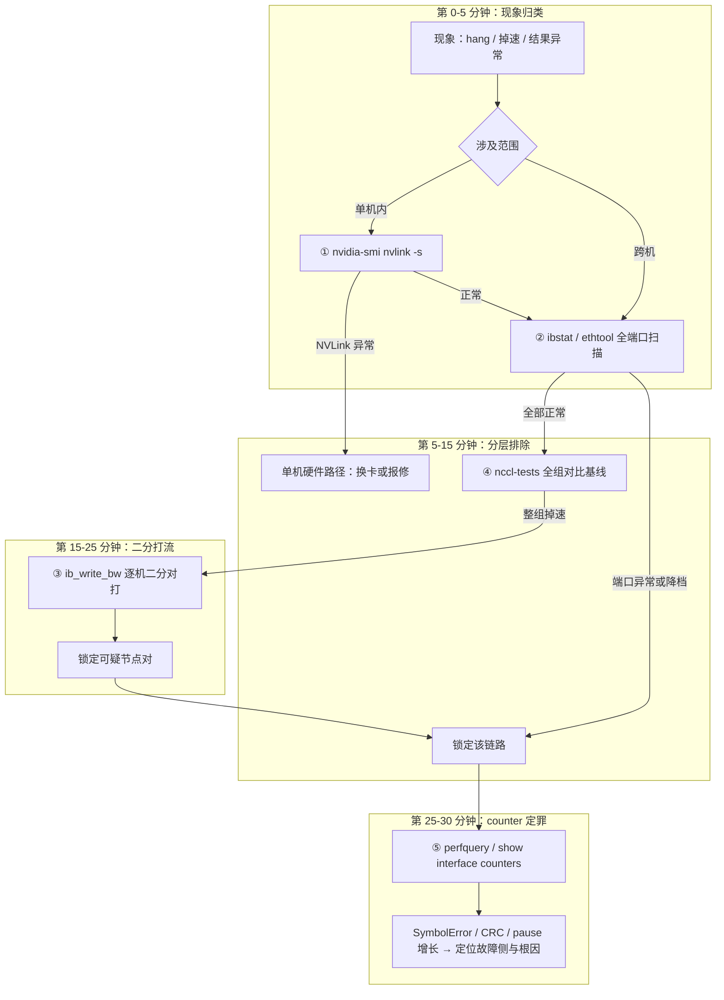

# 网络诊断命令链

> 中文简称：网络诊断命令链

> **一句话理解**: 排网络故障要一层层来：先看机器里（NVLink）、再看线上（端口状态）、再实际打流测带宽、再跑全组集合通信、最后去交换机 counter 上拿证据。

---

## 一、五层命令链总览

诊断顺序固定为五层，每层只回答一个问题，不跳层：

| **层** | **命令** | **回答的问题** |
|---|---|---|
| ① GPU/NVLink 侧 | `nvidia-smi nvlink -s`、`nvidia-smi topo -m` | 单机内 NVLink 有没有 lane 掉线；拓扑与 NUMA 亲和是否符合预期 |
| ② 链路层 | `ibstat`、`ibv_devinfo`、`ethtool` | 端口是否 Active、速率有没有降档 |
| ③ 单链路打流 | `ib_write_bw` / `ib_read_bw` 两两对打 | 单条链路实际带宽与该链路基线带宽数的差距 |
| ④ 全组集合 | `nccl-tests`（all_reduce_perf 等） | 整组集合通信吞吐/时延与全组基线的差距 |
| ⑤ 交换机侧 | `perfquery`、`show interface counters` | 错包与 pause 到底产生在哪一段、哪一侧 |

①②层成本最低、信息密度最高，永远先做；④层异常而①②③层全部正常时，才把怀疑转向拓扑路由、ECMP 哈希或集合算法配置。

**① GPU/NVLink 侧**

```bash
nvidia-smi nvlink -s     # 每条 NVLink 的状态；出现 Disable/Fail 即单机内问题，不用再查跨机
nvidia-smi topo -m       # GPU-网卡-NUMA 拓扑；确认网卡挂在预期 NUMA 节点、亲和没被改坏
```

**② 链路层**

```bash
ibstat                   # 端口 State/Physical state/Rate；一眼看出是否 Active、是否降档
ibv_devinfo              # RDMA 设备与端口信息；确认设备可见、端口 active
ethtool <dev>            # 以太侧链路状态、速率与协商结果
```

**③ 单链路打流（两两对打）**

```bash
# 对端起 server（-d 指定 RDMA 设备，-a 覆盖多档消息尺寸）
ib_write_bw -d <dev> -a --report_gbits
# 本端打流，结果与该链路的基线带宽数对比
ib_write_bw -d <dev> -a --report_gbits <对端IP>
```

**④ 全组集合通信**

```bash
# 与首装存档基线同参数复跑（进程数、消息尺寸一致才可比）
mpirun -np <N> --hostfile hosts \
  ./build/all_reduce_perf -b 8 -e 1G -f 2 -g 1 | tee baseline_$(date +%F).log
```

**⑤ 交换机侧**

```bash
perfquery                 # IB 侧链路错误计数（SymbolError、链路 CRC 等）
show interface counters   # 以太侧错包、drop、pause 计数（命令形态随厂商 CLI 而异）
```

---

## 二、30 分钟定位流程

现象出现后按固定节奏推进，避免一上来就全员抓包：



流程的三个原则：先分层后打流（状态检查便宜、打流贵）；二分而不是遍历（每轮对打把嫌疑范围减半）；counter 定罪（打流只能定位到「哪条链路」，counter 才能回答「哪一侧、什么类型的错」）。

---

## 三、关键输出判读表

| **输出/计数** | **正常** | **异常判读** | **下一步** |
|---|---|---|---|
| `ibstat` State/Physical | Active / LinkUp | LinkDown 或状态反复翻转 = flapping | 读光功率；清洁或更换线缆模块 |
| Rate 速率字段 | 400G（NDR） | 200G = 宽口裂开 lane 降速 | 重插拔；换模块；核对 FEC |
| SymbolError | 0 或长期不变 | 持续增长 = 物理层劣化中 | 看增长方向，定位故障侧 |
| pcrc / rcrc（链路 CRC） | 0 | 增长 = 该链路在错包 | 换该段线缆/模块后复测 |
| pause 帧速率 | 低且平稳 | 陡增 = 拥塞或 PFC 异常 | 转入无损配置核查 |
| ③ 打流带宽 | 达到该链路基线的九成以上 | 明显低于基线 | 保持锁定，换硬件验证 |
| ④ busbw / algbw | 与全组基线一致 | 阶梯状掉速 | 结合拓扑判断哪一层链路出问题 |

判读要点：counter 类指标看「增量速率」而不是绝对值——一台跑了半年的交换机累计错包不为零很正常，两分钟内涨几百个才是事故。

---

## 四、NCCL 日志关键字

NCCL 日志是成本最低的全组探针，训练任务默认就该带 `NCCL_DEBUG=INFO` 运行：

| **日志关键字** | **含义** | **常见根因** |
|---|---|---|
| `NCCL WARN ... Connect to ... failed` | 建立连接失败 | 对端网卡 down、路由不通、端口被占用 |
| socket retry / 连接重试反复出现 | 控制通道（TCP）不稳 | 管理网链路劣化、防火墙干扰长连接 |
| transport 断开 / 通道中途关闭 | 已建立的通信通道断开 | 链路 flapping、网卡复位、驱动异常 |
| 启动期的网络插件选择行 | 实际选用的传输 | 若回退到 Socket/TCP 而非 IB/RoCE 传输，带宽只剩零头，属于配置问题而非硬件故障 |

排障习惯：任务 hang 时先抓 NCCL 日志时间线——最后一条 INFO 的时间点大概率就是断链时刻，拿这个时刻去对交换机 counter 增量与系统日志，比全量翻日志快得多。

---

## 五、与通用诊断页的分工

本页聚焦 GPU 集群网络的链路侧：NVLink 状态、IB/RoCE 链路、单链路打流、集合通信基线、交换机 counter。通用网络命令（连通性、路由、抓包类）的基础用法在[[12_架构基建/08_网络/05_网络_Diagnostics_命令|网络诊断命令]]页，两页互补不重叠：先在本页分层收敛到具体链路，再按需去通用页做协议层深挖。

---

## 交叉引用

- [[12_架构基建/08_网络/07_GPU_高网设计/07_运维故障/01_Failure_Distribution_Patterns|网络故障分布与模式]]
- [[12_架构基建/08_网络/07_GPU_高网设计/07_运维故障/03_Straggler_Identification|慢节点定位与隔离]]
- [[12_架构基建/08_网络/07_GPU_高网设计/07_运维故障/06_Telemetry_Baseline_Monitoring|网络遥测与监控基线]]
- [[12_架构基建/08_网络/07_GPU_高网设计/05_集合通信/06_NCCL_Tests_Reading|nccl-tests 结果判读]]

---

*Last updated: 2026-10-27*
