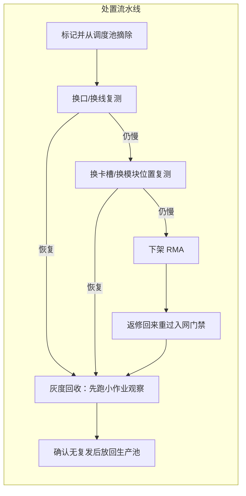

# 慢节点定位与隔离

> 中文简称：慢节点定位与隔离

> **一句话理解**: 集群整体变慢时不用怀疑每一台机器——先分清是卡慢、网慢还是盘慢，再用二分法把那一个「拖后腿的」揪出来隔离。

---

## 一、三类慢源区分

「慢」有三种来源，定位手段完全不同，先分类再动手：

| **慢源类型** | **典型表现** | **判别特征** | **首选定位手段** |
|---|---|---|---|
| 慢卡（GPU/显存异常） | 整机跑分低、单卡算力或显存带宽异常 | 单机内 NVLink 打流正常、跨机链路正常，但该机单卡 micro-benchmark 明显偏低 | GPU 侧压测（算力、显存带宽、温度与降频检查） |
| 慢链路（网络侧） | 涉及该机的两两打流异常、双机 nccl-tests 掉速 | 单机内正常，凡与该机组队的跨机链路都偏慢 | ib_write_bw 逐机矩阵 + 交换机 counter |
| 慢盘 / IO（存储侧） | 数据加载 wait 高、GPU 空转等数据 | 网络打流与集合通信全部正常，但 step 时间被数据加载拉长 | iostat / 存储监控 / dataloader profile |

判别的三板斧：跑一次单机内标准测试、一次跨机标准测试、看一眼训练侧等待分布——单机内都慢是卡；单机内正常、跨机慢是链路；网络全正常但吞吐曲线呈锯齿状空转是盘。三类混叠时（既有慢链路又有慢盘）先修硬故障（链路），再处理软劣化（IO）。

慢卡的典型误判：整机跑分低时第一反应常是网络，但单机内打流（NVLink 与网卡自环）全部正常即可排除网络——问题在卡本身，常见根因是温度墙降频、显存退化、供电不足。

---

## 二、定位手段：从全组到单机

**第一步：全组基线对比。** 用 nccl-tests 与首装基线同参数复跑，确认整组掉速幅度。幅度还能提示怀疑层次：接近腰斩通常是单条链路降档级别的硬故障；百分之几的劣化更多是链路质量渐进劣化或环境变化。

```bash
# 全组基线复跑（参数必须与存档基线一致，否则数字不可比）
mpirun -np <N> --hostfile hosts ./build/all_reduce_perf -b 8 -e 1G -f 2 -g 1
```

**第二步：逐机矩阵二分。** 把嫌疑节点集合一分为二，两边互打，慢的一边再对半分，log(N) 轮收敛到具体节点对。矩阵结果同时存档——它就是下一次的对比基线。

```bash
# 逐机矩阵二分（示意）：嫌疑集合对半互打，慢的一侧继续对半
# 每轮结果入库，形成可追溯的定位链
```

**第三步：耗时 gap 与 profiler 佐证。**

- allreduce 耗时的 max-min gap：每个 rank 上报本地集合耗时，gap = max − min；gap 持续为大值说明有 rank 一直在等人，等待方与被等方的分布就是方向性线索；
- torch profiler：看 comm kernel 的等待时间分布，等待集中在与某个节点相关的通道上，即指向该节点；
- `NCCL_DEBUG=INFO` 的时长线索：各通道建立时间、每次集合调用的耗时分布，异常节点会在时间线上留下尾巴。

```bash
# 定位期临时打开详细日志（日志量大，平时关闭）
NCCL_DEBUG=INFO NCCL_DEBUG_SUBSYS=INIT mpirun -np <N> --hostfile hosts ./train_script.sh
```

gap 统计的实现要点：以 NCCL communicator 为粒度收集各 rank 集合耗时，按节点聚合看分布——单点 max 且其余聚集是典型 straggler 信号；多点分散偏高更像拥塞或配置类问题，不是某个节点。

**第四步：单链路定罪。** 对锁定的节点对跑 ib_write_bw 两两对打，再上交换机 counter 确认错误类型（SymbolError、CRC、pause 哪个在增长），完成从「哪台机器」到「哪条链路哪一侧」的收敛。打流只能定位链路，counter 才能定罪到侧，具体命令见网络诊断命令链。

---

## 三、隔离与处置流水线

定位后不要立即下架，按流水线逐级处置，每级都有复测门禁：



流水线的价值在于区分「可恢复问题」与「部件本体问题」：换口复测能恢复的，大概率是物理接触或污染；换位置仍慢的才值得走 RMA，避免把好件寄走、坏件留下。灰度回收期建议至少覆盖一个完整训练周期，间歇性故障短测测不出来。

处置期间的标签管理：被标记节点在调度与监控两个系统里同时打标，监控侧持续记录其链路指标，作为复测通过与灰度回收的判据，避免「修没修好全凭印象」。

---

## 四、慢节点的放大效应

n 卡 ring allreduce 是同步流水线，所有参与者按最慢环节对齐步调：

- 吞吐近似等于最慢链路/最慢卡的可用带宽，而不是集群的平均水平——512 卡的环里一个慢环节，511 张卡都在等它；
- 时间维度同样放大：每个 step 的集合通信被拉长，计算时间不变，通信占比上升，MFU 直接受损；
- 更隐蔽的是长尾效应：平均耗时可能只涨一点，但 P99 步时翻倍——对带同步屏障的训练任务，看分位数比看均值更早发现问题；
- 量化示例（定性）：某环节有效带宽只有其他链路一半时，环上每个数据块过该段的耗时翻倍，全环步调随之下调，整体 busbw 上限被压到接近一半。

这就是为什么慢节点要「隔离」而不是「容忍」：留在池子里，它不仅贡献自己的低吞吐，还持续把全组基线拉低，让后续新故障的劣化混入旧噪声，更难被发现。

---

## 五、预防：入网门禁与周期抽测

- 新机入网基线门禁：新节点上线前必须通过单机压测 + 两两打流矩阵 + 与既有节点的 nccl-tests 双机对比，三项全部达标才允许进调度池；
- 周期性全组抽测：每周或每次大版本变更后抽样重跑基线，与首装存档对比，漂移超阈值的节点进观察名单；
- 门禁数据与遥测基线共用同一套存档格式，入网值天然成为该节点的首个基线点，后续趋势对比由此起算；
- 调度器联动：被处置流水线标记的节点在 CMDB 里冻结，杜绝「边修边被调度」的二次事故；
- 处置记录沉淀：每次 straggler 处置的根因（接触、固件、部件本体）归类入库，月度复盘反哺备件与巡检策略；
- 显存与温度排查前置：慢卡里相当比例是降频引起——先看温度与功耗曲线是否顶墙，再怀疑硬件本体，能省下大量无谓换件。

门禁与抽测的本质是把「慢节点发现」从被动响应变成主动筛选：被动发现靠生产任务掉速，代价是整组陪跑；主动筛选在低峰期完成，代价只是一点测试算力。

---

## 交叉引用

- [[12_架构基建/08_网络/07_GPU_高网设计/07_运维故障/02_Network_Diagnostics_Command_Chain|网络诊断命令链]]
- [[12_架构基建/08_网络/07_GPU_高网设计/07_运维故障/06_Telemetry_Baseline_Monitoring|网络遥测与监控基线]]
- [[12_架构基建/08_网络/07_GPU_高网设计/05_集合通信/06_NCCL_Tests_Reading|nccl-tests 结果判读]]
- [[07_模型训练/04_分布式训练/04_分布式训练_Hang_操作手册|分布式训练 Hang 操作手册]]

---

*Last updated: 2026-10-27*
