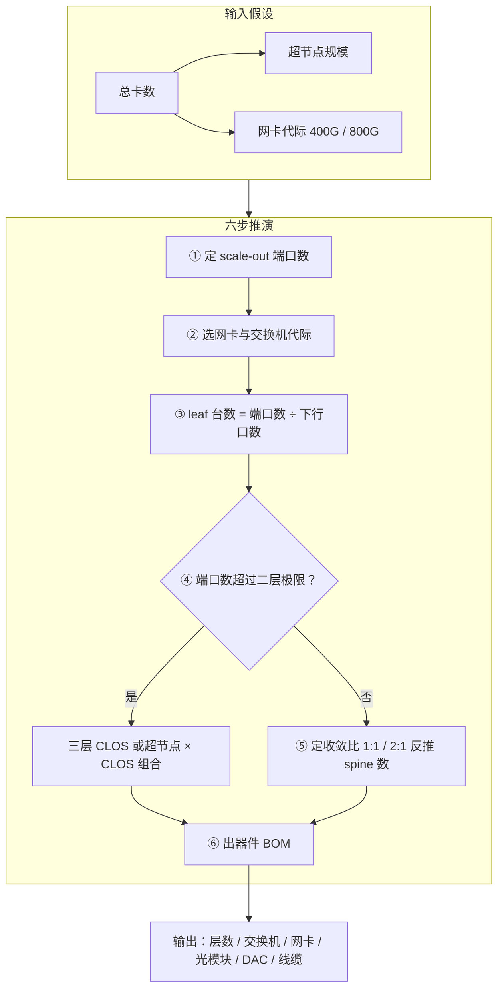

# 拓扑规模推演六步法

> 中文简称：拓扑规模推演六步法

> **一句话理解**: 给定 GPU 总卡数，照六步公式一路算下去，就能得出层数、交换机台数与光模块数量。

---

## 一、六步法总览

拓扑规模推演回答的问题：**已知总卡数与选型代际，推出组网层数、交换机台数、网卡与光模块数量**。六步依次为：

1. **定 scale-out 端口数**：总卡数减去超节点（scale-up 域）内已覆盖的通信，得到要走 scale-out 网络的端口规模
2. **选网卡代际**：400G / 800G 与 GPU 代际匹配，同时锁定交换机代际
3. **二层容量算 leaf 台数**：scale-out 端口数 ÷ 每 leaf 下行口数
4. **判是否三层**：端口数超过二层极限，则分层、分平面或改超节点组合
5. **定收敛比反推 spine 数**：1:1 或 2:1，由上行口总量 ÷ 每 spine 端口数
6. **出器件 BOM**：网卡 / 交换机 / 光模块 / DAC / 线缆



关键分叉在第 ④ 步：二层 CLOS 的端口极限决定集群是「两层到底」，还是走向三层、多平面或超节点组合。

---

## 二、逐步公式与假设

每一步的公式与假设都应显式写进设计文档；带宽数字一律注明口径（单向线速 / 双向聚合，NVLink 官方口径为双向）。

**第 ① 步：定 scale-out 端口数**

```text
scale_out_ports =（总卡数 ÷ 超节点卡数）× 每超节点 scale-out 网卡数
特例（8 卡机、无独立超节点）：scale_out_ports = 总卡数（每卡 1 张网卡）
```

超节点内的带宽由 NVLink 域承担（NVLink4 900GB/s、NVLink5 1.8TB/s，均为双向口径），这部分通信不走 scale-out，正是第 ① 步要扣掉的量。

**第 ② 步：选网卡代际（同时锁定交换机代际）**

```text
A100 / H100 世代 → 400G：ConnectX-7 400G 网卡，51.2T 交换机（128×400G）
B200 / GB200 世代 → 800G：ConnectX-8 800G 网卡；IB 口径为 NDR 400G / XDR 800G
```

**第 ③ 步：二层容量算 leaf 台数**

```text
leaf_count = scale_out_ports ÷ downlink_per_leaf
rail-optimized 部署按 rail 分组下挂，台数公式不变
```

**第 ④ 步：二层极限判定（以 51.2T / 128×400G、leaf 64 下 + 64 上为例）**

```text
leaf 上行 64 口 → spine 最多 64 台
64 台 spine × 128 口 = 8192 个上行口 → 最多 128 台 leaf
二层单平面极限 = 128 台 × 64 口 = 8192 个 scale-out 端口
```

**第 ⑤ 步：定收敛比反推 spine 数**

```text
1:1 → uplink_per_leaf = downlink_per_leaf
2:1 → uplink_per_leaf = downlink_per_leaf ÷ 2
spine_count =（leaf_count × uplink_per_leaf）÷ port_per_spine
```

**第 ⑥ 步：出器件 BOM**

```text
网卡数 = scale_out_ports（每卡 1 张）
交换机 = leaf + spine（三层方案另加 super-spine）
光模块 = 2 ×（服务器侧链路数 + 交换机间链路数），DAC 链路不计入
```

---

## 三、算例一：512 卡（两层 1:1）

**假设**：512 卡、8 卡/机共 64 台机、无独立超节点；网卡 400G（H100 世代，ConnectX-7 400G 口径）；leaf 与 spine 均为 51.2T 交换机（128×400G）；leaf 下行 64 口、上行 64 口；spine 128 口全向下；400G 均为单向线速口径。

| **推演步骤** | **公式与计算** | **结果** |
|---|---|---|
| ① scale-out 端口 | 512 卡 × 每卡 1 张网卡 | 512 个 400G 口 |
| ② 网卡代际 | H100 世代 → 400G | 512 张 400G 网卡 |
| ③ leaf 台数 | 512 ÷ 64 下行口 | 8 台 |
| ④ 层数判定 | 512 远小于 8192（二层极限见算例二） | 两层即可 |
| ⑤ spine 台数 | (8 台 × 64 上行口) ÷ 128 口 | 4 台 |
| ⑥ 交换机合计 | 8 + 4 | 12 台 |

rail-optimized 部署时，8 台 leaf 对应 8 个 rail，每台 leaf 承接 64 台机的同号网卡，台数公式不变。

---

## 四、算例二：4096 卡（二层可行性判定）

**假设**：4096 卡、512 台 8 卡机，其余同算例一；本算例顺带推导该口径的二层极限。

| **推演步骤** | **公式与计算** | **结果** |
|---|---|---|
| ① scale-out 端口 | 4096 × 1 | 4096 个 400G 口 |
| ③ leaf 台数 | 4096 ÷ 64 | 64 台 |
| ⑤ spine 台数 | (64 × 64) ÷ 128 | 32 台 |
| 二层极限 | spine ≤ 64 台；64 × 128 ÷ 64 = 128 台 leaf | 128 × 64 = 8192 个端口 |
| 结论 | 4096 < 8192 | 二层可行，交换机共 96 台 |

二层极限随交换机盒口数变化：800G 代际或更大单体交换机会抬高上限；多平面组网时，每个平面独立套用本公式后再按平面数分摊。

---

## 五、算例三：16384 卡（三层或超节点 × CLOS 组合）

**判定**：16384 > 8192，单平面二层不可行，两条典型路线：

| **路线** | **推演** | **交换机合计** | **取舍** |
|---|---|---|---|
| A：三层 CLOS 1:1 | leaf 256 台（64 下 + 64 上）；spine 256 台（64 下 + 64 上）；super-spine = (256 × 64) ÷ 128 = 128 台 | 640 台 | 全网 1:1 无收敛；三层链路的光模块总量近 10 万量级，成本最高 |
| B：超节点 × CLOS | 32 个 512 卡 pod（pod 内两层）；每 leaf 改 64 下 + 48 pod 内上行 + 16 core 上行；pod 内 spine = (8 × 48) ÷ 128 = 3 台；core = (256 × 16) ÷ 128 = 32 台 | 384 台 | pod 内约 4:3、跨 pod 4:1；交换机与光模块同时省 |

路线 B 的本质是把一部分东西向带宽挪进超节点（scale-up 域），scale-out 网络只承接跨 pod 流量；pod 规模即超节点规模，可与多平面方案叠加。

---

## 六、BOM 骨架表

以算例一（512 卡、400G、两层 1:1、先按全光互联计）为模板：

| **器件** | **规格** | **数量公式** | **512 卡数量** | **备注** |
|---|---|---|---|---|
| **网卡** | 400G，每卡 1 张 | = 卡数 | 512 张 | 常随服务器采购 |
| **leaf 交换机** | 51.2T / 128×400G | = 端口 ÷ 64 | 8 台 | 含电源风扇与系统镜像 |
| **spine 交换机** | 51.2T / 128×400G | = 上行口 ÷ 128 | 4 台 | 三层方案另计 super-spine |
| **400G 光模块** | 链路两端各 1 | 2 × (512 + 512) | 2048 个 | 机柜内换 DAC 可省近半 |
| **DAC / AEC** | 机柜内铜缆 | 机柜内链路数 | 视机柜布局 | 功耗近零、单价低于光模块 |
| **光纤跳线 / 主干** | 与光模块配套 | = 链路数 | 1024 条 | 预端接主干与施工另计 |

BOM 还要补：理线架与轨尾、备件（光模块按 1-2% 备件率）、IB 方案的 per-switch license、布线施工工时——这些进入「网络 CAPEX 模型」统一核算。

---

## 交叉引用

- [[12_架构基建/08_网络/07_GPU_高网设计/08_容量成本/02_Network_CAPEX_Model|网络 CAPEX 模型]]
- [[12_架构基建/08_网络/07_GPU_高网设计/03_拓扑设计/01_Fat_Tree_CLOS|Fat-Tree CLOS 拓扑]]
- [[12_架构基建/08_网络/07_GPU_高网设计/03_拓扑设计/02_Oversubscription_Design|收敛比设计]]
- [[12_架构基建/08_网络/07_GPU_高网设计/03_拓扑设计/04_CLOS_Two_Three_Layer_Scaling|CLOS 二层与三层扩展]]
- [[12_架构基建/08_网络/07_GPU_高网设计/03_拓扑设计/06_Supernode_MegaPod_MultiPlane|超节点 MegaPod 与多平面]]
- [[12_架构基建/08_网络/07_GPU_高网设计/02_物理层硬件/04_Component_Ratio_Cost|器件配比与成本]]

---

*Last updated: 2026-10-27*
