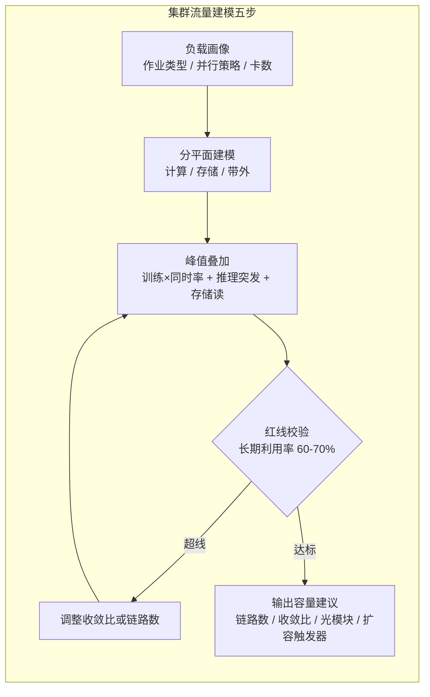

# 集群流量建模

> 中文简称：集群流量建模

> **一句话理解**: 先弄清集群里谁在什么时候产生多大流量，再决定买多少链路、卡多少利用率红线。

---

## 一、东西向与南北向画像

| **流向** | **主要成分** | **量级特征** | **规划去向** |
|---|---|---|---|
| **东西向（跨机）** | 跨机集合通信（AllReduce / AllGather / All-to-All）+ 并行文件系统读取 | 绝对主导 | 决定 scale-out 拓扑与收敛比 |
| **东西向（机柜内）** | rail 内通信、存储本地命中 | 占比随亲和调度上升 | 走 leaf 与 DAC，单位成本最低 |
| **南北向（业务侧）** | 推理对外服务流量、数据集上传 | 比东西向低 1-2 个数量级 | 带外 / 业务平面，容量单独核算 |
| **南北向（运维侧）** | checkpoint 外传、镜像分发、遥测 | 突发型，与训练周期同步 | 存储平面预留，避开通信峰 |

AI 集群与互联网数据中心流量的根本差异：东西向占比压倒性，南北向只服务「数据进出」与「对外服务」。流量画像还随并行策略变化：EP 的 All-to-All 与 TP 的 AllReduce 在同一条网上是两种完全不同的形态，建模输入必须包含作业的并行策略。

---

## 二、训练峰值估算

```text
AllReduce 全网峰值注入带宽 ≈ 参与卡数 × 网卡单向带宽 × 同时系数
算例：1,024 卡 × 400G（即 50GB/s 单向）× 70% ≈ 35.8TB/s（全网聚合口径）
```

- 同时系数 70% 来自多作业错峰假设：不是所有作业同时进入通信阶段；单一独占大作业时按 100% 校验
- 聚合带宽还要分摊到 leaf 上行链路，与收敛比对账：

```text
分摊校验（1024 卡、leaf 64 下 + 64 上，共 16 台 leaf 口径）：
上行总带宽 = 1,024 个上行口 × 50GB/s = 51.2TB/s
峰值占比 = 35.8 ÷ 51.2 ≈ 70% → 已贴红线，应触发扩容评估（见「四、利用率红线」）
```

---

## 三、推理侧预留

```text
PD 分离 KV 迁移带宽 = 并发请求数 × 每请求 KV 大小 ÷ 时延预算
算例：1,000 并发 × 2GB/请求 ÷ 1s = 2TB/s（突发聚合口径）
EP All-to-All：decode 每个 step 触发一次，按峰值 ×2 余量预留
```

- 时延预算来自服务 SLO（如 TTFT 上限）：预算越紧，prefill 与 decode 之间需要的带宽越大
- KV 迁移量随前缀命中率折减：命中率越高，需要迁移的 KV 越少，PD 链路预留可收窄
- 推理是持续小突发，与训练的大周期通信叠加时按 P95 / P99 口径叠加，不按均值

---

## 四、利用率红线与扩容触发

- 链路长期利用率 >60-70% 即触发扩容评估：余量要留给突发、故障倒换与租户增长
- 训练平面看通信期均值与 P95 双口径；推理平面看 P99 突发
- 真拥塞判据要三线同越：链路利用率、交换机缓存水位、PFC 暂停帧 / 重传计数

```text
扩容触发器示例（任一越线持续一周即立项评估）：
计算平面链路利用率 7 日均值 > 70%
集合通信排队时延 P95 同比恶化 50%
PFC 暂停帧或重传速率超基线 3 倍
```

---

## 五、建模流程



流程的落点是回环：红线校验不达标就回到收敛比与链路数调整，达标才固化输出物；作业结构每次变化（新模型、新并行策略）都要重跑一遍。

---

## 六、敏感性与输出物清单

| **变量** | **变化方向** | **对结论的影响** |
|---|---|---|
| **收敛比** | 1:1 → 2:1 | 跨机峰值带宽近似减半，红线校验结论可能反转 |
| **作业放置** | 机柜亲和 → 全局打散 | 跨机流量占比上升，东西向峰值抬升 |
| **前缀命中率** | 上升 | KV 迁移带宽按比例下降，PD 链路预留收窄 |
| **同时系数** | 70% → 100%（独占大作业） | 峰值上探约四成，直接贴线或越线 |

| **输出物** | **内容** | **去向** |
|---|---|---|
| **链路数清单** | 计算 / 存储 / 带外各平面的链路与冗余 | 拓扑设计与 BOM |
| **收敛比依据** | 各层收敛比与其可容忍的业务理由 | 评审与容量看板 |
| **光模块 / DAC 数量** | 与拓扑 BOM 对账后的模块数 | 采购计划 |
| **扩容触发器** | 利用率阈值、排队时延、PFC / 重传基线 | 监控告警联动 |

---

## 交叉引用

- [[12_架构基建/08_网络/07_GPU_高网设计/08_容量成本/01_Topology_Sizing_Walkthrough|拓扑规模推演六步法]]
- [[12_架构基建/08_网络/07_GPU_高网设计/08_容量成本/03_Power_Liquid_Cooling_Network|功率液冷与网络约束]]
- [[12_架构基建/08_网络/07_GPU_高网设计/06_推理网络/01_Training_vs_Inference_Traffic|训练与推理流量对比]]
- [[12_架构基建/08_网络/07_GPU_高网设计/06_推理网络/03_PD_Disaggregation_KV_Transfer|PD 分离 KV 迁移]]
- [[12_架构基建/08_网络/07_GPU_高网设计/05_集合通信/02_Ring_vs_Tree_AllReduce|Ring 与 Tree AllReduce]]
- [[10_部署推理/03_推理优化/05_KV_Cache_深入分析|KV Cache 深入分析]]

---

*Last updated: 2026-10-27*
